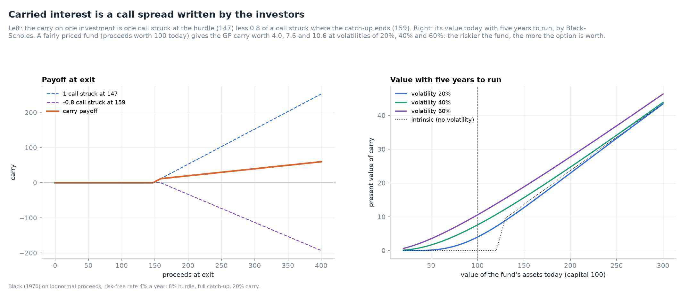
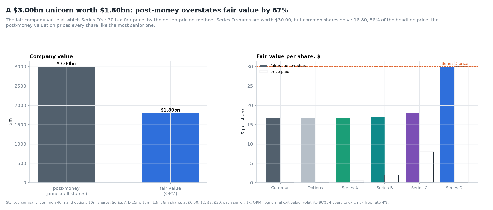

# Private Markets Lab

[](https://github.com/elmarfarajov/private-markets-lab/actions/workflows/ci.yml)


[](https://github.com/elmarfarajov/private-markets-lab/releases)


**Private equity, private credit, real assets and hedge funds, measured: the cash-flow mathematics,
the fees, the fund models, the risk that smoothed returns hide, and how an endowment allocates to
assets it cannot sell - every measure held to a reference it shares no code with.**

Private markets are where an investor's tools are weakest. There are no daily prices, only
cash flows and a manager's valuation; the standard return measure can have two answers or
none; reported volatility is smoothed away; and the benchmark is a choice. This lab builds
the financial engineering of the asset class over ten days, one part a day.


---

## Ten days

| Day | Area | Status |
|---|---|---|
| 1 | Cash flows and performance measures: every IRR, MIRR, multiples, the PME family, the J-curve | ✅ v0.1.0 |
| 2 | Fees, waterfalls and carried interest as an option: European and American carry, hurdle, catch-up, clawback, Metrick-Yasuda | ✅ v0.2.0 |
| 3 | Stochastic fund cash-flow models and secondary pricing: Takahashi-Alexander, calibration, discounts to NAV | ✅ v0.3.0 |
| 4 | Venture capital: preferred stock as a portfolio of options (OPM, Gornall-Strebulaev), post-money valuations | ✅ v0.4.0 |
| 5 | Nowcasting private equity NAVs: state-space models and the Kalman filter on reported values |  |
| 6 | Smoothed returns and hidden risk: Geltner and GLM unsmoothing, appraisal indices against listed proxies |  |
| 7 | Risk-adjusted performance with stochastic discount factors: Korteweg-Nagel GPME, cash-flow betas |  |
| 8 | Optimal allocation with illiquid assets: commitment pacing, liquidity constraints, dynamic programming |  |
| 9 | Hedge funds and liquid alternatives: factor replication, trend following, tail risk |  |
| 10 | The endowment digital twin: a 30-year simulator, dashboard and reproducible reports |  |

The plan and each day's results are in the [roadmap](docs/ROADMAP.md), the charts in the
[gallery](docs/GALLERY.md), the checks in [VALIDATION.md](docs/VALIDATION.md), and the decisions
in the [architecture decision records](docs/adr/README.md). The deal-level LBO model - debt
schedule, value bridge, exit waterfall - is a separate project,
[lbo-returns-engine](https://github.com/elmarfarajov/lbo-returns-engine).

**Day 1: cash flows and performance measures.**

- **Every IRR, not the first one found.** The NPV is scanned in `ln(1 + r)` and every root
  refined. Descartes' rule bounds the count, and `irr` refuses to choose between two answers.
  On random streams, 216 of 606 that met Norstrom's condition also had a negative IRR beside
  the positive one it guarantees.
- **The IRR can be managed.** A subscription line that delays every call by a year lifts a
  fund's IRR from 10.5% to 11.5% while its TVPI falls from 1.80 to 1.70.
- **Five public market equivalents**, held to the identity that a fund replicating the index
  scores a PME of one under all of them, to 1e-15:
  - a PME credits beta as alpha: a zero-alpha fund with beta 1.8 shows 3 to 15 points a year
    against the S&P 500;
  - the benchmark moves the answer by 6 points a year;
  - across 25 vintages, identical managers' IRRs range from 1% to 20% while their Direct Alpha
    stays within three points.


The full account is in [cash flows and performance measures](docs/notes/cash-flows-and-performance.md).

**Day 2: fees, waterfalls and carried interest as an option.**

- **A waterfall engine** for European and American funds: management fees on commitments or
  invested cost, a compounded hurdle, full or partial catch-up, interim carry and a clawback with
  partial recovery. It is vectorised, so 20,000 funds run in under a second, and every pound is
  accounted for to 1e-13.
- **Gross to net.** A fund whose deals earn 15% a year returns 10.2% net under 2 and 20; the GP
  takes 34% of the gross profit, not 20%. Fees cost investors more than carry: halving the fee
  saves 1.5 points of net IRR, halving the carry 0.8.
- **Carry is a call spread,** `cu C(H) - (cu - c) C(V*)`, priced by Black-Scholes and matched by
  Monte Carlo through the waterfall to 1.1 standard errors. In present value the GP expects 14.6
  per 100 committed, 83% of it fixed fees (Metrick and Yasuda, 2010).
- **Break-even alpha:** the deals must beat a fairly priced investment by 4.0% a year for the LPs'
  stake to be worth its cost.
- **Deal by deal, the clawback is the rule:** 82% of simulated American funds overpay their GP, by
  24% of all carry. A portfolio of options (4.9) is worth far more than an option on a portfolio
  (0.7 with independent deals).



The full account is in [fees, waterfalls and carried interest](docs/notes/fees-waterfalls-and-carry.md);
`pmlab fees --waterfall american --recovery 0.5` prints gross to net and the contract's value for
any terms.

**Day 3: fund cash-flow models and the secondary market.**

- **Takahashi-Alexander, exactly, and made random.** The Yale model's IRR equals its growth rate by
  identity; the bow changes the multiple (1.40x to 2.44x) but not the IRR. A quarterly stochastic
  extension adds market beta, own risk, cash-flow noise and appraisal-smoothed NAVs.
- **Calibration** reproduces Day 1's deal-built funds to 1.1% of commitment, and recovers known
  parameters without bias from noisy data.
- **Identical managers, very different funds:** median TVPI 1.49, 21% lose money; 46% of the
  variance of IRRs lies between vintages. The 95th percentile of first-year calls is 35 per 100
  against a median of 24.
- **Secondary pricing.** At a required return equal to the fund's expected return the discount is
  exactly zero; a buyer wanting 15% pays 71% of NAV in year 2 and 90% in year 5. After a 30% crash a
  stale NAV turns an 8% discount to true value into a 35% quoted discount, which narrows as
  appraisals catch up.


The full account is in [fund models and secondaries](docs/notes/fund-models-and-secondaries.md).

**Day 4: venture capital, preferred stock as options.**

- **The exit waterfall with conversion as an equilibrium.** Liquidation preferences by seniority,
  multiples, participation with caps, cumulative dividends; each preferred class converts only when
  that pays more, found by best response rather than a fixed order.
- **The option-pricing method, integrated exactly.** Each class's piecewise-linear payoff is
  integrated against the lognormal density in closed form, checked against Black-Scholes and Monte
  Carlo. The latest round is backsolved to find what the company is worth.
- **A $3.0bn post-money is worth $1.80bn:** an overstatement of 66.6%, with common worth $16.80
  against the round's $30. A 2x preference raises the overstatement to 218%; all rounds pari passu
  lower it to 51%. It peaks near 79% at 60-70% volatility and falls from 128% at one year to exit to
  23% at ten.
- **200 random cap tables:** median overstatement 61% (range 23% to 295%), doubled by a multiple
  above 1x or by participation.



The full account is in [venture capital as options](docs/notes/venture-capital-options.md).

## Validation

`pmlab validate` holds every measure to a published value, an independent method, or an identity
that must hold. A selection:

| Check | Reference | Result |
|---|---|---|
| XIRR | Excel's documented example, 0.373362535 | 0.3733625335 (Excel iterates to 1e-8) |
| MIRR | Excel's documented examples, 12.6% and -4.8% | to the printed digit |
| Two IRRs | Lorie and Savage (1955): 25% and 400% | 9e-16 |
| Every root | mpmath polynomial roots at 50 digits, 600 streams | 9e-15; none above Descartes' bound |
| PME identities | a fund that is the index, all five methods | 6.5e-16 |
| Direct Alpha | the alpha built into noise-free funds | 1.4e-17 |
| Waterfall | LP + GP flows equal the deals' flows, 8,000 funds | 1.1e-13 |
| Carry | Black-Scholes call spread against Monte Carlo through the waterfall | max \|z\| 1.08 |
| Carry | closed form against quadrature of the payoff | 1.5e-8 |
| Venture OPM | one preferred class against Black-Scholes | 3e-7 |
| Venture waterfall | payouts add to the exit value; no class gains by switching | 4e-16; 0 |

## Quickstart

```bash
git clone https://github.com/elmarfarajov/private-markets-lab.git
cd private-markets-lab
python -m venv .venv && source .venv/bin/activate   # Windows: .venv\Scripts\activate
pip install -e ".[dev]"

pmlab validate                 # every check
pmlab market fetch             # index histories for the PMEs (stored locally, never committed)
pmlab irr flows.csv --nav 120 --index sp500   # every IRR, the multiples and the PMEs of your own flows
pmlab gallery                  # every chart
pytest
```

A cash-flow file has two columns, `date` and `amount`, with contributions negative.

## Data

Fund-level cash flows are licensed (Burgiss, Preqin, Cambridge Associates) and are not used or
imitated: funds here are stylised and labelled as such, and published academic figures are cited
as references. Index histories come from Yahoo Finance and stay in the git-ignored `data/`.

## About

Built by Elmar Farajov as an independent research project in quantitative finance, after
[volatility-surface-lab](https://github.com/elmarfarajov/volatility-surface-lab),
[lbo-returns-engine](https://github.com/elmarfarajov/lbo-returns-engine) and
[meridian-investment-platform](https://github.com/elmarfarajov/meridian-investment-platform).
Research and educational use only; not investment advice. Licensed under [MIT](LICENSE).
