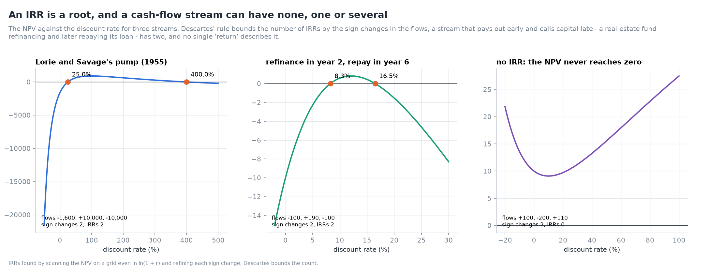
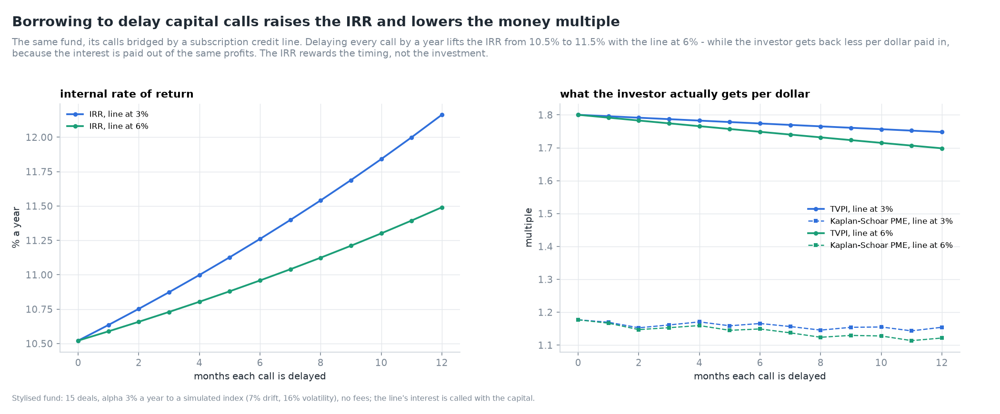
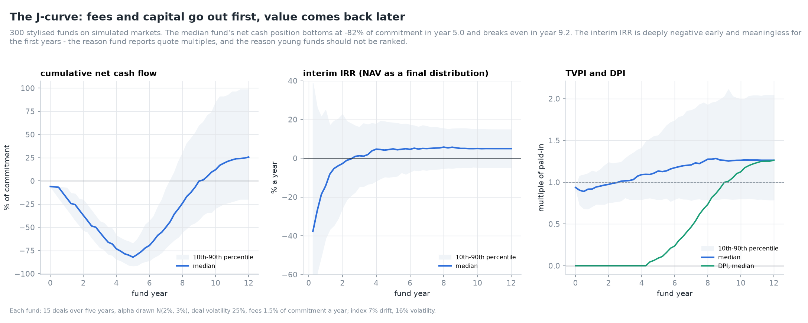
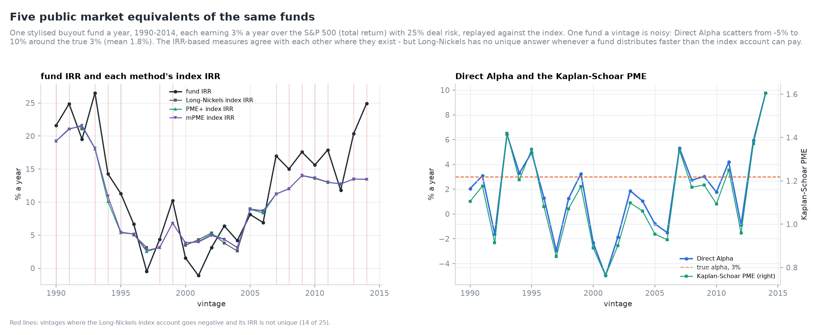
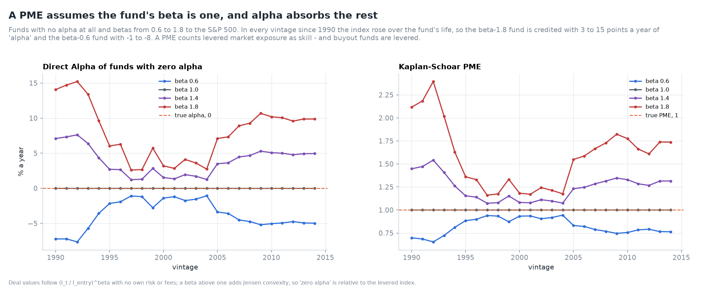
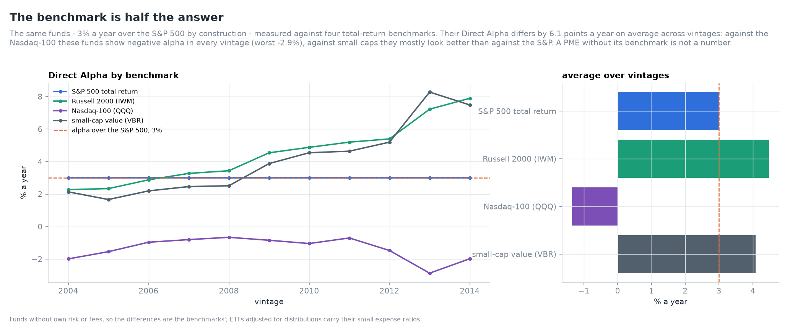
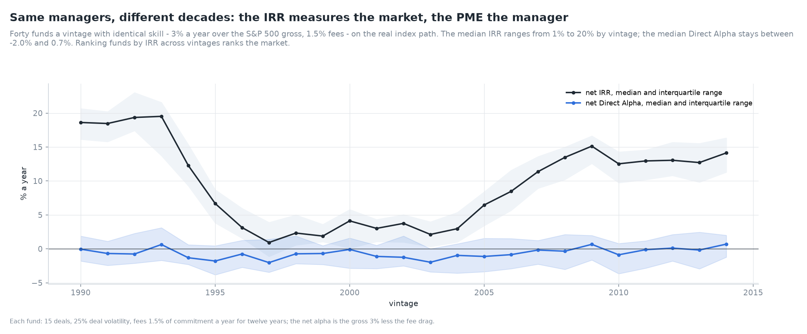

# Gallery

Every chart is rebuilt from source with `pmlab gallery`.

## Day 1: Cash flows and performance measures

**An IRR is a root, and a stream can have none, one or several** - The NPV against the rate for the pump problem, a refinance-and-repay fund, and a stream with no IRR.

**Borrowing to delay capital calls raises the IRR** - A subscription credit line against the IRR, the TVPI and the Kaplan-Schoar PME.

**The J-curve** - Net cash flow, interim IRR and multiples of 300 stylised funds through their lives.

**Five public market equivalents of the same funds** - Kaplan-Schoar, Direct Alpha, Long-Nickels, PME+ and mPME on funds with a known 3% alpha over the S&P 500.

**A PME assumes beta is one** - Funds with zero alpha and betas from 0.6 to 1.8, measured against the S&P 500, vintage by vintage.

**The benchmark is half the answer** - The same funds' Direct Alpha against four total-return benchmarks.

**The IRR measures the market, the PME the manager** - Identical managers across 25 vintages: net IRR against net Direct Alpha.

