# Fees, waterfalls and carried interest as an option: what investors pay, and what a manager's pay is worth

*Day 2 of 10 · private-markets-lab v0.2.0 · stylised funds, no proprietary data*

## Summary

A private equity fund's investors (LPs) pay their manager (GP) twice: a management fee that
does not depend on performance, and carried interest, a share of the profit above a hurdle. This
note builds the machinery to compute both exactly, for any set of terms, and then asks four
questions. How much of the gross return reaches the investors? How do the two standard waterfalls
differ? What is the carry worth as an option? How much better than the market must a manager be
for the fees to be worth paying?

The main findings, on a stylised fund of fifteen deals (every number is computed by code in this
repository):

1. **Fees come out of the commitment.** A fund charging 2% on commitments for five years and then
   on invested cost pays 13.8 of every 100 in fees and invests only 86.2. Charged on commitments
   for the whole life, fees reach 21.0 and only 79 is invested.
2. **Gross to net.** When every deal earns 15% a year, LPs earn 10.2% net under "2 and 20"
   with an 8% hurdle and a full catch-up. A 1.95x gross multiple becomes 1.54x net; the gap is
   4.8 percentage points.
3. **"Two and twenty" takes far more than 20% of the profit.** The GP's take (fees plus carry) is
   34% of gross profit at a 15% gross IRR, 29% at 20% and still 25% at 30%. At a 10% gross IRR,
   where no carry is paid, the fees alone are 28% of the profit.
4. **The carry is a call spread.** For one investment its payoff is one call struck at the hurdle
   minus 0.8 of a call struck where the catch-up ends. Its Black-Scholes value is 4.0, 7.6 and 10.6
   per 100 invested at volatilities of 20%, 40% and 60%.
5. **Most of a manager's pay is fixed.** In present value the GP expects 14.6 per 100 committed:
   12.1 in fees and 2.5 in carry. That makes 83% fixed, in line with Metrick and Yasuda's (2010)
   finding that about two-thirds or more of expected revenue is fixed.
6. **The break-even alpha is about four points a year.** Under 2 and 20 the deals must beat a
   fairly priced investment by 4.0% a year for the LPs' stake to be worth what it costs; 1.5 and 15
   needs 2.9%.
7. **The American waterfall overpays, and the clawback is the rule.** On simulated funds the GP
   is overpaid in 82% of deal-by-deal funds, by 24% of all carry paid. With full recovery this is
   harmless; at 50% recovery the GP keeps 13% more than the European waterfall allows.
8. **A portfolio of options beats an option on a portfolio.** Whole-fund carry falls from 4.8 to
   0.7 as the correlation between deals falls from one to zero. Deal-by-deal carry without a
   clawback stays at 4.9 whatever the correlation.
9. **The carry rewards risk.** Raising deal volatility from 20% to 60% lifts the carry's value
   from 0.6 to 4.4 per 100 committed, and the LPs lose exactly that.
10. **The hurdle with a full catch-up is mostly a timing device.** An 8% hurdle cuts the carry's
    value from 8.24 to 7.59 with a full catch-up, and to 5.73 without one.
11. **The fee costs investors more than the carry.** At a 15% gross IRR, halving the fee from 2%
    to 1% saves LPs 1.5 points of net IRR; halving the carry from 20% to 10% saves 0.8.
12. **The catch-up pins LPs at the hurdle.** In the catch-up tier every extra pound goes to the GP,
    so 6% of simulated funds return their LPs within a quarter point of exactly 8%.

The engine is held to six new checks in [VALIDATION.md](../VALIDATION.md), all passing:

- every pound accounted for;
- the catch-up gives exactly the carry share;
- the clawback returns exactly the excess;
- the closed form matches quadrature and Monte Carlo;
- LPs lose exactly what the GP gains.

## 1. The contract

A limited partnership agreement (LPA) fixes the GP's pay in three parts. Table 1 lists the terms
modelled here and the market-standard values used as the base case.

**Table 1. The economic terms of an LPA, as modelled (`pmlab.waterfall.Terms`).**

| Term | Base case | Range explored | What it does |
|---|---|---|---|
| Management fee, investment period | 2% of commitments a year | 1%–2.5% | paid quarterly in advance, whatever the performance |
| Management fee, afterwards | 2% of the cost of deals still held | 1%–2%, or on commitments | falls as deals are sold |
| Carried interest | 20% | 10%–30% | the GP's share of profit |
| Hurdle (preferred return) | 8% a year, compounded | 0%–14% | LPs' return before any carry |
| Catch-up | 100% | 0%, 50%, 80%, 100% | the GP's share of distributions until it holds 20% of profit |
| Waterfall | European (whole fund) | American (deal by deal) | which capital the tiers are run on |
| Clawback | yes, full recovery | 50% recovery, none | returns any excess carry at the end |

The fund itself is stylised (ADR 0004: no proprietary data is faked). The commitment is 100.
Fifteen deals are bought at regular intervals over five years and held between 3.3 and 6.2 years,
so the last exit is in month 125. The deals' gross returns are either fixed, to show the mechanics
on a fund whose gross IRR is known, or simulated, to value the contract.

## 2. Fees come out of the commitment

Fees are paid from the LPs' commitments, quarterly in advance, while the fund holds any deal.
A fund that charges fees therefore invests less than it raises. With the fee during the
investment period fixed at `a` and the fee afterwards proportional to the invested scale `s`,
calls add up to the commitment when

$$
s \sum_j \text{cost}_j + a + s\,b = 100,
$$

where `b` is the fee per unit of invested cost. This is a linear equation in `s`, solved exactly
(ADR 0006).

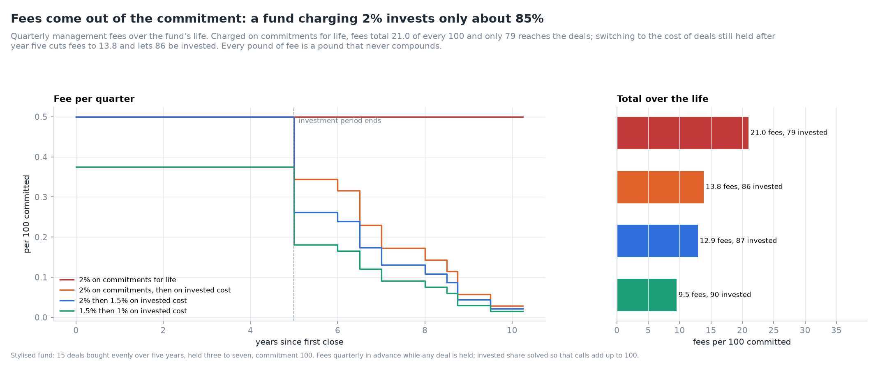

*Figure 1. Quarterly fees under four fee bases, and what is left to invest.*

**Table 2. Fee bases: total fees, invested share and present value (r = 4%).**

| Fee basis | Total fees per 100 | Invested | PV of fees |
|---|---|---|---|
| 2% on commitments for the whole life | 21.0 | 79.0 | 17.2 |
| 2% on commitments, then 2% on invested cost | 13.8 | 86.2 | 12.1 |
| 2% on commitments, then 1.5% on invested cost | 12.9 | 87.1 | 11.4 |
| 1.5% on commitments, then 1% on invested cost | 9.5 | 90.5 | 8.4 |

Switching the post-investment-period fee base from commitments to invested cost is worth more to
LPs than any step-down in the rate: 7.2 points of commitment, against a further 0.9 for a step-down
from 2% to 1.5%. That is why the basis matters as much as the headline rate.

## 3. The waterfall

Every distribution passes through four tiers (Figure 2):

1. **Return of capital:** everything to LPs until they have their contributions back, fees included.
2. **Preferred return:** everything to LPs until their contributions have earned the hurdle,
   compounded.
3. **Catch-up:** a share `cu` of distributions to the GP until the GP holds `c = 20%` of all profit
   distributed so far.
4. **Carried interest:** 20% to the GP, 80% to LPs.

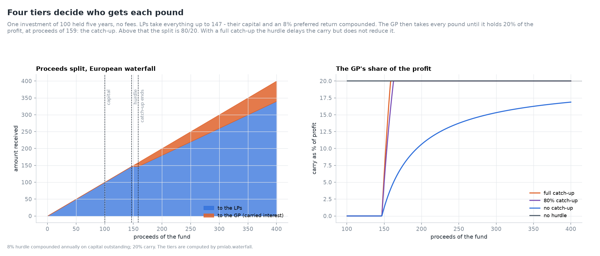

*Figure 2. The European waterfall's tiers for one investment of 100 held five years, and the GP's
share of profit under four variants.*

For one investment of `K = 100` held `T = 5` years with no fees, the tiers' boundaries are exact.
The hurdle amount is `H = K(1 + h)^T = 146.93`. The catch-up ends where the GP holds 20% of profit,
`V* = H + c(H − K)/(cu − c) = 158.67`.

**Table 3. The tiers for one investment of 100 held five years (8% hurdle, 20% carry).**

| Proceeds `V` | LPs receive | GP receives | GP share of profit |
|---|---|---|---|
| up to 100 | `V` | 0 | – |
| 100 to 146.93 (preferred return) | `V` | 0 | 0% |
| 146.93 to 158.67 (catch-up, 100%) | 146.93 | `V − 146.93` | rising from 0% to 20% |
| above 158.67 | `0.8(V − 100) + 100` | `0.2(V − 100)` | 20% |

With a full catch-up, the hurdle delays the carry but does not reduce it: above 158.67 the GP
has 20% of all profit, exactly as with no hurdle. Without a catch-up the GP's share approaches 20%
only slowly, and is 10.6% when proceeds double.

### 3.1 European and American

A **European** (whole-fund) waterfall runs the tiers on the fund's cumulative flows. Each call
raises the hurdle balance, which accrues at `(1 + h)^(1/12)` a month, and each LP distribution
lowers it. Carry starts only when the whole fund has returned all capital called so far plus the
hurdle.

An **American** (deal-by-deal) waterfall runs the tiers on each deal alone. A deal's capital is its
cost plus its share of all fees, earning the hurdle from entry to exit. The GP is paid on each
winner when it exits, whatever the losers will do later.

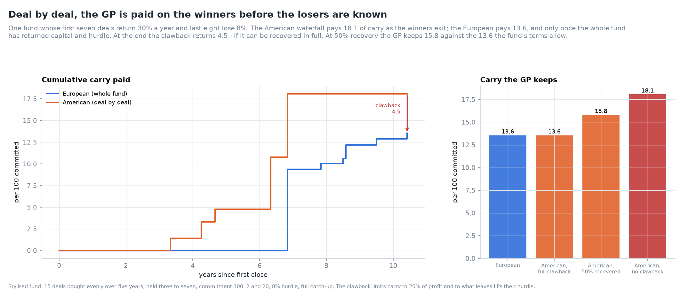

*Figure 3. Cumulative carry under each waterfall for one fund whose first seven deals return 30% a
year and last eight lose 8%.*

**Table 4. One fund, four waterfalls (per 100 committed).**

| Waterfall | Carry paid | Clawback | Carry kept | Net IRR |
|---|---|---|---|---|
| European | 13.55 | 0 | 13.55 | 12.44% |
| American, full clawback | 18.06 | 4.51 | 13.55 | 11.66% |
| American, 50% recovered | 18.06 | 2.25 | 15.81 | 11.39% |
| American, no clawback | 18.06 | 0 | 18.06 | 11.11% |

The fund's gross IRR is 18.47%. Even with full recovery, LPs are worse off under the American
waterfall (net IRR 11.66% against 12.44%). The carry kept is the same, but 4.5 of it was paid years
early, and the LPs have funded that loan to the GP interest-free.

### 3.2 The clawback

At the end, the GP's **entitlement** is the smaller of two amounts (ADR 0008):

- 20% of the fund's total profit;
- the largest carry that still leaves LPs their hurdle.

The second is exact because LPs' flows are linear in a final repayment. If `NPV_h` is the value of
LP flows at the hurdle rate and `d_T` the hurdle discount factor at the end, then

$$
E_{\text{hurdle}} = \text{carry paid} + \frac{NPV_h(\text{LP flows})}{d_T},
\qquad
E = \max\big(0, \min(0.2\,P, E_{\text{hurdle}})\big),
$$

and the GP returns `recovery × max(0, paid − E)`.

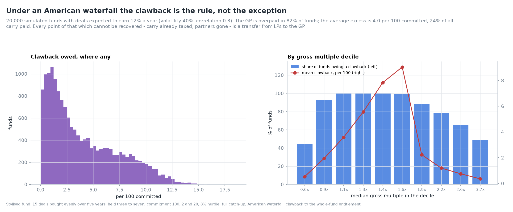

*Figure 4. How often and how much an American waterfall overpays, across 20,000 funds with deals
expected to earn 12% a year.*

**Table 5. The clawback across 20,000 simulated funds (deals: expected return 12%, volatility 40%,
correlation 0.3).**

| Measure | Value |
|---|---|
| Share of American funds owing a clawback | 81.7% |
| Mean clawback where owed, per 100 committed | 4.04 |
| Clawback owed as a share of all carry paid | 24% |
| Carry paid, American (mean) | 13.77 |
| Carry kept, American, full recovery | 10.47 |
| Carry kept, American, 50% recovery | 12.12 |
| Carry kept, European | 10.68 |

The clawback is not an exception for disasters; it is owed by four of every five deal-by-deal
funds. It peaks in funds returning 1.3x to 1.6x gross. These funds have enough winners to pay carry
early but too little profit overall to justify it. With full recovery the American GP keeps
slightly *less* than the European one: it keeps the smaller of what it was paid and what it is
entitled to, while the European pays close to the entitlement. At 50% recovery, a plausible
after-tax figure, the GP keeps 13% more than the European waterfall allows.

## 4. From gross to net

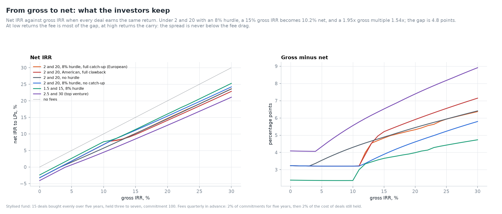

*Figure 5. Net IRR against gross IRR under six sets of terms, and the gap.*

**Table 6. Gross to net under 2 and 20, 8% hurdle, full catch-up, European (every deal earns the
gross IRR).**

| Gross IRR | Net IRR | Gross TVPI | Net TVPI | Fees | Carry | GP take of gross profit |
|---|---|---|---|---|---|---|
| 0% | −3.2% | 1.00x | 0.86x | 13.8 | 0.0 | – |
| 5% | 1.8% | 1.26x | 1.08x | 13.8 | 0.0 | 62% |
| 8% | 4.8% | 1.44x | 1.24x | 13.8 | 0.0 | 37% |
| 10% | 6.8% | 1.57x | 1.35x | 13.8 | 0.0 | 28% |
| 12% | 8.0% | 1.71x | 1.41x | 13.8 | 6.3 | 33% |
| 15% | 10.2% | 1.95x | 1.54x | 13.8 | 13.5 | 34% |
| 20% | 14.7% | 2.39x | 1.85x | 13.8 | 21.2 | 29% |
| 25% | 19.1% | 2.92x | 2.21x | 13.8 | 30.2 | 27% |
| 30% | 23.6% | 3.53x | 2.64x | 13.8 | 40.9 | 25% |

**Table 7. Six sets of terms at gross IRRs of 10%, 15% and 25% (net IRR; GP take of gross profit).**

| Terms | 10% gross | 15% gross | 25% gross |
|---|---|---|---|
| 2 and 20, 8% hurdle, full catch-up, European | 6.8%; 28% | 10.2%; 34% | 19.1%; 27% |
| 2 and 20, American, full clawback | 6.8%; 28% | 9.8%; 34% | 18.5%; 27% |
| 2 and 20, no hurdle | 5.7%; 43% | 10.1%; 34% | 19.1%; 27% |
| 2 and 20, 8% hurdle, no catch-up | 6.8%; 28% | 11.1%; 24% | 19.8%; 23% |
| 1.5 and 15, 8% hurdle | 7.6%; 21% | 11.3%; 26% | 20.6%; 20% |
| 2.5 and 30, no hurdle (top venture) | 4.4%; 55% | 8.5%; 45% | 16.8%; 38% |

Three features of the gross-to-net curve stand out:

- **The gap never falls below the fee drag**, about 3.2 points under 2 and 20. Fees are paid
  whatever happens.
- **The hurdle creates a kink.** Up to a 10% gross IRR (6.8% net) no carry is paid. Between 11% and
  13% the catch-up hands the GP every extra pound, and the net IRR barely rises: 8.0% at 12% gross.
- **Above the catch-up the curve is a straight line** with slope about 0.9. The hurdle no longer
  matters, so "2 and 20 with a hurdle" and "2 and 20 without" converge.

The American waterfall costs 0.4 to 0.6 points of net IRR at high returns even when every deal
earns the same, purely because carry is paid earlier.

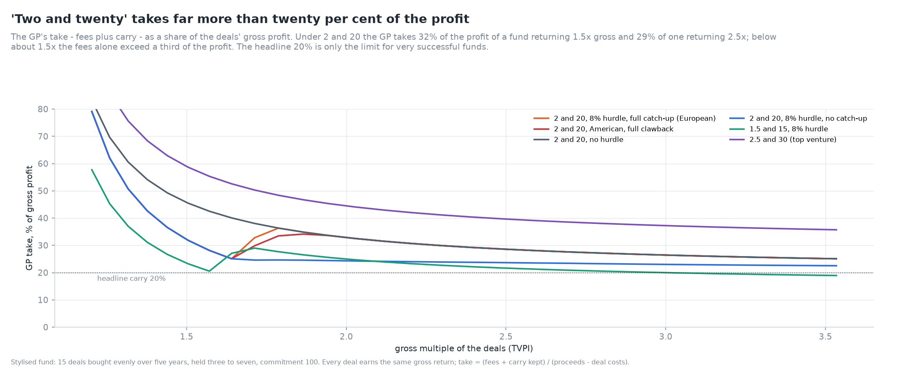

*Figure 6. The GP's take as a share of gross profit against the gross multiple.*

"Two and twenty" sounds like 20% of the profit. It is 20% only in the limit of a very successful
fund. At a 1.5x gross multiple the GP takes 32% of the profit, and at 2.5x still 29%. Fees are a
fixed cost, so the less profit there is, the larger the share they consume.

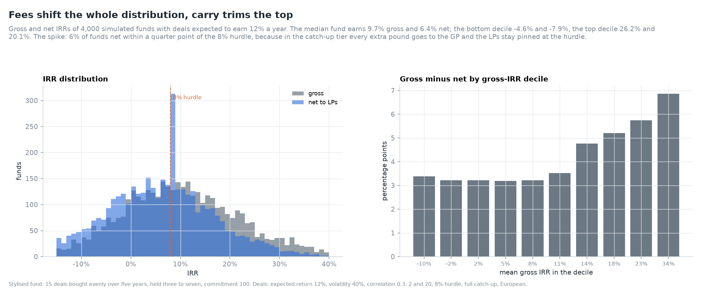

*Figure 7. Gross and net IRRs of 4,000 simulated funds, and the gap by decile.*

**Table 8. The distribution of gross and net IRRs across 4,000 simulated funds (deals expected to
earn 12% a year).**

| Percentile | Gross IRR | Net IRR | Gap |
|---|---|---|---|
| 10th | −4.6% | −7.9% | 3.3 |
| 25th | 1.8% | −1.4% | 3.2 |
| 50th | 9.7% | 6.4% | 3.2 |
| 75th | 18.0% | 12.8% | 5.2 |
| 90th | 26.2% | 20.1% | 6.1 |

19.6% of funds lose money gross, and 28.8% lose money net. The gap is the fee drag in the bottom
half of the distribution and grows with the carry in the top half. The histogram shows a spike at
exactly 8%: 6% of funds return their LPs within a quarter point of the hurdle. These are funds in
the catch-up tier, where each extra pound of gross return goes to the GP and the LPs stay pinned at
the hurdle. Only 44.7% of funds pay any carry at all.

## 5. Carried interest is an option

The GP's carry pays nothing unless the fund clears the hurdle, and a share of the upside if it
does. It is a call option on the fund's assets, written by the LPs and paid for with their capital.
For one investment the payoff from Table 3 is

$$
\text{carry}(V) = cu\,(V - H)^+ - (cu - c)\,(V - V^*)^+ ,
$$

long `cu` calls struck at the hurdle and short `cu − c` calls struck where the catch-up ends.
Without a catch-up it is `c (V − H)^+`. If proceeds are lognormal and the investment is fairly
priced (worth `K` today, growing at `r` in expectation under the pricing measure), each call has a
Black (1976) price, and

$$
\text{PV}(\text{carry}) = cu\,C(H) - (cu - c)\,C(V^*),\qquad
C(X) = e^{-rT}\big(F\,N(d_1) - X\,N(d_2)\big),\quad F = K e^{rT}.
$$

*Figure 8. The carry payoff as two calls, and its value today as a function of the fund's value.*

**Table 9. Closed form against Monte Carlo through the waterfall engine (one investment of 100,
five years, r = 4%; Monte Carlo with 200,000 paths, standard error in brackets).**

| Terms | σ = 20% closed / MC | σ = 40% closed / MC | σ = 60% closed / MC |
|---|---|---|---|
| 8% hurdle, full catch-up | 3.995 / 4.009 (0.018) | 7.594 / 7.643 (0.045) | 10.569 / 10.687 (0.096) |
| 8% hurdle, 80% catch-up | 3.931 / 3.945 (0.018) | 7.561 / 7.610 (0.045) | 10.549 / 10.667 (0.096) |
| 8% hurdle, no catch-up | 2.190 / 2.202 (0.013) | 5.727 / 5.774 (0.040) | 9.023 / 9.140 (0.093) |
| no hurdle | 5.341 / 5.354 (0.018) | 8.238 / 8.287 (0.045) | 10.950 / 11.069 (0.096) |

Every Monte Carlo value lies within 1.3 standard errors of the formula. All rows use the same
random numbers, which is why their gaps share a sign. Across ten independent seeds the mean
standardised gap is 0.31, with standard deviation 0.96, so the engine is unbiased. The closed form
itself matches numerical integration of the payoff against the lognormal density to 1.5 × 10⁻⁸.

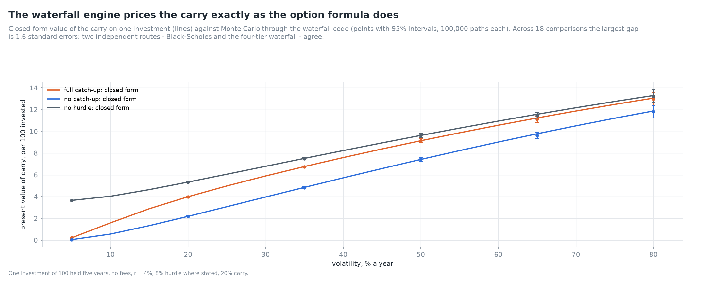

*Figure 9. Closed-form carry (lines) against Monte Carlo through the waterfall (points with 95%
intervals).*

### 5.1 What a manager's pay is worth

With many deals, fees and an American waterfall there is no closed form. `pmlab.carry.value` values
the contract by Monte Carlo on the waterfall engine (ADR 0007). Fees are discounted at the
risk-free rate. Carry is valued under the risk-neutral measure, where each deal earns `r` in
expectation. Under that measure the deals are worth exactly what they cost, so the LPs' stake is
worth minus the fees and carry: a zero-sum identity the validation suite checks.

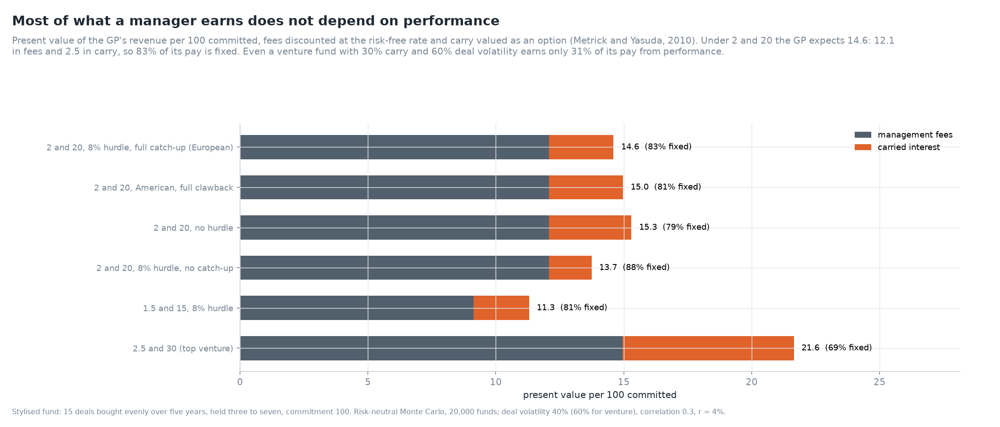

*Figure 10. Present value of fees and carry per 100 committed (Metrick-Yasuda).*

**Table 10. Present value of the GP's revenue per 100 committed (risk-neutral, 20,000 funds, deal
volatility 40%, correlation 0.3, r = 4%).**

| Terms | Fees | Carry | Total | Fixed share | LP stake |
|---|---|---|---|---|---|
| 2 and 20, 8% hurdle, full catch-up, European | 12.07 | 2.53 | 14.60 | 83% | −14.70 |
| 2 and 20, American, full clawback | 12.07 | 2.90 | 14.97 | 81% | −15.07 |
| 2 and 20, American, 50% recovered | 12.07 | 3.92 | 15.99 | 75% | −16.09 |
| 2 and 20, American, no clawback | 12.07 | 4.94 | 17.01 | 71% | −17.11 |
| 2 and 20, no hurdle | 12.07 | 3.23 | 15.30 | 79% | −15.40 |
| 2 and 20, 8% hurdle, no catch-up | 12.07 | 1.67 | 13.74 | 88% | −13.84 |
| 1.5 and 15, 8% hurdle | 9.14 | 2.16 | 11.30 | 81% | −11.41 |
| 2.5 and 30, no hurdle (venture, σ = 60%) | 14.94 | 6.70 | 21.64 | 69% | −21.69 |

Standard errors of the carry are 0.04–0.05 (0.13 for the venture case). The LPs' stake differs
from minus the GP's total by Monte Carlo noise in the deals' value (standard error about 0.15).

The fixed share, 69% to 88%, is the central finding of Metrick and Yasuda (2010). Most of what a
private equity manager expects to earn does not depend on how well it invests. The fees are worth
five times the carry under 2 and 20. Even a top venture contract, with 30% carry on deals of 60%
volatility, earns only 31% of its value from performance.

Deal-by-deal carry without a clawback is worth almost twice the European carry (4.94 against
2.53). This is the difference between a portfolio of options and an option on a portfolio
(Section 5.3). Partial recovery of the clawback sits in between.

### 5.2 The break-even alpha

If the deals earn more than a fairly priced investment, an extra `alpha` a year, the LPs' stake
rises. The **break-even alpha** is the alpha at which the stake is worth zero: the outperformance
a manager must deliver for its fees to be worth paying.

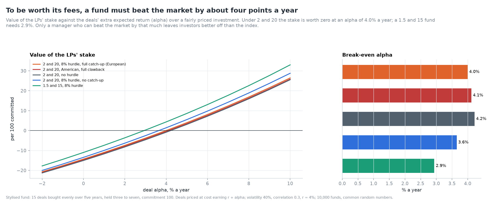

*Figure 11. The LPs' stake against deal alpha, and the break-even alpha.*

**Table 11. Break-even alpha (10,000 funds, common random numbers, Brent's method).**

| Terms | Break-even alpha, % a year |
|---|---|
| 2 and 20, 8% hurdle, full catch-up, European | 4.00 |
| 2 and 20, American, full clawback | 4.12 |
| 2 and 20, no hurdle | 4.22 |
| 2 and 20, 8% hurdle, no catch-up | 3.65 |
| 1.5 and 15, 8% hurdle | 2.93 |

A buyout manager on standard terms must beat a fairly priced investment by about four points a
year. This is the model's counterpart of the wide gap between gross and net returns that
Phalippou (2009) and Metrick and Yasuda (2010) document: net-of-fee comparisons with public markets,
such as Harris, Jenkinson and Kaplan (2014), already have this hurdle deducted. Cutting the terms
to 1.5 and 15 lowers the break-even alpha by more than a point.

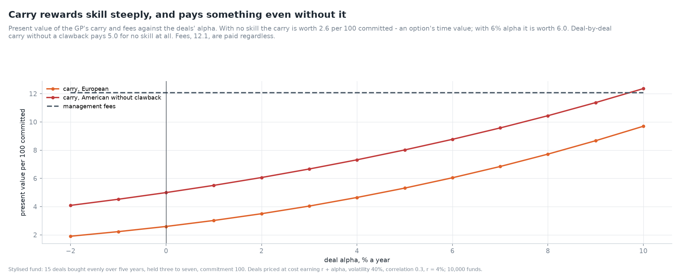

*Figure 12. Carry and fees against deal alpha.*

The carry rises steeply with skill: from 2.6 at zero alpha to 6.1 at 6% and 9.7 at 10%. But it is
worth 2.6 with no skill at all. That is an option's time value, paid by LPs for volatility rather
than for outperformance. Deal-by-deal carry without a clawback pays 5.0 for no skill.

### 5.3 Volatility and correlation

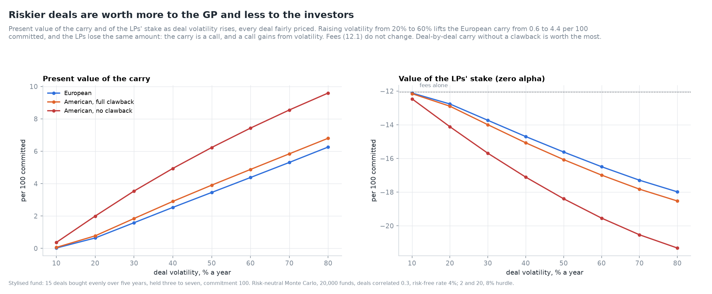

*Figure 13. Carry and the LPs' stake against deal volatility.*

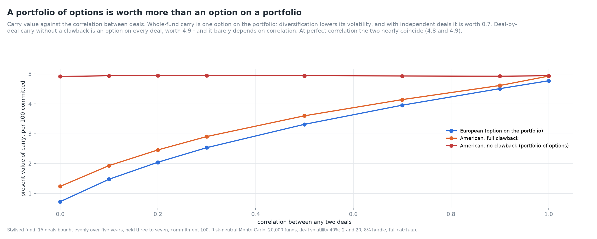

*Figure 14. Carry against the correlation between deals.*

**Table 12. Carry value against deal volatility and correlation (per 100 committed, risk-neutral).**

| Deal volatility | European | American, full clawback | American, no clawback | LP stake (European) |
|---|---|---|---|---|
| 10% | 0.02 | 0.06 | 0.37 | −12.12 |
| 20% | 0.64 | 0.78 | 2.00 | −12.77 |
| 40% | 2.53 | 2.90 | 4.94 | −14.70 |
| 60% | 4.38 | 4.88 | 7.43 | −16.49 |
| 80% | 6.26 | 6.80 | 9.60 | −17.98 |

| Correlation between deals | European | American, full clawback | American, no clawback |
|---|---|---|---|
| 0.0 | 0.73 | 1.24 | 4.91 |
| 0.3 | 2.53 | 2.90 | 4.94 |
| 0.5 | 3.31 | 3.60 | 4.94 |
| 1.0 | 4.77 | 4.92 | 4.94 |

The carry is long volatility, so the GP gains from risk that the LPs bear. Raising deal volatility
from 20% to 60% transfers 3.7 per 100 committed from LPs to the GP, with no change in expected
return. This is the risk-shifting incentive of convex pay (Carpenter, 2000), and the fee is no
remedy: it is the same at every volatility.

Correlation separates the waterfalls. Whole-fund carry is one option on the portfolio.
Diversification lowers the portfolio's volatility, and with independent deals the option is worth
only 0.73. Deal-by-deal carry is an option on each deal, and a portfolio of options is worth at
least an option on the portfolio (Merton, 1973). Its value, 4.9, hardly moves with correlation.
The clawback converts the portfolio of options back towards an option on the portfolio, which is
why its recovery rate matters so much.

### 5.4 Hurdle and catch-up

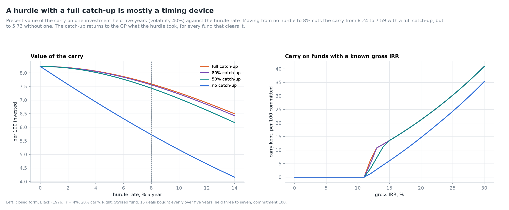

*Figure 15. Carry value against the hurdle rate for four catch-ups, and carry on funds with a
known gross IRR.*

**Table 13. Value of the carry on one investment (σ = 40%, five years) by hurdle and catch-up.**

| Hurdle | Full catch-up | 80% | 50% | None |
|---|---|---|---|---|
| 0% | 8.24 | 8.24 | 8.24 | 8.24 |
| 4% | 8.07 | 8.06 | 8.02 | 6.93 |
| 6% | 7.86 | 7.84 | 7.76 | 6.31 |
| 8% | 7.59 | 7.56 | 7.44 | 5.73 |
| 10% | 7.27 | 7.22 | 7.05 | 5.17 |
| 12% | 6.90 | 6.84 | 6.63 | 4.65 |

With a full catch-up an 8% hurdle costs the GP 8% of the carry's value. Without one it costs 30%.
Negotiating a hurdle while conceding a full catch-up protects LPs only against funds that fail to
clear it, and gives them almost nothing on funds that do.

## 6. The fee is the bigger lever

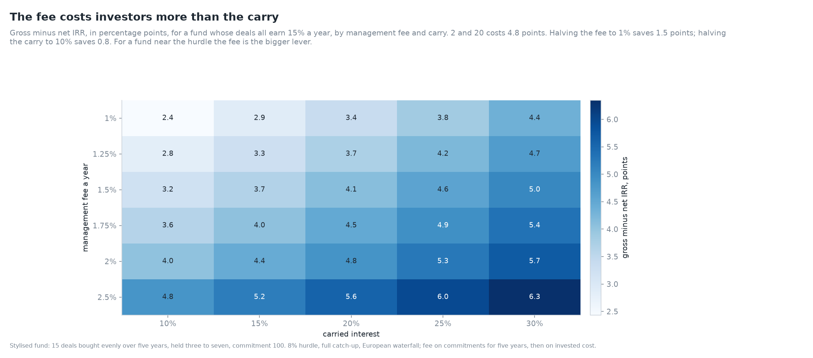

*Figure 16. Gross minus net IRR by management fee and carry, for a fund whose deals all earn 15%.*

**Table 14. Gross minus net IRR (percentage points) at a 15% gross IRR.**

| Fee \ carry | 10% | 15% | 20% | 25% | 30% |
|---|---|---|---|---|---|
| 1.00% | 2.4 | 2.9 | 3.4 | 3.8 | 4.4 |
| 1.25% | 2.8 | 3.3 | 3.7 | 4.2 | 4.7 |
| 1.50% | 3.2 | 3.7 | 4.1 | 4.6 | 5.0 |
| 1.75% | 3.6 | 4.0 | 4.5 | 4.9 | 5.4 |
| 2.00% | 4.0 | 4.4 | 4.8 | 5.3 | 5.7 |
| 2.50% | 4.8 | 5.2 | 5.6 | 6.0 | 6.3 |

From 2 and 20, halving the fee saves LPs 1.5 points of net IRR; halving the carry saves 0.8. Each
quarter point of fee costs about 0.4 points of net IRR, and each 5 points of carry about 0.45. For a
fund near the hurdle the fee is the bigger lever. For a very successful fund the carry catches up.

## 7. Validation

Six checks were added to the suite (13 before, 19 now), all passing:

| Check | Reference | Result |
|---|---|---|
| Every pound accounted for | LP + GP flows = deals' flows, 2,000 funds × 4 sets of terms | max gap 1.1 × 10⁻¹³ |
| Catch-up gives exactly the carry share | carry = 20% of profit above the catch-up | 1.4 × 10⁻¹⁴ |
| Clawback returns exactly the excess | kept = min(paid, entitlement) ≤ 20% of profit, 5,000 funds | 0 |
| Closed form against quadrature | payoff integrated against the lognormal density | 1.5 × 10⁻⁸ |
| Closed form against the waterfall engine | Monte Carlo, 4 cases, 200,000 paths | max \|z\| 1.08 |
| LPs lose what the GP gains | zero alpha: LP stake = −(fees + carry) | z within ±4 |

The tests add hand-checked single-deal cases for each tier boundary, partial catch-ups and the
fee schedule. A property-based test checks conservation, non-negative flows and the carry cap on
random terms. A separate run of 400,000 risk-neutral funds confirmed the deals' present value
equals their cost (z = −0.29).

## 8. Limitations

1. **The fund is stylised.** Fifteen equal deals, fixed holding periods and lognormal returns with
   one common factor. Real funds recycle capital, make follow-on investments and have skewed,
   fat-tailed deal returns. Day 3 calibrates a stochastic fund model.
2. **Portfolio-company fees are not modelled.** Transaction and monitoring fees, and the share
   offset against the management fee, add materially to what LPs pay (Phalippou, Rauch and Umber,
   2018).
3. **Risk-neutral values assume deals are priced at cost.** Alpha is modelled as a mispricing the
   GP captures. Leverage, illiquidity premia and the GP's own commitment are not.
4. **Taxes are not modelled,** except through the clawback recovery rate.
5. **The clawback's timing is simplified.** It is settled at the last exit, with no interest, no
   escrow and no interim test.
6. **The comparison with Metrick and Yasuda is qualitative.** Their parameters (deal volatility,
   correlation, fee bases) came from their sample of fund agreements; the numbers here come from
   the stated stylised model.

## 9. What comes next

Day 3 replaces the stylised fund with a stochastic cash-flow model (Takahashi-Alexander and its
extensions) calibrated to published fund-level moments. It uses the model to price secondary
transactions, where a buyer pays for the remaining fees and carry as well as for the NAV.

## References

- Black, F. (1976). The pricing of commodity contracts. *Journal of Financial Economics* 3(1–2),
  167–179.
- Black, F. and Scholes, M. (1973). The pricing of options and corporate liabilities. *Journal of
  Political Economy* 81(3), 637–654.
- Carpenter, J. N. (2000). Does option compensation increase managerial risk appetite? *Journal of
  Finance* 55(6), 2311–2331.
- Gompers, P. and Lerner, J. (1999). An analysis of compensation in the U.S. venture capital
  partnership. *Journal of Financial Economics* 51(1), 3–44.
- Goetzmann, W. N., Ingersoll, J. E. and Ross, S. A. (2003). High-water marks and hedge fund
  management contracts. *Journal of Finance* 58(4), 1685–1717.
- Harris, R. S., Jenkinson, T. and Kaplan, S. N. (2014). Private equity performance: what do we
  know? *Journal of Finance* 69(5), 1851–1882.
- Huther, N., Robinson, D. T., Sievers, S. and Hartmann-Wendels, T. (2020). Paying for performance
  in private equity: evidence from venture capital partnerships. *Management Science* 66(4),
  1756–1782.
- Institutional Limited Partners Association (2019). *ILPA Principles 3.0: fostering transparency,
  governance and alignment of interests for general and limited partners.*
- Kaplan, S. N. and Strömberg, P. (2009). Leveraged buyouts and private equity. *Journal of
  Economic Perspectives* 23(1), 121–146.
- Litvak, K. (2009). Venture capital limited partnership agreements: understanding compensation
  arrangements. *University of Chicago Law Review* 76(1), 161–218.
- Merton, R. C. (1973). Theory of rational option pricing. *Bell Journal of Economics and
  Management Science* 4(1), 141–183.
- Metrick, A. and Yasuda, A. (2010). The economics of private equity funds. *Review of Financial
  Studies* 23(6), 2303–2341.
- Phalippou, L. (2009). Beware of venturing into private equity. *Journal of Economic Perspectives*
  23(1), 147–166.
- Phalippou, L., Rauch, C. and Umber, M. (2018). Private equity portfolio company fees. *Journal of
  Financial Economics* 129(3), 559–585.
- Robinson, D. T. and Sensoy, B. A. (2013). Do private equity fund managers earn their fees?
  Compensation, ownership, and cash flow performance. *Review of Financial Studies* 26(11),
  2760–2797.
