# Fund cash-flow models and the secondary market: projecting a fund, and pricing someone else's

*Day 3 of 10 · private-markets-lab v0.3.0 · model funds, no proprietary data*

## Summary

An investor in private funds needs two things the asset class does not provide: a forecast of
when its capital will be called and returned, and a price for its interest if it wants to sell.
This note builds both. It implements Takahashi and Alexander's (2002) deterministic fund model,
extends it into a stochastic model with market risk, cash-flow noise and appraisal-smoothed NAVs,
calibrates it, and uses it to price LP interests on the secondary market.

The main findings, on model funds with the parameters stated on each chart:

1. **A handful of parameters describe the average fund's life.** With calls of 25%, 33%, 50% and 50% of the
   uncalled commitment, growth of 13%, a bow of 2.5 and a twelve-year life, the investor is 79 out
   of pocket at the bottom of the J-curve in year 4, breaks even in year 8, and ends with a 1.89x
   multiple.
2. **The model's IRR equals its growth rate G, exactly.** It is an identity, whatever the call schedule and bow. The bow
   changes the multiple (1.40x at bow 1, 2.44x at bow 5) but not the IRR.
3. **Eight parameters reproduce a fund built deal by deal.** Fitted to the average of 250 Day 1
   stylised funds, the model misses by 1.1% of commitment across calls, distributions and NAV.
4. **Calibration is unbiased.** With 8% noise in every data point, growth is re-estimated at 13.2%
   (true 13.0%, standard deviation 0.8 points) and the bow at 2.50 (true 2.50, standard deviation
   0.07).
5. **Identical managers produce very different funds.** Across 5,000 model funds the median TVPI is
   1.49, and 21% lose money. The 5th to 95th percentile TVPI runs from 0.68 to 3.57.
6. **Vintage explains almost half of it.** 46% of the variance of IRRs lies between vintages that
   share a market path. Peer comparison removes almost half of the noise, not most of it.
7. **Capital calls have a fat right tail.** In each of the first three years the median fund calls
   about 24 per 100 committed, the 95th percentile 35 and the 99th 40.
8. **Reported NAVs lag and understate risk.** With appraisals moving 40% of the way each quarter,
   reported quarterly returns have half the true volatility (median 50%).
9. **A buyer requiring the fund's expected return pays exactly NAV.** Every secondary discount is
   about required returns or stale prices, not fund quality as such.
10. **Young funds trade at deep discounts.** A buyer requiring 15% from a fund expected to earn 11%
    pays 71% of NAV in year 2, 90% in year 5 and 96% in year 9. In year 1 the unfunded commitment is
    64% of the discount.
11. **Stale NAVs widen discounts after a crash.** After a 30% fall in true value, a buyer requiring
    14% quotes a 35% discount to the unmoved reported NAV, but only 8% to the true value. The quoted
    discount narrows to 8% within a year as appraisals catch up.
12. **A secondary buyer pays up front and gets its money back in half the time:** 4.5 years after
    entry, against 8.2 for a primary investor.

Six new validation checks bring the suite to 25, all passing.

## 1. The question

A private equity commitment is a promise to provide capital when called, over a period no one
specifies in advance, against distributions that arrive when the manager sells. Two questions
follow for every investor:

* **Projection.** How much will be called each year, how much returned, and how wide is the range
  of outcomes? This drives liquidity planning and commitment pacing (Day 8).
* **Pricing.** What is an existing interest worth to someone else? The secondary market prices
  interests at a discount or premium to the reported NAV. What sets that discount?

The two are linked. The price of an interest is the present value of its projected flows, so a
pricing model is only as good as the cash-flow model behind it.

## 2. Literature

Takahashi and Alexander (2002) proposed the model Yale's investment office used for pacing. It
remains the industry's default because its parameters are interpretable and few. Stochastic
extensions add random returns and timing: de Malherbe (2004) and Buchner, Kaserer and Wagner
(2010), among others. Robinson and Sensoy (2016) and Brown, Ghysels and Gredil (2023)
document the empirical regularities of calls and distributions that such models must match,
including their dependence on the public market.

On secondaries, Kleymenova, Talmor and Vasvari (2012) and Nadauld, Sensoy, Vorkink and Weisbach
(2019) study transaction prices and find that discounts are larger for younger funds and in falling
markets, and that sellers are often liquidity-constrained. Appraisal smoothing, which makes
NAVs stale, goes back to Geltner (1993) and is the subject of Day 6.

## 3. The Takahashi-Alexander model

In year *t* of a fund with commitment *K* and paid-in capital PIC:

$$
C_t = RC_t\,(K - \text{PIC}_{t-1}),\qquad
D_t = RD_t\,\text{NAV}_{t-1}(1+G),\qquad
RD_t = \max\!\Big(Y, \big(\tfrac{t}{L}\big)^{B}\Big),
$$

$$
\text{NAV}_t = \text{NAV}_{t-1}(1+G) + C_t - D_t .
$$

The call rates RC_t determine the pace of investment. G is the growth of the NAV. The bow B delays
distributions, and the life L forces everything left to be paid out in the final year.

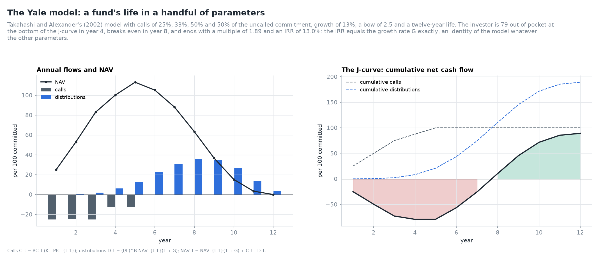

*Figure 1. Annual flows, NAV and the J-curve of the base case.*

**Table 1. The base case, year by year (per 100 committed).**

| Year | Calls | Distributions | NAV | Cumulative net |
|---|---|---|---|---|
| 1 | 25.0 | 0.0 | 25.0 | −25.0 |
| 2 | 25.0 | 0.3 | 52.9 | −49.6 |
| 3 | 25.0 | 1.9 | 82.9 | −72.8 |
| 4 | 12.5 | 6.0 | 100.2 | −79.3 |
| 5 | 12.5 | 12.7 | 113.0 | −79.1 |
| 6 | 0.0 | 22.6 | 105.2 | −56.5 |
| 7 | 0.0 | 30.9 | 88.0 | −25.6 |
| 8 | 0.0 | 36.1 | 63.3 | +10.4 |
| 9 | 0.0 | 34.9 | 36.7 | +45.3 |
| 10 | 0.0 | 26.3 | 15.2 | +71.6 |
| 11 | 0.0 | 13.8 | 3.4 | +85.4 |
| 12 | 0.0 | 3.8 | 0.0 | +89.1 |

**The IRR equals G.** Each pound in the fund grows at G until it is distributed, and the final
year distributes everything. The investor's flows are therefore those of an account earning G, and
the IRR is G whatever the call schedule and the bow. The validation suite tests this to 3 × 10⁻¹⁶
over nine parameter sets. G is a fund-level return, not a deal-level one.

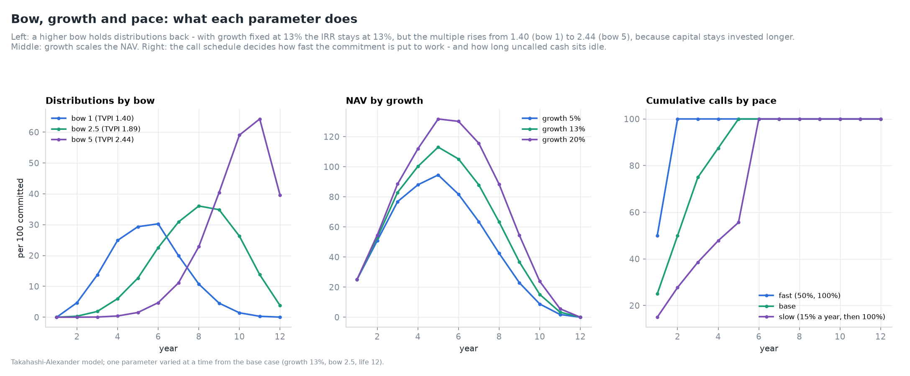

*Figure 2. One parameter varied at a time.*

**Table 2. What each parameter does.**

| Variant | TVPI | IRR | Trough of the J-curve | Break-even year | Peak NAV |
|---|---|---|---|---|---|
| Bow 1 | 1.40 | 13.0% | −56.6 (year 3) | 6 | 66 |
| **Bow 2.5 (base)** | **1.89** | **13.0%** | **−79.3 (year 4)** | **8** | **113** |
| Bow 5 | 2.44 | 13.0% | −98.0 (year 5) | 10 | 154 |
| Growth 5% | 1.28 | 5.0% | −82.5 | 9 | 95 |
| Growth 20% | 2.66 | 20.0% | −78.3 | 8 | 132 |

The bow is the duration of the fund. A higher bow keeps capital invested longer: the multiple rises,
the J-curve deepens and break-even comes later, while the IRR does not move. Comparing funds by
multiple without regard to duration is comparing bows.

## 4. Calibration

The model is fitted by least squares to year-end cumulative calls, cumulative distributions and NAV,
all in units of commitment. Five annual call rates and a tail rate are free, together with G and B;
the life is fixed.

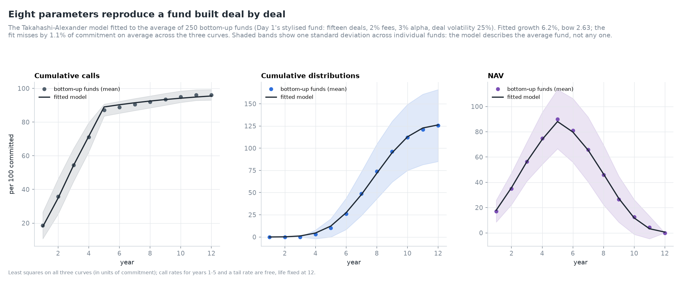

*Figure 3. The model fitted to the average of 250 bottom-up funds.*

**Table 3. Calibration to Day 1's stylised deal-by-deal funds.**

| Parameter | Fitted |
|---|---|
| Call rates, years 1-5 | 17.9%, 20.7%, 29.6%, 38.0%, 61.3% |
| Tail call rate | 12.0% |
| Growth G | 6.2% |
| Bow B | 2.63 |
| Root-mean-square gap, % of commitment | 1.1% |

The deal-built funds call capital for fees throughout their lives, so the tail call rate is
positive. Their growth of 6.2% is the net-of-fee fund-level return of deals that earn 3% alpha over
a market drifting at 7%, after fees and the drag of uninvested capital. The fit is tight for the
average fund. The bands in Figure 3 show how far any one fund strays from it.

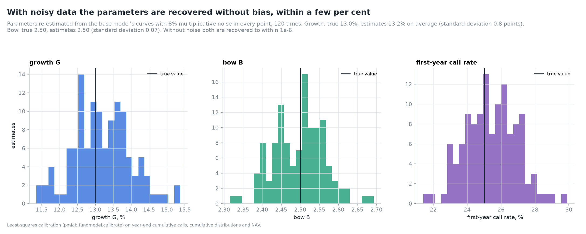

*Figure 4. Parameters re-estimated from noisy curves, 120 times.*

**Table 4. Parameter recovery with 8% multiplicative noise in every point (120 trials).**

| Parameter | True | Mean estimate | Standard deviation | Range |
|---|---|---|---|---|
| Growth G | 13.0% | 13.2% | 0.8 points | 11.4%-15.4% |
| Bow B | 2.50 | 2.50 | 0.07 | 2.32-2.69 |
| First-year call rate | 25.0% | 25.4% | 1.5 points | 21.4%-29.9% |

Without noise, calibration recovers every parameter to 10⁻⁶ (a validation check).

## 5. The stochastic model

The stochastic model keeps the skeleton on a quarterly grid (ADR 0009). With *dt* = 1/4, the
fund's true value evolves as

$$
V_k = V_{k-1}\exp\!\big((\mu - \tfrac12 s^2)dt + \beta\sigma_m\sqrt{dt}\,Z^m_k + \sigma_i\sqrt{dt}\,Z^i_k\big) + C_k - D_k,
\qquad s^2 = \beta^2\sigma_m^2 + \sigma_i^2 ,
$$

so the expected growth is *e*^(μ dt) whatever the mix of market and own risk. Calls and
distributions are the Takahashi-Alexander rates converted to quarters, times mean-one lognormal
noise ε:

$$
C_k = \min\!\big(1, (1-(1-RC_t)^{dt})\,\varepsilon^C_k\big)\,U_{k-1},\qquad
D_k = \min\!\big(1, (1-(1-RD_t)^{dt})\,\varepsilon^D_k\big)\,V_{k-1}e^{(\cdot)} ,
$$

where *U* is the uncalled commitment. The reported NAV is an appraisal that lags the true value:

$$
R_k = a\,V_k + (1-a)\,(R_{k-1} + C_k - D_k).
$$

**Table 5. Parameters of the model fund.**

| Parameter | Value |
|---|---|
| Call rates (annual) | 25%, 33%, 50%, 50%, then 100% |
| Bow, life | 2.5, 12 years |
| Expected return μ | 11% a year |
| Beta, market volatility, own volatility | 1.2, 16%, 20% (total 27%) |
| Noise in call and distribution rates (coefficient of variation) | 50% |
| Appraisal smoothing *a* | 0.4 a quarter |

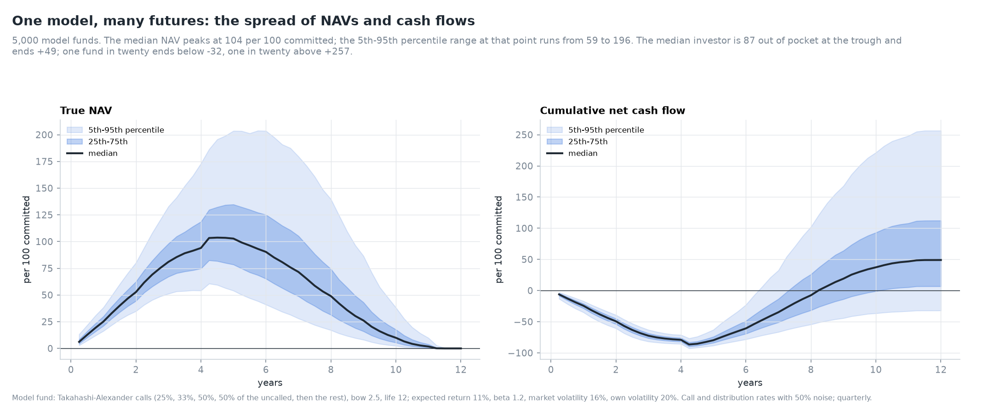

*Figure 5. Fan charts of NAV and cumulative net cash flow, 5,000 funds.*

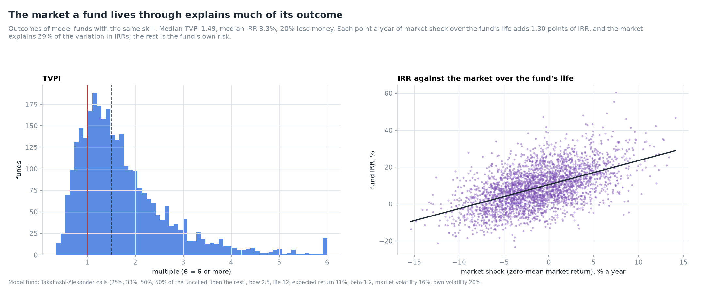

*Figure 6. The distribution of TVPIs, and IRR against the market shock over the fund's life.*

**Table 6. Outcomes of 5,000 model funds with identical parameters.**

| Percentile | 5th | 10th | 25th | 50th | 75th | 90th | 95th |
|---|---|---|---|---|---|---|---|
| TVPI | 0.68 | 0.80 | 1.07 | 1.49 | 2.12 | 2.94 | 3.57 |
| IRR | −7.7% | −4.6% | 1.5% | 8.3% | 15.7% | 23.0% | 27.1% |

21% of the funds lose money. The median IRR (8.3%) is below the expected return (11%), because
compounding a risky return makes the distribution of multiples right-skewed: the mean outcome is
pulled up by a few very good funds. The market shock over a fund's life explains 29% of the
variation in IRRs; each point a year of market shock adds 1.3 points of IRR.

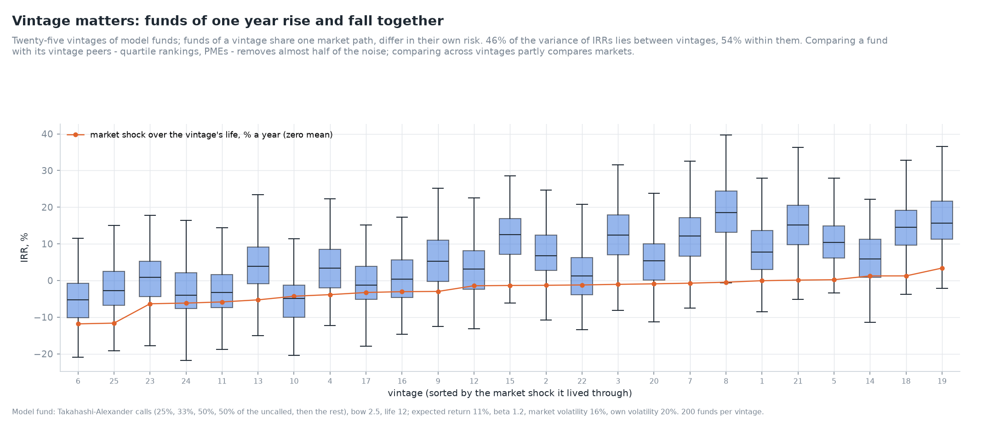

*Figure 7. IRRs of 25 vintages; funds of a vintage share one market path.*

**Table 7. Vintage dispersion (25 vintages × 200 funds).**

| Measure | Value |
|---|---|
| Variance of IRRs between vintages | 46% of the total |
| Variance within vintages | 54% |
| Median vintage IRR: lowest, median, highest | −5.3%, 5.2%, 18.5% |

The best vintage's median fund earned 24 points a year more than the worst's with identical
managers (ADR 0011). Day 1 showed the same in real index paths. Peer comparison within a vintage
removes almost half of the variance; the rest is the fund's own risk, which no benchmark removes.

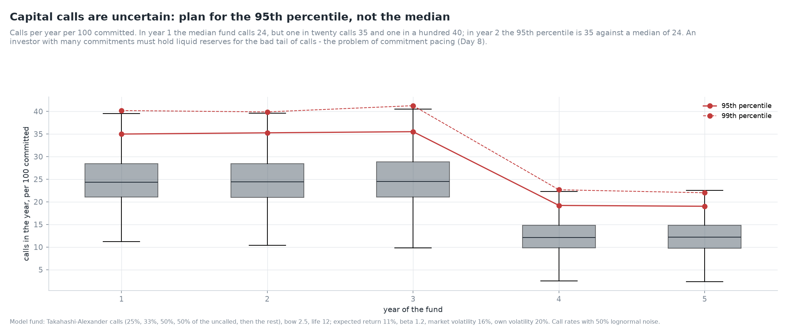

*Figure 8. Annual capital calls and their tail.*

**Table 8. Calls per year per 100 committed.**

| Year | 5th percentile | Median | 95th percentile | 99th percentile |
|---|---|---|---|---|
| 1 | 17.0 | 24.4 | 35.0 | 40.2 |
| 2 | 16.5 | 24.4 | 35.3 | 39.9 |
| 3 | 16.1 | 24.5 | 35.5 | 41.3 |
| 4 | 6.9 | 12.1 | 19.2 | 22.7 |
| 5 | 6.5 | 12.2 | 19.0 | 22.0 |

An investor that holds liquid reserves for the median call is short in one year of twenty by about
11 points of each commitment. With many commitments and calls correlated through the market, the
tail of total calls is fatter still. That is Day 8's problem.

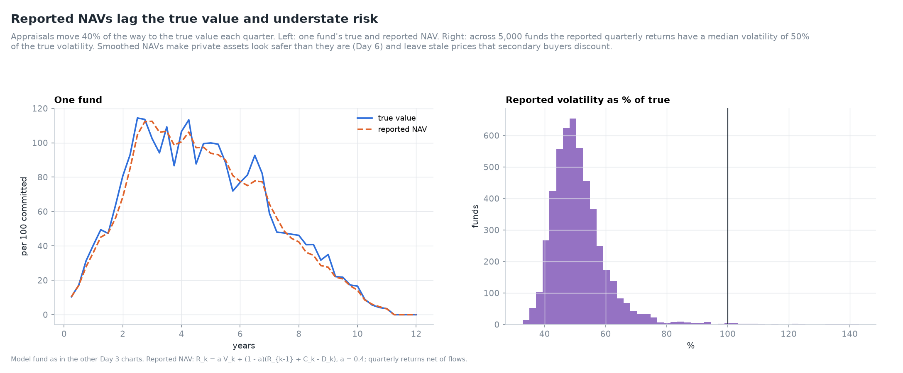

*Figure 9. True and reported NAV, and the ratio of reported to true volatility.*

With *a* = 0.4, reported quarterly returns have a median volatility of 50% of the true volatility
across funds. The reported NAV lags in both directions. It is above the true value after falls and
below it after rises, which is the staleness secondary buyers price.

## 6. Pricing an LP interest

A buyer at fund age τ pays a price *P* and takes over all future distributions and calls. Its value
at required return *r* (ADR 0010) is

$$
V(r) = \sum_{k} \big(\mathbb{E}[D_k] - \mathbb{E}[C_k]\big)\,e^{-r t_k},
\qquad
\text{discount} = 1 - \frac{V(r)}{\text{NAV}_{\text{reported}}} .
$$

The expected flows follow the deterministic recursion with growth *e*^(μ dt), because the noise is
mean-one and independent of the NAV. Full Monte Carlo agrees to within 2.1 standard errors (Figure
16 and a validation check).

**The anchor: at r = μ the discount is zero.** Existing assets are worth what they are expected to
return, and each future call is invested at a fair price. A buyer requiring the fund's own expected
return therefore pays exactly NAV, at every age (tested to 10⁻¹⁴). Every discount in this section
comes from a required return above μ or from a stale NAV.

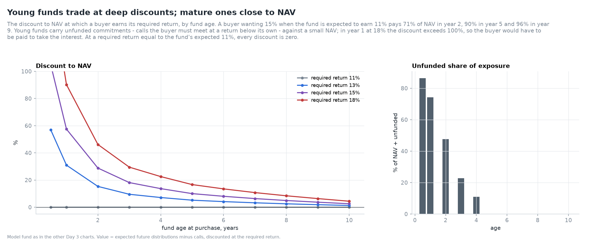

*Figure 10. Discount by fund age and required return.*

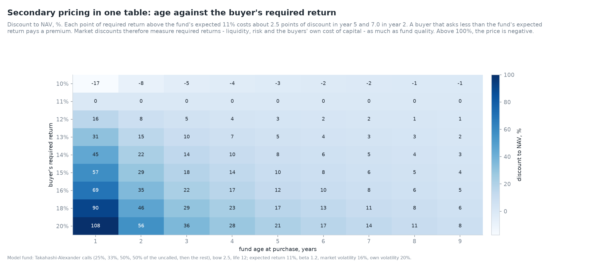

*Figure 11. Discount by age and required return.*

**Table 9. Discount to NAV (%) by fund age and the buyer's required return (fund expected to earn
11%).**

| Age | 11% | 13% | 15% | 18% |
|---|---|---|---|---|
| 0.5 | 0 | 57.0 | 104.9 | 162.6 |
| 1 | 0 | 31.0 | 57.5 | 90.2 |
| 2 | 0 | 15.3 | 28.8 | 46.2 |
| 3 | 0 | 9.5 | 18.1 | 29.5 |
| 4 | 0 | 7.1 | 13.7 | 22.6 |
| 5 | 0 | 5.2 | 10.0 | 16.7 |
| 6 | 0 | 4.1 | 8.0 | 13.5 |
| 8 | 0 | 2.5 | 4.9 | 8.4 |
| 10 | 0 | 1.3 | 2.6 | 4.4 |

Discounts fall steeply with age. A young fund's NAV is small against its unfunded commitment, and
its remaining flows are long-dated, so a higher discount rate hits them hardest. Above 100% the
price is negative: for a six-month-old fund a buyer requiring 15% would have to be paid to take on
the commitment.

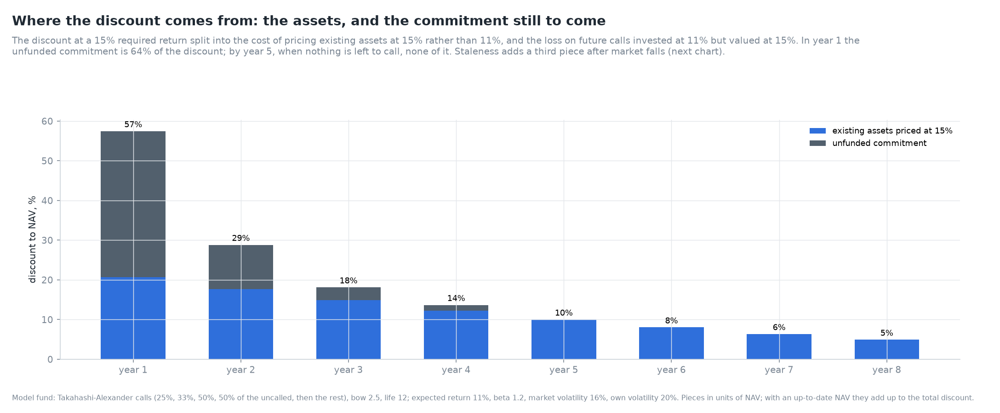

*Figure 12. The discount at 15% split into existing assets and the unfunded commitment.*

**Table 10. Decomposition of the discount at a 15% required return.**

| Age | NAV | Uncalled | From existing assets | From the unfunded commitment | Total |
|---|---|---|---|---|---|
| 1 | 26.1 | 75.0 | 20.7% | 36.7% | 57.5% |
| 2 | 54.8 | 50.0 | 17.7% | 11.1% | 28.8% |
| 3 | 85.2 | 25.0 | 14.9% | 3.2% | 18.1% |
| 4 | 101.7 | 12.5 | 12.3% | 1.4% | 13.7% |
| 5 | 113.2 | 0.0 | 10.0% | 0.0% | 10.0% |
| 6 | 104.1 | 0.0 | 8.0% | 0.0% | 8.0% |
| 8 | 61.1 | 0.0 | 4.9% | 0.0% | 4.9% |

In year 1 two-thirds of the discount is the unfunded commitment: future calls the buyer must meet,
invested at 11% but valued at 15%. By year 5 nothing remains to be called, and the discount is the
pure cost of pricing existing assets at a higher return over their remaining life.

### 6.1 Stale NAVs

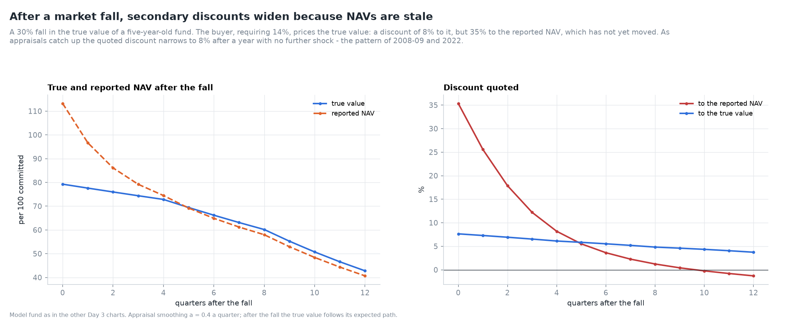

*Figure 13. True and reported NAV, and the discount quoted, after a 30% fall in true value.*

**Table 11. After a 30% fall at age 5 (buyer requires 14%).**

| Quarters after the fall | True value | Reported NAV | Discount to reported | Discount to true |
|---|---|---|---|---|
| 0 | 79.3 | 113.2 | 35.3% | 7.6% |
| 1 | 77.6 | 96.7 | 25.6% | 7.3% |
| 2 | 76.0 | 86.1 | 17.9% | 6.9% |
| 4 | 72.8 | 74.5 | 8.2% | 6.1% |
| 8 | 60.2 | 58.0 | 1.2% | 4.8% |
| 12 | 42.8 | 40.7 | −1.3% | 3.7% |

The buyer's price on the true value barely changes: its discount to the true value is 7.6% at once
and declines with the fund's shortening life. The quoted discount, against a reported NAV that has
not yet moved, is 35%. As appraisals catch up it narrows, and after two years it turns into a small
premium, because the smoothed NAV then lags below the true value. The same pattern, discounts
widening sharply in 2008-09 and narrowing as NAVs were written down, appears in transaction data
(Nadauld et al., 2019). Part of a quoted discount is the market reading through stale prices.

### 6.2 What a buyer earns

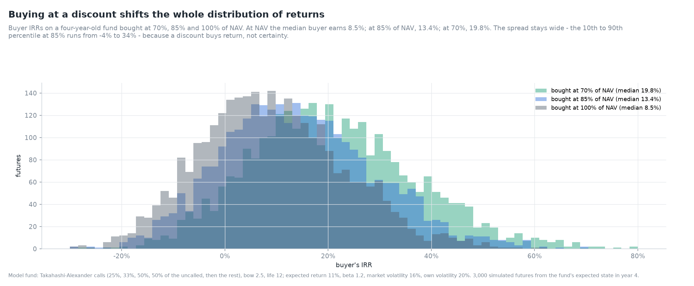

*Figure 14. Buyer IRR distributions at three prices, from the expected state in year 4.*

**Table 12. Buyer IRRs on a four-year-old fund (3,000 futures).**

| Price, % of NAV | 10th | 25th | Median | 75th | 90th | P(IRR < 0) |
|---|---|---|---|---|---|---|
| 70% | 1.1% | 9.6% | 19.8% | 31.0% | 42.4% | 8.7% |
| 85% | −4.2% | 3.8% | 13.4% | 23.9% | 34.4% | 17.0% |
| 100% | −8.1% | −0.7% | 8.5% | 18.4% | 28.1% | 26.6% |

A discount shifts the whole distribution: each 15 points of discount add about 5 to 6 points of
median IRR. It does not narrow the spread. Even at 70% of NAV, one buyer in eleven loses money.

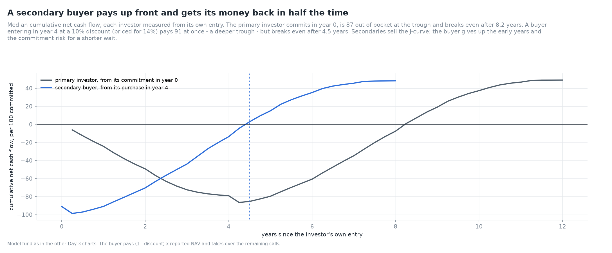

*Figure 15. Median cumulative net cash flow of a primary investor and a secondary buyer, each from
its own entry.*

The primary investor is 87 out of pocket at the trough and breaks even after 8.2 years. A buyer in
year 4, at a 10% discount priced for 14%, pays 91 at once, a deeper trough, but breaks even 4.5
years after entry. Secondaries sell the J-curve. The buyer gives up the early years and most of the
commitment risk in exchange for a shorter wait, and the seller pays for liquidity with the discount.

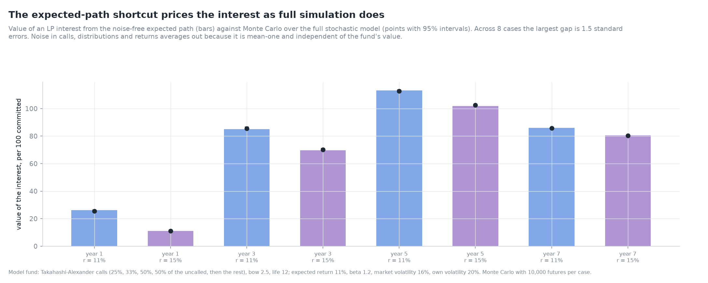

*Figure 16. Expected-path value against full Monte Carlo, eight cases.*

## 7. Validation

Six checks were added (19 before, 25 now), all passing:

| Check | Reference | Result |
|---|---|---|
| Takahashi-Alexander identities | IRR = G, NAV ends at 0, calls sum to commitment; 9 parameter sets | 3.1 × 10⁻¹⁶ |
| Calibration recovers known parameters | noise-free curves of a known model | 6.4 × 10⁻⁷ |
| Simulation mean matches the expected path | 15,000 noise-free-rate paths, 48 quarters; calls sum to commitment | max \|z\| 1.58; calls exact |
| Fair pricing at the fund's expected return | discount at r = μ, ages 0.5-10 | 1.0 × 10⁻¹⁴ |
| Expected-path value against Monte Carlo | two fund states, 20,000 futures each | max \|z\| 2.07 |
| Discount decomposition adds up | assets + unfunded + staleness = total | 8.3 × 10⁻¹⁷ |

The tests add hand-checked first years of the model, the IRR identity across parameters, the effect
of the bow on TVPI but not IRR, and calibration recovery. They also check conservation and an empty
final NAV in simulation, the noise-free limit, smoothing, the vintage variance split, a fund started
from a given state, the monotonicity of discounts in age and required return, staleness in the
decomposition, the narrowing discount after a crash, and buyer IRRs rising with the discount.

## 8. Limitations

1. **Model funds.** No fund-level data is used (ADR 0004). Parameters are typical, not estimated
   from a sample; the conclusions are about mechanisms, not levels.
2. **Independent noise.** Call and distribution noise is independent of the market. In practice
   distributions fall and calls slow in bad markets (Robinson and Sensoy, 2016), which fattens the
   tail of net flows. Day 8 will add that dependence.
3. **No recycling or fee calls** in the stochastic model; Day 1's deal-built fund has them, which is
   why its fitted tail call rate is positive.
4. **Known μ.** The buyer is assumed to know the fund's expected return. Information asymmetry
   between seller, buyer and GP, central in the secondary literature, is not modelled.
5. **Deal structures.** Deferred payments, preferred equity, continuation vehicles and NAV loans
   change the economics of a sale and are not modelled.
6. **A single smoothing parameter.** Appraisal behaviour differs by manager and over the cycle.

## 9. What comes next

Day 4 turns to venture capital. A start-up's preferred stock is a portfolio of options on the
company, and headline "post-money valuations" systematically overstate what the company is worth
(Gornall and Strebulaev, 2020).

## References

- Brown, G. W., Ghysels, E. and Gredil, O. R. (2023). Nowcasting net asset values: the case of
  private equity. *Review of Financial Studies* 36(3), 945-986.
- Buchner, A., Kaserer, C. and Wagner, N. (2010). Modeling the cash flow dynamics of private equity
  funds: theory and empirical evidence. *Journal of Alternative Investments* 13(1), 41-54.
- de Malherbe, E. (2004). Modeling private equity funds and private equity collateralised fund
  obligations. *International Journal of Theoretical and Applied Finance* 7(3), 193-230.
- Geltner, D. (1993). Estimating market values from appraised values without assuming an efficient
  market. *Journal of Real Estate Research* 8(3), 325-345.
- Gornall, W. and Strebulaev, I. A. (2020). Squaring venture capital valuations with reality.
  *Journal of Financial Economics* 135(1), 120-143.
- Kleymenova, A., Talmor, E. and Vasvari, F. P. (2012). Liquidity in the secondaries private equity
  market. Working paper, London Business School.
- Nadauld, T. D., Sensoy, B. A., Vorkink, K. and Weisbach, M. S. (2019). The liquidity cost of
  private equity investments: evidence from secondary market transactions. *Journal of Financial
  Economics* 132(3), 158-181.
- Robinson, D. T. and Sensoy, B. A. (2016). Cyclicality, performance measurement, and cash flow
  liquidity in private equity. *Journal of Financial Economics* 122(3), 521-543.
- Takahashi, D. and Alexander, S. (2002). Illiquid alternative asset fund modeling. *Journal of
  Portfolio Management* 28(2), 90-100.
