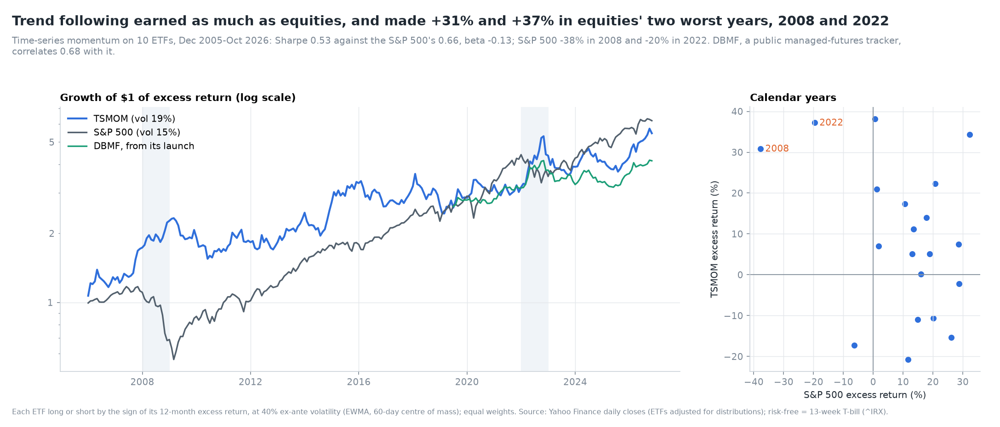
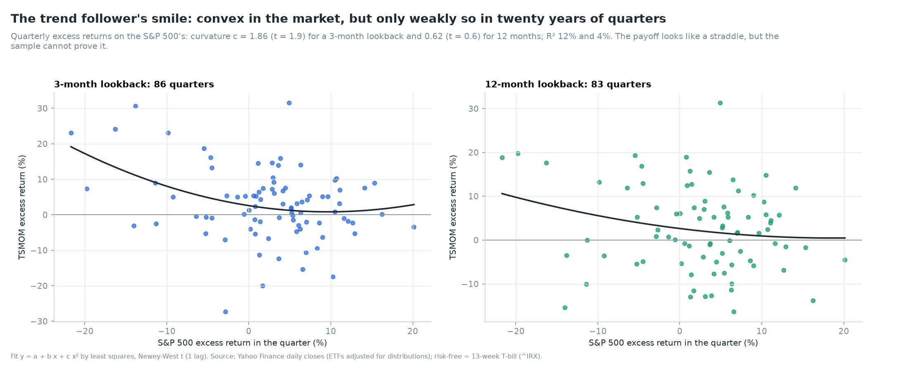
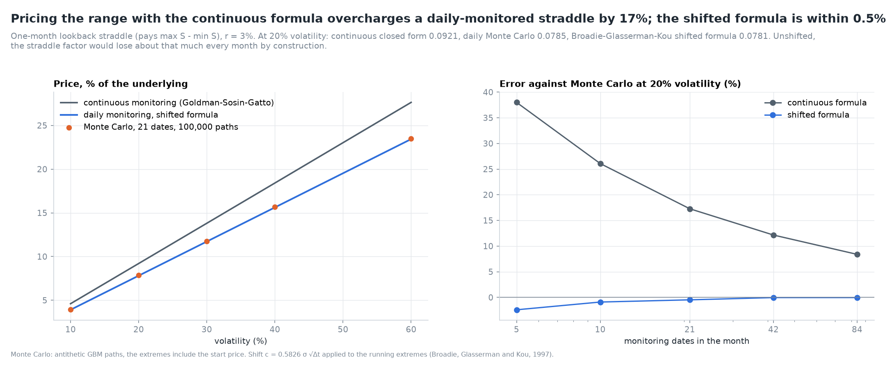
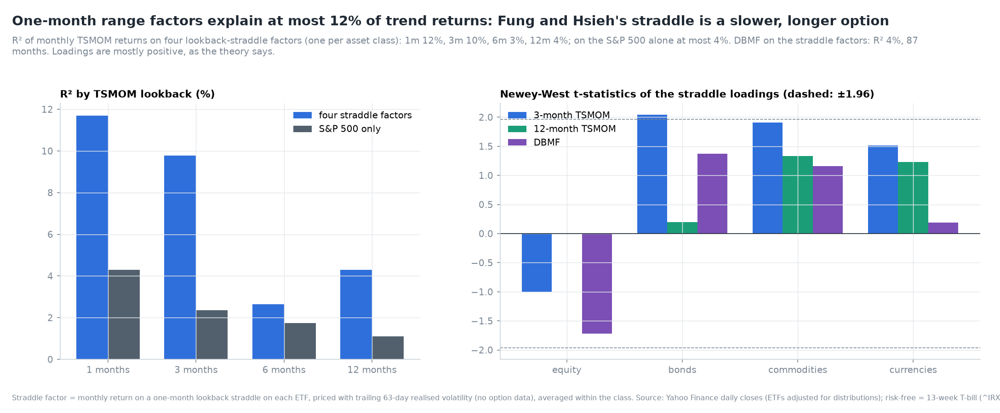
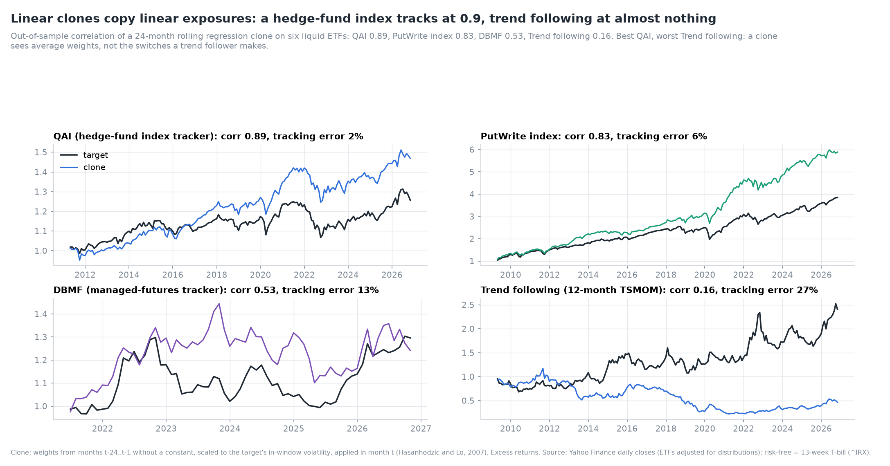
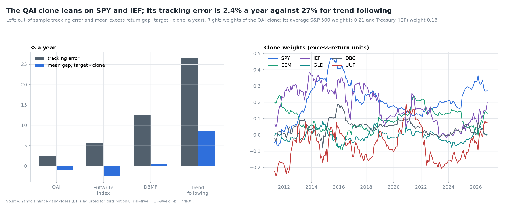
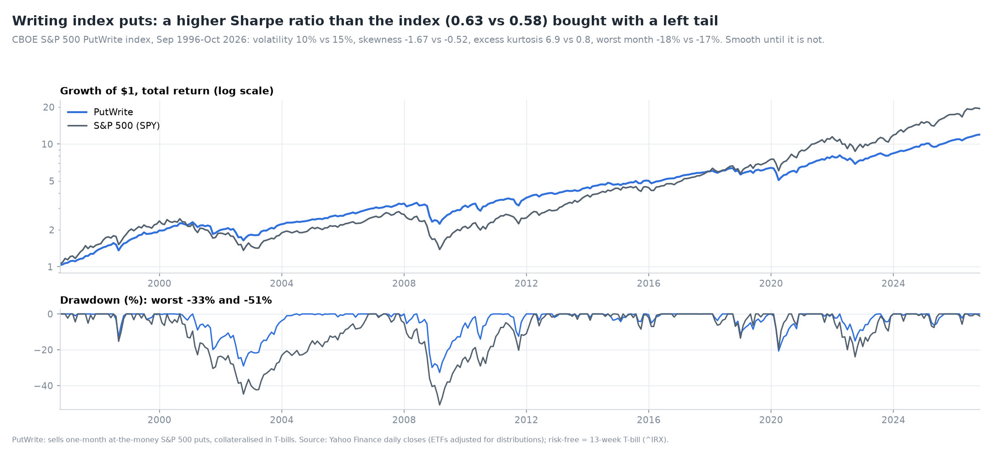
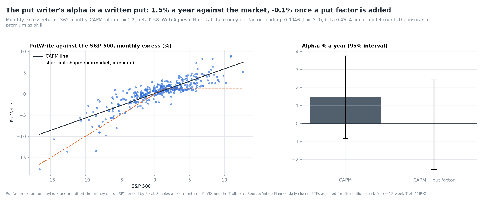
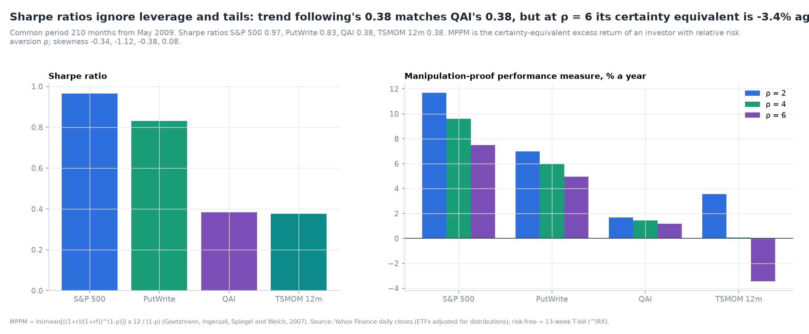
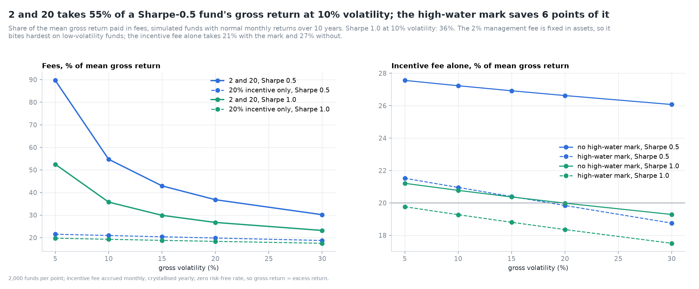

# Hedge funds and liquid alternatives

*Day 9 of 10 · private-markets-lab v0.9.0*

## Summary

Private equity hides its risk behind appraisals. Hedge funds are marked to market every month,
yet their risk can be just as hard to see, because some of it is not linear. A fund that writes
crash insurance looks like a low-beta fund with alpha until the crash. A trend follower looks
uncorrelated with equities on average, but it is long volatility and does best when equities do
worst. This note asks four questions, using public data:

1. **Trend following.** What does a simple trend follower earn, and is its payoff the lookback
   straddle that Fung and Hsieh (2001) proposed?
2. **Replication.** How much of a hedge-fund return can a linear clone of liquid ETFs copy
   (Hasanhodzic and Lo, 2007)?
3. **Tail risk.** Is the alpha of a put-writing strategy skill, or an option premium (Agarwal and
   Naik, 2004)? What do performance measures that punish the left tail say?
4. **Fees.** How much of the gross return do 2 and 20 take, and what is the high-water mark worth?

Findings:

1. **Trend following paid when equities did not.** Time-series momentum on ten ETFs earned 9.9% a
   year over T-bills from December 2005 to October 2026: about the S&P 500's 9.9%, with a Sharpe
   ratio of 0.53 against 0.66 and a beta of −0.13. In the market's two worst years it made +31%
   (2008, when the S&P 500 lost 38%) and +37% (2022, when it lost 20%). DBMF, a public fund that
   tracks managed-futures indices, correlates 0.68 with it.
2. **The straddle is visible, but only weakly.** Quarterly trend returns are convex in the
   market: the curvature has t = 1.9 for a 3-month lookback and 0.6 for 12 months. Monthly
   lookback-straddle factors built from the ETFs explain 12% of a 1-month trend follower's
   returns but only 4% of a 12-month one. The straddle Fung and Hsieh describe is a slower option
   than a one-month straddle.
3. **Linear clones copy linear exposures.** A 24-month rolling clone on six ETFs tracks QAI, a
   public hedge-fund index tracker, with correlation 0.89 and a 2.4% tracking error. It tracks the
   PutWrite index at 0.83, DBMF at 0.53, and trend following at 0.16, with a 27% tracking error.
4. **The put writer's alpha is a written put.** Against the market, the CBOE PutWrite index has an
   alpha of 1.5% a year (t = 1.2) over 362 months. Add an at-the-money put factor and the alpha is
   −0.0% (t = −0.04), with the put loading significant (t = −3.0). Its Sharpe ratio beats the
   index's (0.63 against 0.58), but its skewness is −1.67 and its excess kurtosis 6.9.
5. **Sharpe ratios ignore leverage and tails.** From May 2009 trend following and QAI have the same
   Sharpe ratio (0.38). For an investor with relative risk aversion 6, the manipulation-proof
   measure gives QAI a certainty equivalent of +1.2% a year and the 19%-volatility trend follower
   −3.4%.
6. **2 and 20 take most of a mediocre fund's return.** For a fund with a gross Sharpe ratio of 0.5
   at 10% volatility, fees take 55% of the mean gross return; at Sharpe 1.0 they take 36%. The
   management fee does most of it. The high-water mark cuts the incentive fee from 27% to 21% of
   the gross return.

The checks and their limits are at the end.

## 1. Data

Hedge-fund databases (HFR, Lipper TASS, BarclayHedge) are licensed, so no fund-level hedge-fund
data are used. Their place is taken by public instruments, all daily adjusted closes from Yahoo
Finance and stored locally only (ADR 0020):

| Role | Series | From |
|---|---|---|
| Trend universe: equities | SPY, EFA, EEM | 1993, 2001, 2003 |
| Trend universe: bonds | IEF, TLT | 2002 |
| Trend universe: commodities | GLD, DBC | 2004, 2006 |
| Trend universe: currencies | UUP, FXY, FXE | 2007, 2007, 2005 |
| Hedge-fund index tracker | QAI (IQ Hedge Multi-Strategy Tracker) | 2009 |
| Managed-futures tracker | DBMF (iMGP DBi Managed Futures) | 2019 |
| Put writing | ^PUT (CBOE S&P 500 PutWrite index) | 1996 |
| Implied volatility | ^VIX | 1990 |
| Risk-free rate | ^IRX (13-week T-bill yield) | 1960 |

The monthly risk-free return earned in a month is last month-end's bill yield divided by twelve.
QAI and DBMF are funds that themselves replicate hedge-fund and CTA indices. They are proxies
for the indices, not the indices.

## 2. Trend following

**Strategy.** Each month every ETF is held long if its past 12-month excess return is positive
and short if it is negative (Moskowitz, Ooi and Pedersen, 2012). The position is scaled to 40%
ex-ante volatility, using an exponentially weighted estimate of daily volatility (60-day centre of
mass). The portfolio is the equal-weighted average of the available assets, once at least six
have a history. ETFs are not futures, so the excess return over the T-bill stands in for a
futures return. Trading costs are ignored.

| Lookback | Excess return | Volatility | Sharpe | Skewness | Beta | Max drawdown |
|---|---|---|---|---|---|---|
| 1 month | 2.1% | 19.9% | 0.11 | 0.50 | −0.28 | −49% |
| 3 months | 11.3% | 20.2% | 0.56 | 0.18 | −0.21 | −34% |
| 6 months | 8.3% | 18.9% | 0.44 | −0.02 | −0.17 | −46% |
| 12 months | 9.9% | 18.7% | 0.53 | 0.14 | −0.13 | −33% |
| S&P 500 (same months) | 9.9% | 15.0% | 0.66 | −0.54 | 1 | −51% |

The 12-month strategy earned what equities earned with a negative beta. Its best calendar
years were 2007 (+38%), 2022 (+37%), 2013 (+34%) and 2008 (+31%); its worst were 2016 (−21%),
2018 (−17%), 2009 (−15%) and 2010 (−11%). The calendar-year scatter shows the pattern: in the two
years when equities fell hardest the strategy made more than 30%, while in years when equities
rose it was anywhere from −21% to +38%. It is not a hedge that pays every time equities fall: in
2018, when the S&P 500 lost 6%, it lost 17%. Positive skewness (0.14) against the market's −0.54 is the usual sign of a long-volatility
strategy.

DBMF launched in May 2019. Over its 89 months it correlates 0.68 with the 12-month strategy.
That is high for two strategies built so differently: DBMF holds futures chosen to match CTA
indices, while the strategy here holds ten ETFs by a rule.

**The smile.** A trend follower is long whichever direction the market moves in persistently. Its
return should therefore be a convex function of the market's: a smile. The quarterly fit
y = a + b x + c x² gives:

| Lookback | Curvature c | t | R² | Quarters |
|---|---|---|---|---|
| 3 months | 1.86 | 1.9 | 12% | 86 |
| 12 months | 0.62 | 0.6 | 4% | 83 |

The 3-month strategy shows the smile at about the 6% level; the 12-month strategy hardly shows it.
Moskowitz, Ooi and Pedersen found the smile in 25 years of 58 futures markets. Twenty years of
ten ETFs is a much smaller sample, and the slow strategy's convexity is spread over horizons
longer than a quarter.

## 3. The lookback straddle

Fung and Hsieh (2001) argued that a trend follower's ideal payoff is a lookback straddle: an
option that pays the range of a price over a period, max S − min S. If the trend follower always
bought at the low and sold at the high, that is what it would earn. Their primitive
trend-following factors are returns on rolled lookback straddles on futures.

**Pricing.** The straddle is a floating-strike lookback call plus a floating-strike lookback put.
Both have closed forms under geometric Brownian motion (Goldman, Sosin and Gatto, 1979). The
code reproduces Hull's textbook example (call 8.04, put 7.79) to the printed digit. Those formulas
assume the extremes are taken continuously. A range measured on daily closes is smaller, so the
continuous price overcharges a daily-monitored straddle. Broadie, Glasserman and Kou (1997) show
that a discretely monitored lookback is priced by the continuous formula with the running extremes
shifted by c = 0.5826 σ√Δt:

    call_m(S, m) = e^c · call(S, m e^−c) − (e^c − 1) S
    put_m(S, M)  = e^−c · put(S, M e^c) − (1 − e^−c) S

| One-month straddle, r = 3%, 20% volatility | Price (% of S) |
|---|---|
| Continuous closed form | 9.21 |
| Daily monitoring, Monte Carlo (21 dates, 100,000 paths) | 7.85 |
| Daily monitoring, shifted formula | 7.81 |

The continuous formula overstates the daily straddle by 17%. With 5 monitoring dates the
overstatement is 38%, and with 84 it is still 8%. The shifted formula is within 2.4% at 5 dates,
0.5% at 21, and 0.03% at 42 and above.

This mattered here. The first version of the straddle factor priced the premium with the
continuous formula and measured the payoff on daily closes. It lost 14% a month on average,
purely by construction. With the shifted formula the class factors average between +0.7% and
+4.8% a month, against a monthly volatility of about 42%.

**Factors.** For each ETF and month, the factor is the return on buying a one-month lookback
straddle at last month's close. The premium uses trailing 63-day realised volatility in place of
implied volatility, because no option prices are used. The payoff is the month's range of daily
closes. The factors are averaged within the four asset classes.

**Regressions.** The trend returns are regressed on the four class factors, with Newey-West
standard errors:

| Target | R², straddle factors | R², S&P 500 only | Months |
|---|---|---|---|
| TSMOM, 1-month lookback | 11.7% | 4.3% | 245 |
| TSMOM, 3-month | 9.8% | 2.3% | 245 |
| TSMOM, 6-month | 2.6% | 1.7% | 245 |
| TSMOM, 12-month | 4.3% | 1.1% | 245 |
| DBMF | 4.1% | 2.1% | 87 |

The loadings are mostly positive, as the theory predicts: a trend follower is long range, in
bonds, commodities and currencies above all. Most are not significant at 5%. The equity loading is
negative for the 3-month strategy and DBMF, and zero for the 12-month strategy.

The straddle factors explain much less than in Fung and Hsieh, who reported R² near one half for
trend-following fund indices. There are three reasons:

- Their straddles last three months and are rolled, while these last one month. The faster
  trend followers here (1 and 3 months) fit best, which is consistent with that.
- Their premiums come from option markets, while these use realised volatility.
- Their target is an index of many CTAs, whose idiosyncratic noise averages out, while the targets
  here are one rule and one fund.

The conclusion holds in direction, not in size: trend returns load on range, but a one-month
range explains little of a 12-month trend.

## 4. Replication

**Method.** Hasanhodzic and Lo (2007) built linear clones of hedge funds from a few liquid
factors. Each month a regression without a constant is fitted on the previous 24 months. The
weights are scaled so that the fitted series has the target's in-window volatility. They are then
held for the next month, so the clone is out of sample. The constant is left out because alpha
cannot be bought. The six factors are excess returns on SPY, EEM, IEF, GLD, DBC and UUP.

| Target | Months | Correlation | Tracking error | Target mean | Clone mean |
|---|---|---|---|---|---|
| QAI (hedge-fund index tracker) | 187 | 0.89 | 2.4% | 1.6% | 2.6% |
| PutWrite index | 211 | 0.83 | 5.7% | 8.2% | 10.6% |
| DBMF (managed-futures tracker) | 65 | 0.53 | 12.6% | 5.5% | 4.9% |
| Trend following (12-month) | 211 | 0.16 | 26.5% | 6.7% | −1.9% |

The ranking follows linearity:

- **QAI** is itself a linear replicator of hedge-fund indices, so the clone copies it closely. The
  clone also earned a point a year more; QAI's fund expenses are part of that.
- **The PutWrite index** is mostly a beta-0.6 equity position, so its clone tracks it closely, but
  it misses most in falling markets (the gap correlates −0.18 with the S&P 500). In March 2020 the
  index lost 13.5% and its clone 8.9%: the clone holds the line, the index holds a written put.
- **DBMF** changes its weights more slowly than a trend follower but faster than a 24-month window
  can follow.
- **The trend follower** switches sign whenever a trend turns. A clone fitted on the past two
  years holds the average of positions that have already been reversed, so it lost 1.9% a year
  while the target earned 6.7%.

The QAI clone leans on the S&P 500 (average weight 0.21) and Treasuries (0.18), with smaller
weights on emerging markets, a short dollar and commodities. That is the textbook picture of the
average hedge fund: long equity, long duration, short dollar.

## 5. Tail risk

**Writing puts.** The CBOE PutWrite index sells one-month at-the-money S&P 500 puts each month
and holds the collateral in T-bills. From September 1996 to October 2026:

| | PutWrite | S&P 500 |
|---|---|---|
| Excess return | 6.6% | 8.8% |
| Volatility | 10.5% | 15.3% |
| Sharpe ratio | 0.63 | 0.58 |
| Skewness | −1.67 | −0.52 |
| Excess kurtosis | 6.9 | 0.8 |
| Worst month | −17.7% | −16.6% |
| Maximum drawdown | −33% | −51% |

On the Sharpe ratio, put writing beats the index it insures. The cost is in the third and fourth
moments: its worst month is as bad as the index's at two-thirds of the volatility.

**The put factor.** Agarwal and Naik (2004) added option returns to the factor model. Here the
factor is the return on buying a one-month at-the-money SPY put, priced by Black-Scholes at last
month-end's VIX and T-bill rate, and paid off at the month-end close. It loses the whole premium in
33% of months and averages −43% a month. That is the variance risk premium: implied volatility
is usually above realised.

| Model | Alpha a year | t | Market beta | Put loading (t) | R² |
|---|---|---|---|---|---|
| CAPM | 1.5% | 1.2 | 0.58 | | 0.715 |
| CAPM + ATM put factor | −0.0% | −0.04 | 0.49 | −0.0046 (−3.0) | 0.724 |
| CAPM + 5% OTM put factor | 0.2% | 0.22 | 0.53 | −0.0023 (−3.7) | 0.729 |

The CAPM alpha is the option premium. Once the put factor is in the model it disappears, whether
the put is at the money or 5% out. The CAPM alpha was not significant to begin with. What matters
is how it is misread: a manager who writes puts looks like a low-beta fund with alpha, and a
linear risk model calls the premium skill.

**Performance measures.** The Sharpe ratio counts only volatility. The manipulation-proof
performance measure of Goetzmann, Ingersoll, Spiegel and Welch (2007) is the certainty-equivalent
excess return of an investor with power utility and relative risk aversion ρ:

    MPPM = 12 / (1 − ρ) · ln mean[((1 + r) / (1 + r_f))^(1−ρ)]

It cannot be raised by selling options or by leverage. Over the common period of May 2009 to
October 2026 (210 months):

| | Sharpe | Skewness | MPPM ρ = 2 | ρ = 4 | ρ = 6 |
|---|---|---|---|---|---|
| S&P 500 | 0.97 | −0.34 | 11.7% | 9.6% | 7.5% |
| PutWrite | 0.83 | −1.12 | 7.0% | 6.0% | 5.0% |
| QAI | 0.38 | −0.38 | 1.7% | 1.4% | 1.2% |
| TSMOM, 12-month | 0.38 | 0.08 | 3.6% | 0.1% | −3.4% |

In this bull market the index leads on every measure. The interesting comparison is between QAI
and trend following, which have the same Sharpe ratio. At ρ = 2 the trend follower is worth more,
but at ρ = 6 it is worth less than cash, because its 40%-per-asset volatility target leaves it at
19% volatility. A Sharpe ratio is the same at any leverage; a certainty equivalent is not. Over
the full PutWrite sample the measures also cross: at ρ = 2 the index is worth more than put writing
(6.4% against 5.4%), while at ρ = 6 put writing is worth more (2.8% against 1.4%), because its
volatility is lower. The MPPM penalises the left tail, but it penalises volatility too.

## 6. Fees

**Terms.** The fee engine charges a 2% management fee on assets, monthly. It charges a 20%
incentive fee on the gain above a high-water mark, accrued in the reported NAV each month and
crystallised once a year, when the mark resets to the NAV after the fee. There is no hurdle. A
validation check holds the engine to the closed form for a constant 12% gross return:
each year's net growth is 1 + 0.8 · (((1 + g)(1 − m/12))^12 − 1).

**Who gets the return.** Funds are simulated with normal monthly returns over ten years, 2,000 per
point, with a zero risk-free rate, so the gross return is all excess return. The table shows fees
as a share of the mean gross return:

| Gross volatility | 2 and 20, Sharpe 0.5 | 2 and 20, Sharpe 1.0 | Incentive only, Sharpe 0.5, with mark | Without mark |
|---|---|---|---|---|
| 5% | 90% | 53% | 21% | 28% |
| 10% | 55% | 36% | 21% | 27% |
| 15% | 43% | 30% | 20% | 27% |
| 20% | 37% | 27% | 20% | 27% |
| 30% | 30% | 23% | 19% | 26% |

- **The management fee is the larger fee for most funds.** A 2% fee on assets is fixed, so it takes
  a larger share the lower the fund's gross return. A Sharpe-0.5 fund at 5% volatility earns 2.5%
  gross and pays 2% of it straight back.
- **The high-water mark is worth six to seven points of gross return to investors.** Without it,
  the manager would earn 20% of every positive year, including years that only recover earlier
  losses, and would take 27% of the gross return instead of 21%. With it, the incentive fee takes a
  little less than 20%, because some gains only restore the mark and are never charged.
- **Why the incentive share falls with volatility.** The incentive fee is an option, and its value
  rises with volatility in dollars. As a share of the mean gross return, it falls slightly as
  volatility rises at a fixed Sharpe ratio, because deeper drawdowns leave the fund under water
  for longer.

## 7. Checks and limits

**Validation** (four new checks, 51 in all):

- **Lookback closed form against Hull's published example:** 8.0371 and 7.7902, against 8.04 and
  7.79.
- **Continuous straddle against Monte Carlo with the BGK shift:** within 4 standard errors. The
  daily-monitoring formula is within 1% of unshifted daily Monte Carlo (−0.50%).
- **Fee engine against the closed form at a constant return:** 1.1e-15.
- **The clone recovers fixed weights when the target is a mix of the factors:** 3.6e-15.

**Limits:**

- **No hedge-fund database.** QAI and DBMF are public replicators of indices, not funds with
  managers. Survivorship, backfill and self-selection biases, the central problems of hedge-fund
  data, cannot be studied without the databases.
- **ETFs instead of futures.** Futures would roll and need no collateral. Excess returns over the
  T-bill approximate futures returns, and the currency ETFs carry their own deposit rates.
- **No option prices.** The straddle factors use realised volatility, and the put factor uses the
  VIX, which is a 30-day variance swap rate rather than an at-the-money implied volatility. Both
  set the level of the premium and so mainly the regressions' constants.
- **One-month straddles.** Fung and Hsieh roll three-month straddles. Longer straddles would
  probably explain more of the 12-month trend follower.
- **No transaction costs** in the trend strategy or the clones. The 1-month strategy trades the most
  and would lose the most.
- **Normal returns in the fee study.** Real funds have fatter tails and serial correlation, and
  their fees include hurdles, side pockets and redemption gates that are not modelled.

## References

- Agarwal, V. and Naik, N. (2004). Risks and portfolio decisions involving hedge funds. *Review of
  Financial Studies* 17(1).
- Broadie, M., Glasserman, P. and Kou, S. (1997). A continuity correction for discrete barrier
  options. *Mathematical Finance* 7(4). The same correction for lookbacks: Broadie, Glasserman and
  Kou (1999), Connecting discrete and continuous path-dependent options, *Finance and Stochastics* 3.
- Fung, W. and Hsieh, D. (2001). The risk in hedge fund strategies: theory and evidence from trend
  followers. *Review of Financial Studies* 14(2).
- Getmansky, M., Lo, A. and Makarov, I. (2004). An econometric model of serial correlation and
  illiquidity in hedge fund returns. *Journal of Financial Economics* 74(3). (Day 6.)
- Goetzmann, W., Ingersoll, J., Spiegel, M. and Welch, I. (2007). Portfolio performance
  manipulation and manipulation-proof performance measures. *Review of Financial Studies* 20(5).
- Goldman, M., Sosin, H. and Gatto, M. (1979). Path dependent options: "buy at the low, sell at the
  high". *Journal of Finance* 34(5).
- Hasanhodzic, J. and Lo, A. (2007). Can hedge-fund returns be replicated? The linear case.
  *Journal of Investment Management* 5(2).
- Moskowitz, T., Ooi, Y. H. and Pedersen, L. H. (2012). Time series momentum. *Journal of Financial
  Economics* 104(2).
