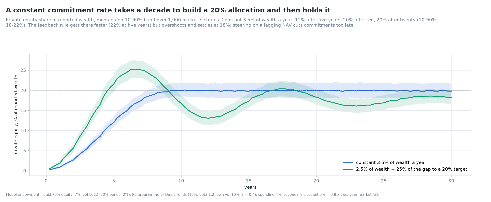
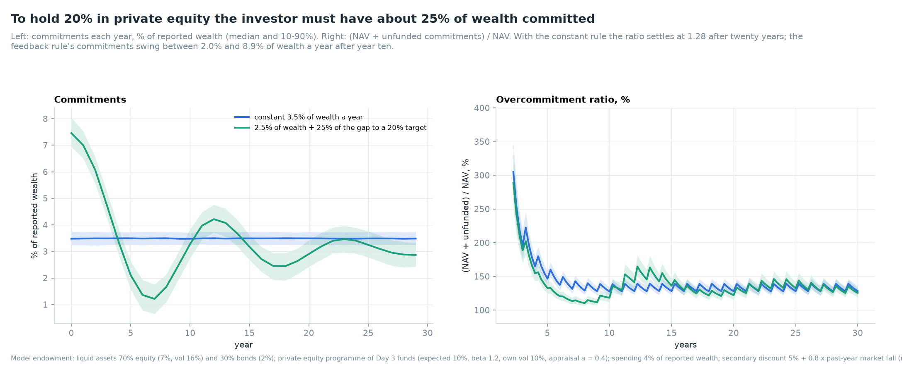
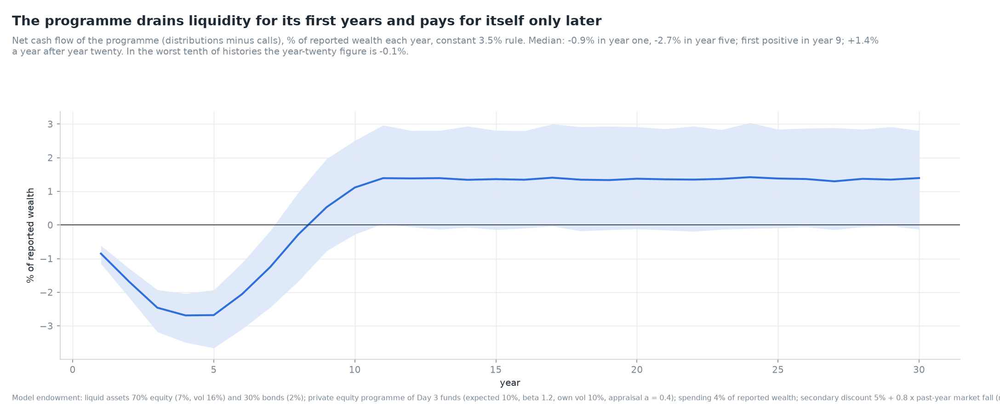
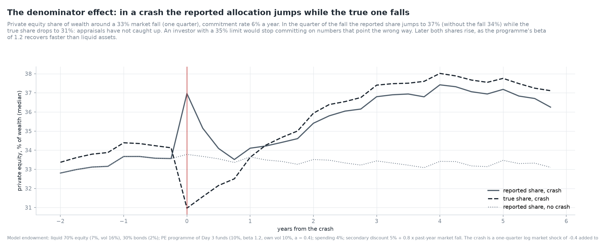
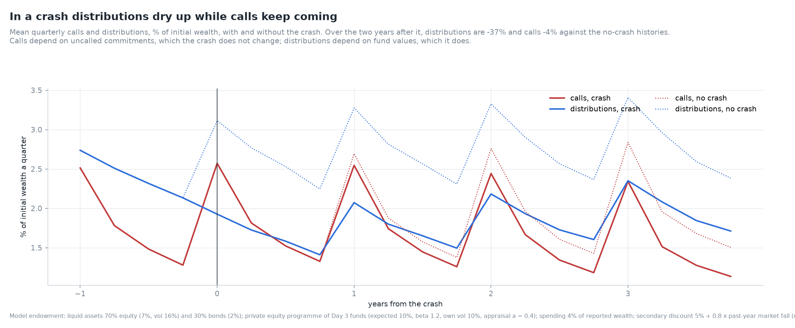
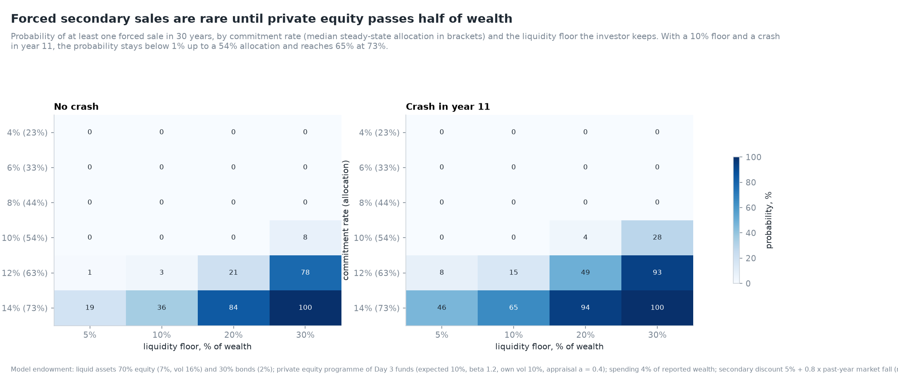
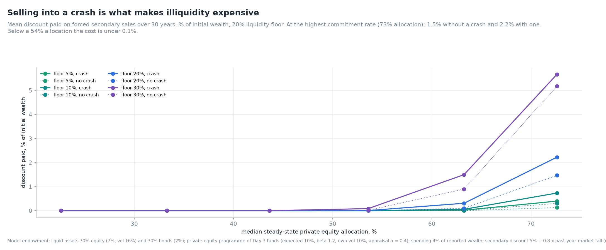
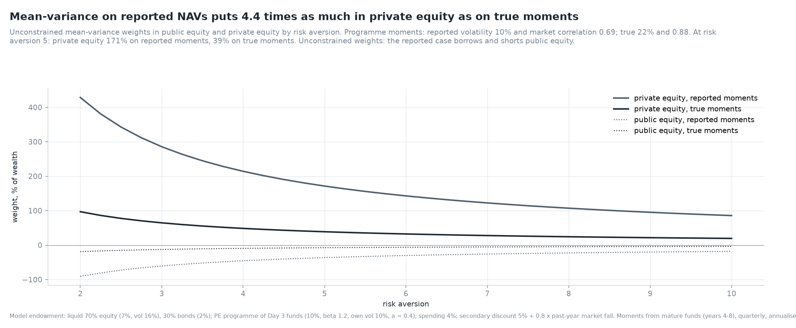
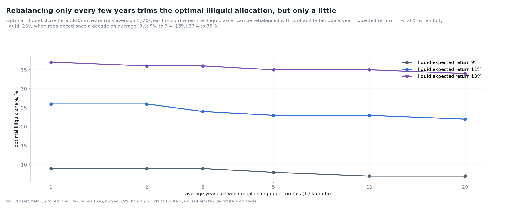
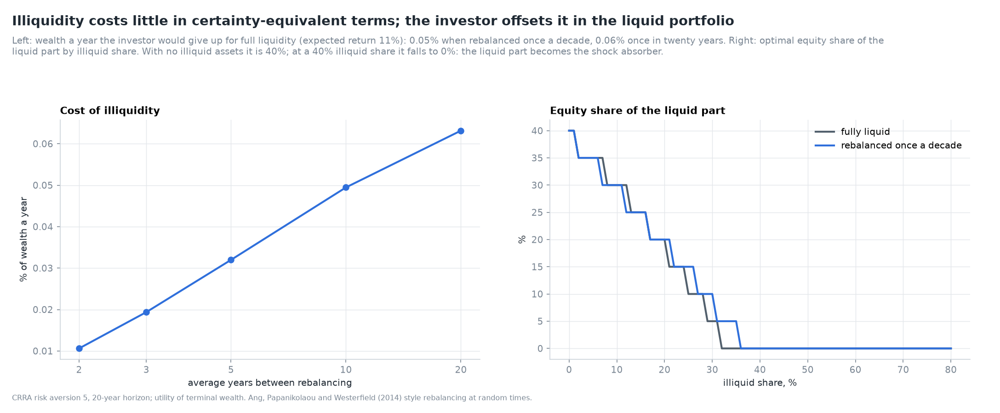

# Allocating to illiquid assets

*Day 8 of 10 · private-markets-lab v0.8.0*

## Summary

An investor cannot buy a private equity allocation. They can only commit capital to funds, which
call it over several years and return it over a decade. The allocation they hold is an outcome of
past commitments, fund pacing and markets. This note studies a model endowment that builds and holds
a private equity programme, using the Day 3 fund model on simulated market paths, and asks four
questions:

1. **Pacing.** How should commitments be paced to reach and hold a target?
2. **Crises.** What happens in a crash: to the reported allocation, and to the cash flows?
3. **Liquidity.** When does the programme force the investor to sell on the secondary market, and
   what does that cost?
4. **How much to hold.** How much should the investor hold, once the asset's true risk and its
   illiquidity are counted?

Findings:

1. **A constant commitment rate is a good pacing rule.** Committing 3.5% of wealth a year builds a
   20% allocation in about ten years and then holds it (10-90% band 18-22% after twenty years). A
   rule that steers on the gap to target gets to 22% in five years, but it overshoots to 25% and
   then oscillates, settling at 18%: it steers on reported NAV, which lags.
2. **Holding 20% needs about 25% of wealth committed.** At the constant rule, NAV plus unfunded
   commitments is 1.28 times NAV.
3. **The programme drains cash for eight years.** Net cash flow is −2.7% of wealth in year five
   and turns positive in year nine; after year twenty it adds about 1.4% a year.
4. **The denominator effect is a measurement artefact.** In a quarter in which the market falls
   33%, the reported allocation of a 33% programme jumps to 37%, while the true allocation falls to
   31%. Appraisals have not yet caught up.
5. **In the crash, distributions fall 37% over two years, but calls fall only 4%.** Calls are set
   by unfunded commitments, which the crash does not change.
6. **Forced secondary sales are rare below a 50% allocation.** Even with a crash and a 20%
   liquidity floor, the probability of a forced sale is 4% at a 54% allocation. It reaches 49% at
   63% and 94% at 73%. The discount paid is under 0.1% of wealth below 54% and 2.2% at 73% with a
   crash.
7. **Mean-variance on reported NAVs puts 4.4 times too much in private equity.** The programme's
   reported volatility is 10% (correlation with the market 0.69). Its true volatility is 22%
   (correlation 0.88). At risk aversion 5 the unconstrained weight is 171% on reported moments and
   39% on true moments.
8. **Illiquidity itself costs little.** A CRRA investor (risk aversion 5, 20-year horizon) who can
   rebalance the illiquid asset only once a decade on average holds 23% instead of 26%. They would
   give up 0.05% of wealth a year to make it liquid, and they offset the illiquid risk by holding
   less public equity in the liquid part.

Taken together: true risk matters far more than illiquidity. Using unsmoothed risk changes the
answer four-fold. Rebalancing frictions change it by a tenth, and liquidity crises only bite above
half of wealth.

## 1. The model endowment

**Table 1. Assumptions**

| Item | Value |
|---|---|
| Liquid assets | 70% public equity (expected 7%, volatility 16%), 30% bonds (2%), rebalanced quarterly |
| Programme | Day 3 stochastic fund model: expected 10%, beta 1.2, own volatility 10% (a diversified programme), 12-year life, Takahashi-Alexander call and distribution rates with noise |
| Appraisal | Reported NAV catches 40% of the gap to true value each quarter (Day 5, Day 6) |
| Spending | 4% of reported wealth a year, from liquid assets |
| Commitments | One new vintage a year; each vintage runs on the scenario's market path |
| Liquidity floor | If liquid assets fall below the floor (5% of reported wealth unless stated), enough of the programme is sold to restore it |
| Secondary discount | 5% of reported NAV, plus 0.8 times the past year's market fall, at most 50% |
| Scenarios | 1,000 market histories of 30 years |

Two features matter most:

- **A vintage's cash flows are linear in its commitment.** So each vintage is simulated once per
  scenario for one unit, then scaled by the commitment the pacing rule chooses. The rule sees only
  information available at the time.
- **Secondary sales scale down every vintage held** in the same proportion. The discount schedule
  gives about 37% after a 40% market fall, which is close to the discounts of early 2009.

## 2. Pacing

### 2.1 Two rules

- **Constant:** commit 3.5% of reported wealth a year.
- **Feedback:** commit 2.5% of wealth plus 25% of the gap between a 20% target and the current
  reported NAV share, floored at zero.

**Table 2. Private equity share of reported wealth (median)**

| Rule | Year 5 | Year 10 | Year 20 | Year 20, 10-90% |
|---|---:|---:|---:|---:|
| Constant 3.5% | 12% | 20% | 20% | 18-22% |
| Feedback | 22% | 17% | 18% | 16-20% |

The constant rule is slow but stable, because it ignores NAV. The feedback rule commits up to 7.5%
of wealth a year at first, so it overshoots: by the time the reported NAV reaches the target, the
commitments of the past four years are still being called. It then cuts commitments to near zero,
undershoots, and oscillates. Proportional control on a lagging signal behaves like this. Better
rules project the NAV forward from the unfunded commitments, as Takahashi and Alexander's model
does. A rule that commits a share of wealth sized to the target allocation needs no projection.

### 2.2 Cash flows

The programme is a net user of cash until year nine. The median net cash flow is −0.9% of wealth
in year one and −2.7% in year five. After year twenty it adds about 1.4% a year, which pays a third
of the spending. In the worst tenth of histories, year twenty's net cash flow is still slightly
negative.

## 3. A crash

A one-quarter log shock of −0.4 to the market (a 33% fall) is added to every history at the start
of year 11. The programme commits 6% of wealth a year, a 33% allocation.

### 3.1 The denominator effect

**Table 3. Private equity share around the crash (median)**

| | Quarter before | Quarter of the crash | One year later | Four years later |
|---|---:|---:|---:|---:|
| Reported share, crash | 34% | 37% | 34% | 37% |
| True share, crash | 34% | 31% | 34% | 38% |
| Reported share, no crash | 34% | 34% | 34% | 33% |

In 2008 and 2022, investors found themselves above their private equity limits. Many stopped
committing and some sold on the secondary market. The model shows why. Public assets are marked
at once, so the denominator falls. The private NAV is appraised with a lag, so the numerator falls
slowly. The reported share jumps by three points, while the true share has fallen by three. Over
the next years both shares rise above their pre-crash level. The programme has a beta of 1.2, so it
recovers faster than a liquid portfolio that is 30% bonds.

### 3.2 Cash flows in a crash

Over the two years after the crash, distributions are 37% lower than in the same histories without
it, while calls are only 4% lower. Funds keep calling committed capital whatever the market does,
but they distribute only out of exits, and exits wait for better prices. The crash therefore turns
the programme's cash flow negative just when liquid assets have fallen.

## 4. Liquidity

### 4.1 Forced sales

**Table 4. Probability of at least one forced secondary sale in 30 years, %**

| Commitment rate (median allocation) | Floor 5% | 10% | 20% | 30% |
|---|---:|---:|---:|---:|
| **No crash** | | | | |
| 4% (23%) | 0 | 0 | 0 | 0 |
| 8% (44%) | 0 | 0 | 0 | 0 |
| 10% (54%) | 0 | 0 | 0 | 8 |
| 12% (63%) | 1 | 3 | 21 | 78 |
| 14% (73%) | 19 | 36 | 84 | 100 |
| **Crash in year 11** | | | | |
| 10% (54%) | 0 | 0 | 4 | 28 |
| 12% (63%) | 8 | 15 | 49 | 93 |
| 14% (73%) | 46 | 65 | 94 | 100 |

Liquidity risk is a threshold effect. Up to an allocation of about 45% there are no forced sales
in 1,000 histories, with or without a crash. The liquid part, 55% of wealth or more, covers the
calls and the spending. Above 55% the probability rises steeply. A higher floor makes it rise
sooner: a floor is a liquidity reserve that the investor has promised not to use.

The model allocates up to 73% to private equity, which is higher than any real endowment. Real
endowments of the 2000s held 50-60% in all illiquid assets together: private equity, real estate,
natural resources and hedge funds with lock-ups. They also had unfunded commitments larger than
this model's. In 2008-2009, the investors with the most illiquid assets did need to sell
secondaries or issue bonds.

### 4.2 The cost of forced sales

With a 20% floor, the mean discount paid over 30 years is 1.5% of initial wealth at a 73%
allocation without a crash, and 2.2% with one. Below a 54% allocation it is under 0.1%. The cost
is concentrated in the histories that sell, and sales cluster after market falls, when discounts
are widest.

## 5. How much to hold

### 5.1 Mean-variance with reported and true risk

The programme's quarterly returns, measured on funds aged four to eight years:

**Table 5. Programme moments (annualised)**

| | Mean | Volatility | Correlation with the market |
|---|---:|---:|---:|
| True value | 10.0% | 22% | 0.88 |
| Reported NAV | 8.9% | 10% | 0.69 |
| Public equity | 7.0% | 16% | 1 |

On reported moments, private equity looks like a bond-like asset with an equity-like return.
Mean-variance then wants to borrow to buy it and short public equity to hedge it. At risk aversion
5 the unconstrained weight is 171%, against 39% on true moments: 4.4 times as much. This is Day 6's
finding turned into an allocation. The weight on true moments is close to what the DP below chooses
when the asset is liquid.

### 5.2 Dynamic programming with rebalancing at random times

Ang, Papanikolaou and Westerfield (2014) model an illiquid asset that can be traded only at random
times, arriving at rate λ a year. Between those times, the illiquid share drifts with returns. The
investor can only adjust the liquid part.

The model here:

- **Preferences.** A CRRA investor (risk aversion 5) maximises expected utility of wealth in 20
  years.
- **Assets.**
  - public equity: 7%, volatility 16%;
  - bonds: 2%;
  - the illiquid asset: beta 1.2 to equity, own volatility 15%, expected return 9%, 11% or 13%.
- **Decisions.** Each year the investor chooses the equity share α of the liquid part. With
  probability λ they may also reset the illiquid share θ.

Utility is homogeneous in wealth, so the value function is W^(1−γ) v(θ). Backward induction runs on
a 1% grid of θ, with Gauss-Hermite quadrature over the two shocks. The solver recovers Merton's
share for the liquid problem: 0.39, against (μ − r)/(γσ²) = 0.39.

**Table 6. Optimal illiquid share and the cost of illiquidity**

| Illiquid expected return | λ = 1 (liquid) | 1/2 | 1/3 | 1/5 | 1/10 | 1/20 | Cost at 1/10, % a year |
|---:|---:|---:|---:|---:|---:|---:|---:|
| 9% | 9% | 9% | 9% | 8% | 7% | 7% | 0.008 |
| 11% | 26% | 26% | 24% | 23% | 23% | 22% | 0.049 |
| 13% | 37% | 36% | 36% | 35% | 35% | 34% | 0.12 |

Illiquidity lowers the optimal share by one to four points, and costs between 0.01% and 0.15% of
wealth a year. The investor makes up for it in the liquid part. With no illiquid assets they hold
40% of the liquid part in public equity. At a 40% illiquid share they hold none, because the liquid
part becomes the buffer that absorbs the illiquid asset's risk.

The cost is small for two reasons:

- the optimal allocation is moderate, so the illiquid share rarely drifts far from it;
- the investor has a liquid instrument correlated with the illiquid asset, public equity, with
  which to offset the drift.

Ang, Papanikolaou and Westerfield find larger costs when the illiquid asset is a larger share of
wealth, and when the investor must also consume out of liquid wealth. This model has no spending
in the DP part; Sections 3 and 4 show where spending and calls bite.

## 6. Limits

- **Every result is a model result.** No real programme's cash flows are used; Day 3's model is
  calibrated to published fund behaviour, not to a dataset.
- **One crash shape** (a single 33% quarter) and a crash-dependent discount schedule chosen by hand.
- **The liquidity simulation has a single illiquid asset.** Real investors also hold real estate
  and hedge funds, and some can borrow against assets.
- **The DP ignores spending, commitments and the J-curve.** Its illiquid asset is a single,
  instantly investable holding that can be traded at random times. The programme simulation has
  all those features but no optimisation. Joining the two would need a state for unfunded
  commitments, as in Giommetti and Sorensen (2021).
- **The pacing rules are simple.** Projection-based rules are discussed but not simulated.

## References

- Ang, A., Papanikolaou, D. and Westerfield, M. (2014). Portfolio choice with illiquid assets.
  *Management Science* 60, 2737-2761.
- Giommetti, N. and Sorensen, M. (2021). Optimal allocation to private equity. NBER Working Paper
  29464.
- Merton, R. (1969). Lifetime portfolio selection under uncertainty: the continuous-time case.
  *Review of Economics and Statistics* 51, 247-257.
- Takahashi, D. and Alexander, S. (2002). Illiquid alternative asset fund modeling. *Journal of
  Portfolio Management* 28(2), 90-100.
