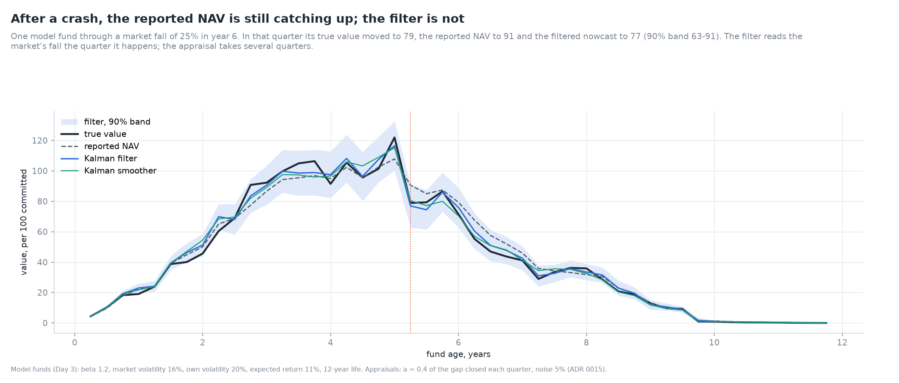
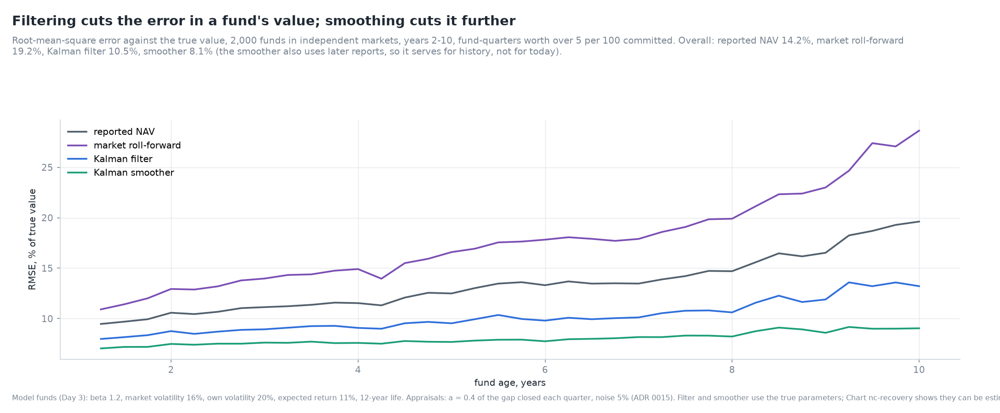
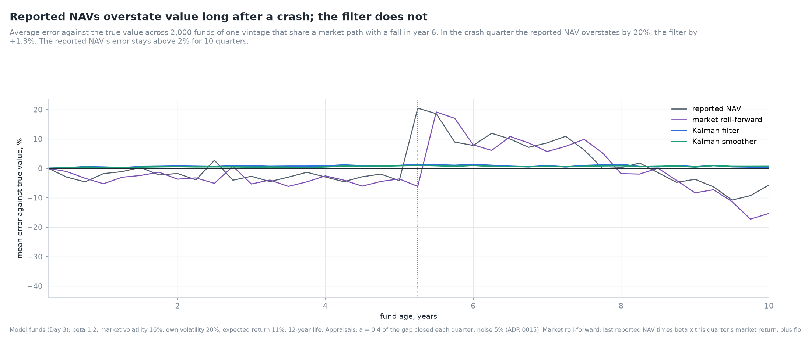
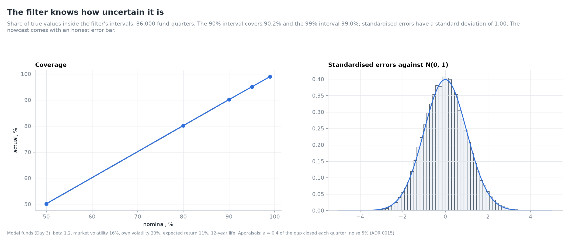
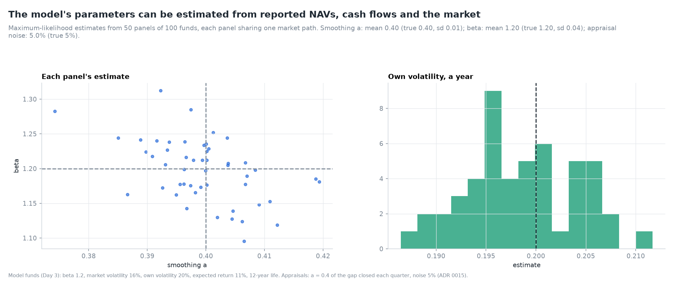
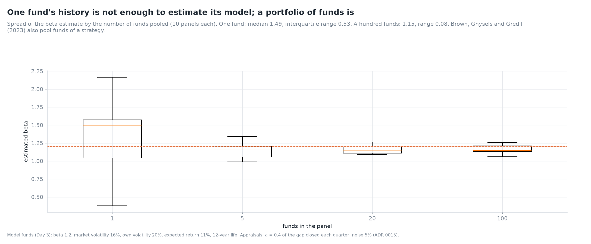
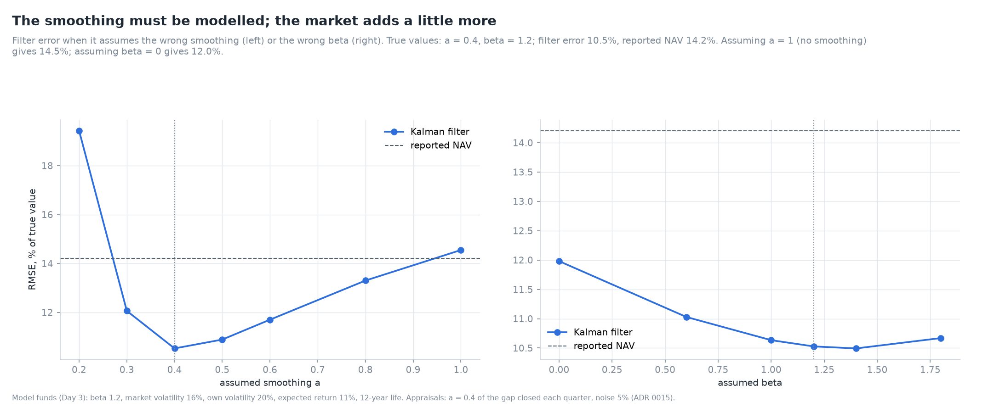
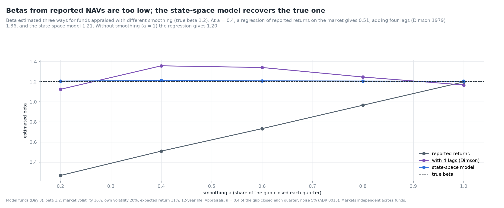
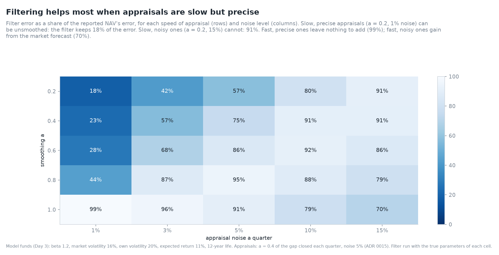
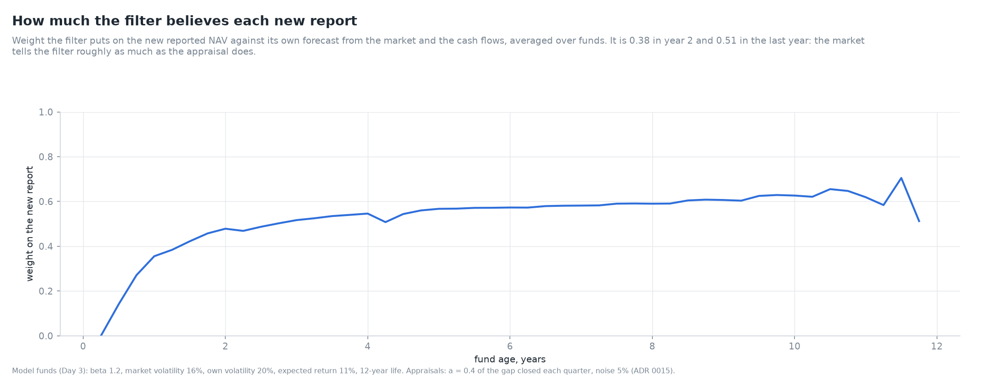

# Nowcasting fund values: the Kalman filter on stale, noisy NAVs

*Day 5 of 10 · private-markets-lab v0.5.0 · model funds, no proprietary data*

## Summary

A private fund's reported NAV is an appraisal: late, partial and imprecise. When public markets
fall 25% in a quarter, the reported NAVs of buyout funds fall much less, and catch up over the
following year. An investor who needs today's value, for risk, for pacing new commitments, or to
price a secondary, has three observed inputs: the last reported NAV, the fund's cash flows and the
public market's return. This note combines them in a state-space model and estimates the true value
with the Kalman filter. Every method is scored against the true value of model funds from Day 3.

Findings (model funds with beta 1.2, appraisals closing 40% of the gap each quarter with 5% noise):

1. **The filter cuts the error by a quarter, the smoother by almost half.** Root-mean-square error
   against the true value: reported NAV 14.2%, Kalman filter 10.5%, Kalman smoother 8.1%.
2. **Rolling the last NAV forward with the market is worse than doing nothing.** The common shortcut
   (last report × beta × market return, plus flows) has an error of 19.2%. It applies the market
   move to a stale base and ignores the new report.
3. **After a crash, reported NAVs overstate.** In a quarter when the market falls 25%, the average
   reported NAV of 2,000 funds overstates the true value by 20%. The error stays above 2% for 10
   quarters. The filter's average error is 1.3% in that quarter.
4. **The filter's error bars are honest.** Its 90% intervals contain the true value 90.2% of the
   time and its 99% intervals 99.0%. Standardised errors have a standard deviation of 1.00.
5. **The parameters can be estimated.** Maximum likelihood on panels of 100 funds recovers the
   appraisal speed (0.399 against 0.40, sd 0.008), the beta (1.198 against 1.20, sd 0.045) and the
   appraisal noise (5.0%).
6. **One fund is not enough.** Estimated from a single fund, beta has a median of 1.49 and an
   interquartile range of 0.53. Pooling funds that share a strategy is necessary.
7. **Betas from reported NAVs are too low.** Regressing reported returns on the market gives 0.51
   (true 1.2), about a × beta. Adding four lags (Dimson 1979) overshoots, at 1.36. The state-space
   model gives 1.21. Without smoothing, the plain regression gives 1.20.
8. **Filtering helps most when appraisals are slow but precise.** Then the reported NAV can be
   unsmoothed: at a = 0.2 and 1% noise, the filter keeps only 18% of the reported NAV's error.
   Slow, noisy appraisals (a = 0.2, 15% noise) leave 91%. Fast, precise ones leave nothing to
   add (99%).
9. **The smoothing must be modelled; the market adds a little more.** A filter that assumes no
   smoothing (a = 1) has an error of 14.5%, no better than the reported NAV. One that ignores the
   market (beta = 0) has 12.0%, against 10.5% with the true beta.
10. **The filter weighs each new report and its own market forecast about equally.** It puts an
    average weight of 0.38 on the new report in year 2 and about 0.5 later.

Four new validation checks bring the suite to 35, all passing.

## 1. The question

Every quarter a fund manager reports a NAV. It is an estimate of what the fund's companies are
worth, produced by appraisal: comparable companies, recent transactions, discounted cash flows.
Three features make it a poor measure of today's value:

* **Lag.** Appraisals move only part of the way towards a new value each quarter. Managers wait for
  evidence (a transaction, a refinancing, an audited result) before they write a company up or down.
* **Noise.** Two appraisers would not agree. The NAV carries an error of its own.
* **Timing.** Reports arrive a quarter or more after the date they refer to. This note sets the
  reporting delay aside and treats each report as arriving at the end of its quarter.

The consequences reach every later day of this project. Smoothed NAVs understate risk and beta
(Day 6), bias performance measures (Day 7), and distort an investor's allocation when public
markets fall and private holdings appear to rise as a share of the portfolio: the
"denominator effect" (Day 8).

## 2. Literature

**Geltner (1993)** introduced the partial-adjustment model of appraisal for real estate and the
"unsmoothing" that inverts it. **Getmansky, Lo and Makarov (2004)** model smoothed hedge fund
returns as a moving average of true returns. **Dimson (1979)** showed that summing slope
coefficients on lagged market returns corrects betas for stale prices. **Woodward (2009)** and
**Ang, Chen, Goetzmann and Phalippou (2018)** estimate private equity returns with latent-variable
models. **Brown, Ghysels and Gredil (2023)** nowcast the NAVs of buyout and venture funds from
public-market returns and fund cash flows with a state-space model, which is the approach followed
here in a simpler form. The Kalman filter (**Kalman 1960**) and the Rauch-Tung-Striebel smoother
(**Rauch, Tung and Striebel 1965**) are standard; **Harvey (1989)** and **Durbin and Koopman (2012)**
cover state-space estimation by maximum likelihood.

## 3. The model

### 3.1 True value and reported NAV

The true value of the fund evolves with its own return and its cash flows:

  value_t = g_t · value_{t−1} + calls_t − distributions_t,
  log g_t = c + β · log m_t + σ · e_t,

where m_t is the market's growth factor in quarter t and e_t is standard normal. This is the Day 3
stochastic model, rewritten so that the market return enters directly.

The appraisal closes a share a of the gap between the true value and last quarter's report, after
the quarter's cash flows, with an error:

  reported_t = a · value_t + (1 − a) · (reported_{t−1} + calls_t − distributions_t) + ε_t,

with ε_t normal and a standard deviation of 5% of the appraiser's anchor (ADR 0015).

| Parameter | Meaning | Base case |
|---|---|---|
| a | share of the gap closed each quarter | 0.40 |
| β | beta to the market | 1.2 |
| c | log growth a quarter with a flat market | 2.2% |
| σ | own volatility a quarter | 10% (20% a year) |
| obs | appraisal noise a quarter | 5% |

*Table 1. The model's parameters.*

### 3.2 The filter

Given the market return and the cash flows, the transition is linear in the true value and the
observation is linear in it too. The Kalman filter therefore runs in two steps each quarter:

* **predict** the true value from last quarter's estimate, the market return and the flows, with
  mean F_t·m_{t−1} + flows and variance F_t²(P + q(m² + P)), where F_t is the expected growth and
  q = e^{σ²} − 1;
* **update** with the new report: the gap between the report and what the prediction implies it
  should be is weighted by the Kalman gain.

The multiplicative shock makes the model non-Gaussian, so this is the best linear filter, built
from exact first and second moments, rather than an exact posterior. Section 5.1 shows its
uncertainty is nonetheless correctly sized.

### 3.3 Estimation

The parameters are chosen to maximise the likelihood of the reports given the filter's predictions,
on a panel of funds that share them (ADR 0016). One fund's 47 quarters are too few.

## 4. How good is the nowcast?

The single-fund chart shows the mechanism. In the crash quarter the true value falls to 79, the
reported NAV only to 91. The filter, which sees the market fall, estimates 77 with a 90% band of
63 to 91.

| Method | RMSE, % of true value | Mean error, % |
|---|---|---|
| Reported NAV | 14.2 | −1.9 |
| Market roll-forward | 19.2 | −4.0 |
| Kalman filter | 10.5 | +0.9 |
| Kalman smoother | 8.1 | +0.7 |

*Table 2. Errors against the true value, 2,000 funds in independent markets, years 2-10, where the
fund is worth more than 5 per 100 committed.*

The filter is the right tool for today's value; the smoother uses later reports too, so it serves
for reconstructing history (Day 6 uses it to measure true risk). The roll-forward shortcut does
worse than the stale NAV: it moves the stale base with this quarter's market, but the base's own
lag is not corrected and the new report is ignored.

| Quarter | Reported NAV | Roll-forward | Kalman filter | Kalman smoother |
|---|---|---|---|---|
| Crash quarter | +20.5% | −6.1% | +1.3% | +1.0% |
| One year later | +11.9% | +6.1% | +1.0% | +0.6% |
| Two years later | +10.9% | +7.5% | +0.5% | +0.5% |

*Table 3. Mean error across 2,000 funds of one vintage sharing a market path with a 25% fall in
year 6.*

This is the denominator effect in numbers. A year after the crash, the average reported NAV is
still 12% above the true value. An investor rebalancing on reported values would believe its
private allocation had grown, when in fact it had shrunk.

## 5. Can the nowcast be trusted?

### 5.1 Coverage

| Nominal coverage | 50% | 80% | 90% | 95% | 99% |
|---|---|---|---|---|---|
| Actual | 50.2% | 80.2% | 90.2% | 95.1% | 99.0% |

*Table 4. Share of true values inside the filter's intervals, 86,000 fund-quarters.*

### 5.2 Estimating the parameters

| Parameter | True | Mean estimate | Standard deviation |
|---|---|---|---|
| a | 0.40 | 0.399 | 0.008 |
| β | 1.20 | 1.198 | 0.045 |
| σ, a quarter | 0.100 | 0.099 | 0.003 |
| obs | 0.050 | 0.050 | 0.001 |

*Table 5. Maximum-likelihood estimates, 50 panels of 100 funds, each panel sharing one market path.*

| Funds in the panel | Median β | Interquartile range |
|---|---|---|
| 1 | 1.49 | 0.53 |
| 100 | 1.15 | 0.08 |

*Table 6. Beta estimates by panel size (10 panels each; 5 and 20 funds in the chart).*

### 5.3 The wrong parameters

| Filter assumes | RMSE |
|---|---|
| True parameters | 10.5% |
| No smoothing (a = 1) | 14.5% |
| No market exposure (β = 0) | 12.0% |
| Reported NAV, for comparison | 14.2% |

*Table 7. Filter error under misspecification.*

Most of the gain comes from modelling the appraisal's lag. The market forecast adds the rest. The
error curve is flat near the true values, so rough estimates are enough.

## 6. What smoothing does to beta

| Smoothing a | Reported returns | With 4 lags (Dimson) | State-space model |
|---|---|---|---|
| 0.4 | 0.51 | 1.36 | 1.21 |
| 1.0 | 1.20 | 1.17 | 1.21 |

*Table 8. Beta estimated three ways, true beta 1.2 (other rows in the chart).*

A regression on reported returns finds roughly a × β: the appraisal transmits only a share of each
market move in the same quarter. The Dimson correction adds back the lagged response but
overshoots, here to 1.36. The reason is that reported returns are measured on a stale base. After
the market rises, the reported NAV is below the true value, and the true gains are divided by a base
that is too small. Each additional lag adds more of this. The state-space model estimates the
appraisal process itself and avoids both biases.

## 7. When filtering helps

| a \ noise | 1% | 3% | 5% | 10% | 15% |
|---|---|---|---|---|---|
| 0.2 | 18% | | | | 91% |
| 1.0 | 99% | | | | 70% |

*Table 9. Filter error as a share of the reported NAV's error, corners of the grid (full grid in
the chart).*

The value of filtering depends on what is wrong with the appraisals. Slow, precise appraisals
are biased but informative: the filter can unsmooth them. Fast, noisy ones are unbiased but
imprecise: the filter averages them with the market forecast. Slow and noisy appraisals are the
hardest case. The filter must lean on the market forecast, and with own volatility of 20% a year,
the market explains only part of a fund's return.

The filter's weight on each new report rises from zero in the first quarter, when the state is
known from the call, to about 0.4 by year 2 and 0.5 later. Roughly half of each nowcast comes from
the market and the cash flows.

## 8. Validation

| Check | Reference | Result |
|---|---|---|
| Exact limit | no smoothing and no noise: the filter returns the true value | 2 × 10⁻¹⁶ |
| Coverage | 90% intervals, 64,500 fund-quarters | 90.1% |
| Parameter recovery | a = 0.4, β = 1.2, noise 5%, 200 funds | 0.400, 1.225, 0.050 |
| Smoother | equals the filter at the end; more accurate before | 8.0% vs 10.4% |

*Table 10. The four new checks; all 35 pass ([VALIDATION.md](../VALIDATION.md)).*

Eleven new tests cover the appraisal rule, the mapping from the simulator's parameters, the known
initial state, the likelihood's peak at the true smoothing, estimation, the shortcuts and the error
floor.

## 9. Limitations

* **Model funds.** No fund-level NAV data is freely available. The results show how the method
  behaves when its model is right. Real appraisal behaviour is less regular: speeds change with
  market conditions, and write-downs may be faster than write-ups.
* **One market factor** and a constant beta. Buyout funds load on small-cap value; venture funds on
  technology. Adding factors is straightforward in the model.
* **No reporting delay.** Real reports arrive one to two quarters late, which adds a pure forecast
  step to the filter.
* **Linear filter for a non-Gaussian model.** Coverage is correct here; with fatter tails it might
  not be.

## 10. What comes next

Day 6 uses the smoother's reconstructed values and Geltner and Getmansky-Lo-Makarov unsmoothing to
measure the risk that reported returns hide: volatility, beta, drawdowns and correlations.

## References

* Ang, A., Chen, B., Goetzmann, W. N. and Phalippou, L. (2018). Estimating private equity returns
  from limited partner cash flows. *Journal of Finance*, 73(4), 1751-1783.
* Brown, G. W., Ghysels, E. and Gredil, O. R. (2023). Nowcasting net asset values: The case of
  private equity. *Review of Financial Studies*, 36(3), 945-986.
* Dimson, E. (1979). Risk measurement when shares are subject to infrequent trading. *Journal of
  Financial Economics*, 7(2), 197-226.
* Durbin, J. and Koopman, S. J. (2012). *Time Series Analysis by State Space Methods*, 2nd ed.
  Oxford University Press.
* Geltner, D. (1993). Estimating market values from appraised values without assuming an efficient
  market. *Journal of Real Estate Research*, 8(3), 325-345.
* Getmansky, M., Lo, A. W. and Makarov, I. (2004). An econometric model of serial correlation and
  illiquidity in hedge fund returns. *Journal of Financial Economics*, 74(3), 529-609.
* Harvey, A. C. (1989). *Forecasting, Structural Time Series Models and the Kalman Filter*.
  Cambridge University Press.
* Kalman, R. E. (1960). A new approach to linear filtering and prediction problems. *Journal of
  Basic Engineering*, 82(1), 35-45.
* Rauch, H. E., Tung, F. and Striebel, C. T. (1965). Maximum likelihood estimates of linear dynamic
  systems. *AIAA Journal*, 3(8), 1445-1450.
* Woodward, S. E. (2009). Measuring risk for venture capital and private equity portfolios.
  Working paper, Sand Hill Econometrics.
