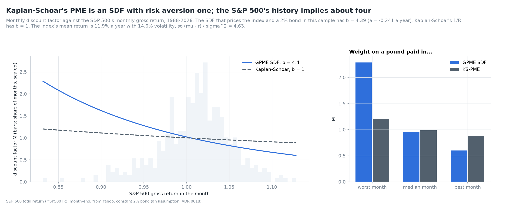
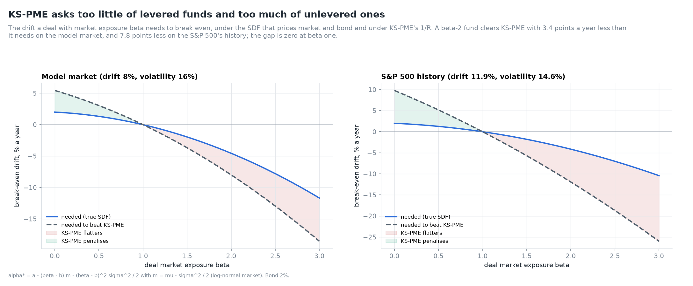
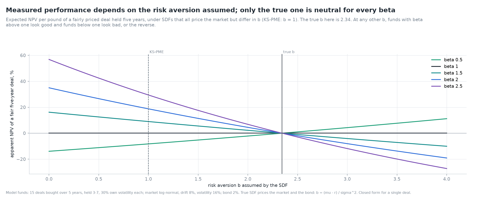
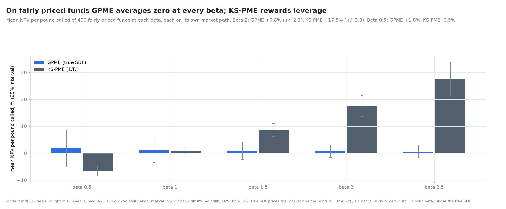
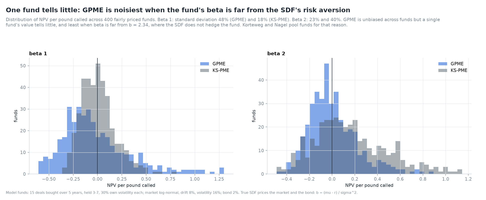
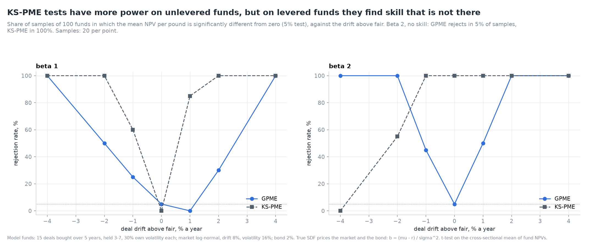
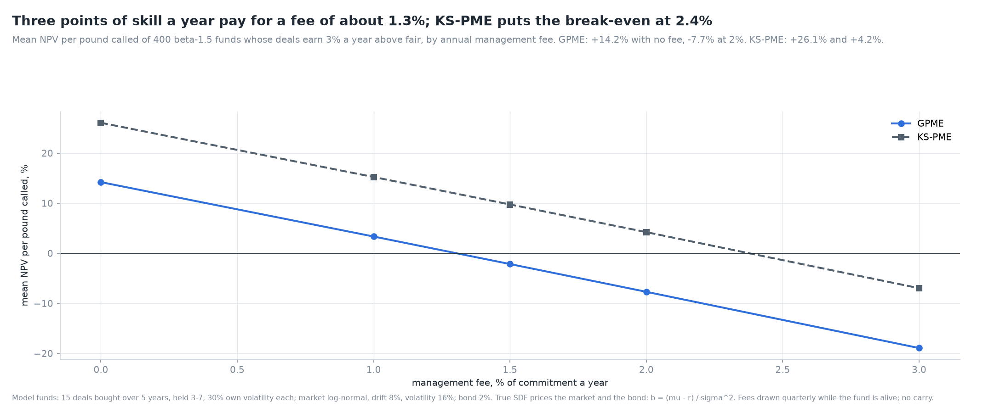
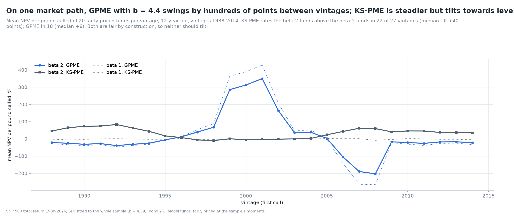
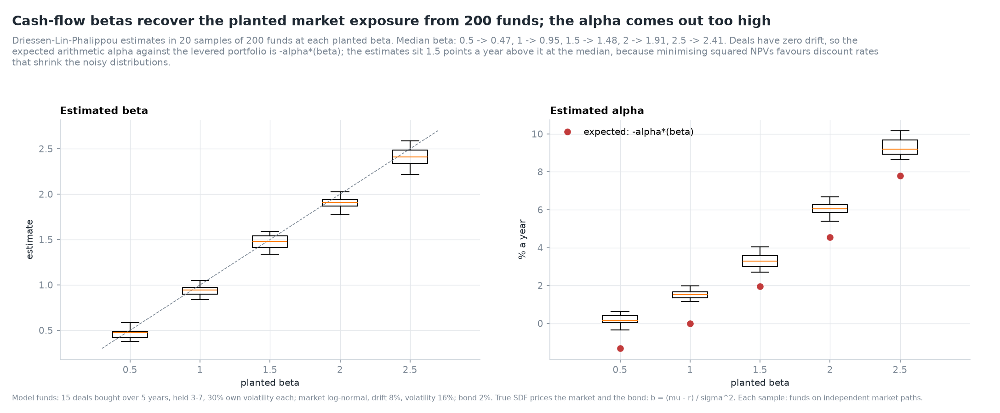
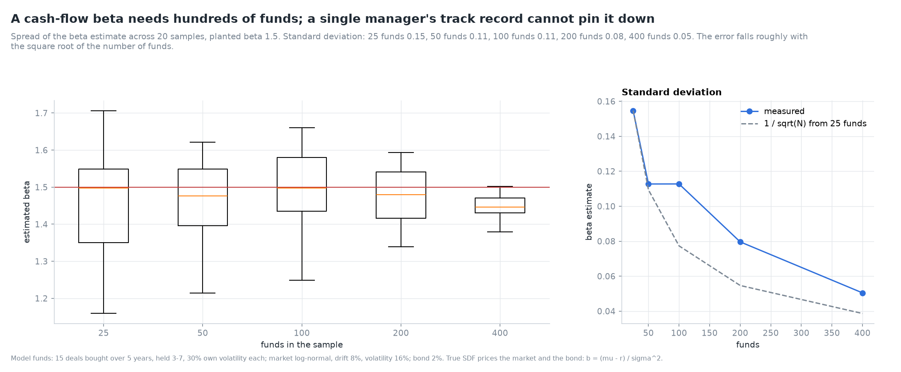

# Risk-adjusted performance with a stochastic discount factor

*Day 7 of 10 · private-markets-lab v0.7.0*

## Summary

The Kaplan-Schoar PME compares a fund with the public market by compounding its cash flows at
the index. It is the industry's standard measure, and Day 1 showed that it says nothing about
risk. A fund that borrows to double its market exposure will beat KS-PME in a rising market
without any skill. Korteweg and Nagel (2016) fix this with a stochastic discount factor (SDF).
They value the fund's cash flows with an SDF that prices both the market and the risk-free asset,
and call the result the generalised PME (GPME). KS-PME is a special case of this SDF: risk
aversion one and a zero time-discount term.

This note implements GPME and the cash-flow beta of Driessen, Lin and Phalippou (2012). Both are
tested on model funds whose true risk-adjusted value is known. Fund-level cash flows are licensed
(Burgiss, Preqin, Cambridge Associates), so no real fund is measured. The real S&P 500 history is
used only to calibrate the SDF and as one market path.

Findings:

1. **KS-PME is an SDF with risk aversion one.** The SDF that prices the S&P 500 total return and a
   2% bond over 1988-2026 has b = 4.39, from a mean return of 11.9% and volatility of 14.6%.
2. **KS-PME misprices any fund whose beta is not one.** On the S&P 500's history, a beta-2 deal
   needs a drift of −4.1% a year to be fair, but it clears KS-PME at −11.9%. That is 7.8 points a
   year of credit for leverage. On the model market (drift 8%, volatility 16%) the gap is 3.4
   points. Unlevered funds are penalised by the same logic.
3. **On fairly priced model funds, GPME averages zero at every beta; KS-PME does not.** At beta 2,
   the mean GPME per pound called is +0.8% (±2.3) and the mean KS-PME is +17.5% (±3.9). At beta
   0.5 they are +1.8% and −6.5%.
4. **A single fund's GPME is noisy,** and noisiest when the fund's beta is far from the SDF's risk
   aversion. The standard deviation across funds is 48% at beta 1 and 23% at beta 2, where b = 2.34.
5. **On one market path, GPME swings by hundreds of points between vintages.** With b = 4.4 on
   the S&P 500, the 1999-2001 vintages score about +300% and the 2007-2008 vintages about −200%. KS-PME is
   steadier, but it rates the beta-2 funds above the beta-1 funds in 22 of 27 vintages (median
   tilt +40 points). GPME does so in 18 (median +6). Both sets of funds are fair by construction.
6. **Cash-flow betas recover the planted beta from 200 funds** (median 0.47, 0.95, 1.48, 1.91 and
   2.41 for planted 0.5 to 2.5). The alpha comes out about 1.5 points a year too high. The spread
   of the beta estimate falls roughly with the square root of the number of funds, from 0.15 with
   25 funds to 0.05 with 400.
7. **Testing for skill with KS-PME finds skill that is not there in levered funds.** In samples
   of 100 beta-2 funds without skill, a 5% test on the mean KS-PME rejects in 100% of samples;
   on the mean GPME, in 5%.
8. **Fees:** three points of skill a year pay for a management fee of about 1.3% on a beta-1.5
   fund. KS-PME puts the break-even at 2.4%.

## 1. The stochastic discount factor

### 1.1 Valuing cash flows

An SDF M(0, t) values any payoff X_t at date 0 as E[M(0, t) X_t]. For a fund with calls C_t and
distributions D_t, the net present value is

    NPV = E[ Σ_t M(0, t) (D_t − C_t) ],

and zero means that the fund earned exactly the reward for its risk. The SDF must price the
alternatives open to the investor: here, the public market index I and a risk-free bond at rate r.

Korteweg and Nagel use the exponential-affine form

    M(0, t) = exp(−a t − b ln(I_t / I_0)).

Here b is the investor's relative risk aversion: the SDF is high in states where the market has
fallen. The term a discounts time. The two parameters are pinned down by two conditions: the SDF
must price one unit of the market at one, and the bond at exp(−rt).

### 1.2 The log-normal case

If the index is log-normal with arithmetic drift μ and volatility σ, and m = μ − σ²/2, the two
conditions give

    b = (μ − r) / σ²,   a = r − b m + b² σ² / 2.

On the model market (μ = 8%, σ = 16%, r = 2%), b = 2.34 and a = −6.7% a year.

### 1.3 Kaplan-Schoar as an SDF

KS-PME compounds every flow at the index, which is the same as discounting with M = I_0 / I_t:
a = 0 and b = 1. This SDF prices the market exactly. It prices the bond only if μ − r = σ²,
that is, if the market's risk premium equals its variance. With a 6% premium and 16% volatility the
premium is more than twice the variance; on the S&P 500 it is more than four times. The
implementation checks the special case: `gpme.pme_ratio` with a = 0 and b = 1 equals
`pme.ks_pme` to 3e-16 on five model funds.

### 1.4 Estimating the SDF from data

`SDF.fit` chooses a and b so that the sample averages of the SDF price the index's monthly
returns and the bond exactly:

- mean(M) = exp(−r Δt) gives a for each b;
- b then solves mean(M · R) = 1 by root finding.

**Table 1. SDFs used in this note**

| SDF | a, a year | b | Prices the market | Prices the bond |
|---|---:|---:|:---:|:---:|
| Kaplan-Schoar | 0 | 1 | yes | only if μ − r = σ² |
| Model market, log-normal | −0.067 | 2.34 | yes | yes |
| S&P 500 1988-2026, log-normal fit | −0.253 | 4.63 | yes | yes |
| S&P 500 1988-2026, sample moments | −0.241 | 4.39 | yes (in sample) | yes (in sample) |

The S&P 500's b is high because its sample Sharpe ratio is high: a 9.9-point excess return with
14.6% volatility. Korteweg and Nagel report smaller values for their sample and also estimate b
jointly with the funds. Here r is a constant 2% (ADR 0018). A higher r lowers b; at r = 3%,
b = (0.119 − 0.03) / 0.0214 ≈ 4.2.

## 2. What KS-PME gets wrong

### 2.1 The break-even drift

The model fund's deals are worth K (I_t / I_e)^β exp(α (t − t_e)) at time t. The drift α* at
which such a deal has price one under an SDF (a, b) is

    α*(β) = a − (β − b) m − (β − b)² σ² / 2.

Under the SDF that prices both market and bond, this simplifies to α*(β) = (1 − β)(r + β σ²/2).
Two facts follow:

- α* is zero at β = 1, so a fund that holds the market earns no abnormal return;
- for β > 1, α* is negative. A power of the index is convex, so it earns more than β times the
  market's return. A levered fund with zero α* therefore beats a levered portfolio on average.

Under KS-PME's SDF, α*_KS(β) = −(β − 1) m − (β − 1)² σ²/2.

**Table 2. Break-even drift, % a year, by market exposure**

| Beta | Model: true SDF | Model: KS-PME | S&P 500: true SDF | S&P 500: KS-PME |
|---:|---:|---:|---:|---:|
| 0 | +2.00 | +5.44 | +2.00 | +9.79 |
| 0.5 | +1.32 | +3.04 | +1.27 | +5.16 |
| 1 | 0 | 0 | 0 | 0 |
| 1.5 | −1.96 | −3.68 | −1.80 | −5.70 |
| 2 | −4.56 | −8.00 | −4.14 | −11.93 |
| 2.5 | −7.80 | −12.96 | −7.02 | −18.70 |
| 3 | −11.68 | −18.56 | −10.43 | −26.01 |

KS-PME asks too little of levered funds and too much of unlevered ones. A buyout fund with
beta 1.5 is credited with 1.7 points a year on the model market and 3.9 points on the S&P 500's
history. A bond (beta 0) must beat 9.8% a year to clear KS-PME on the S&P 500's history, though
it is fairly priced at 2%.

### 2.2 The family of SDFs that price the market

KS-PME is one member of a family: every b with a = (1 − b) m + (1 − b)² σ²/2 prices the market
exactly. Only one member, the true b, also prices the bond, and only that member is neutral for
every beta. At any other b, funds with beta above one look good and funds below one look bad, or
the reverse. A beta-1 fund looks fair under all of them.

## 3. Simulated funds

### 3.1 Design

Each fund is the Day 1 deal-built fund: 15 deals bought over five years and held three to seven,
each with 30% own volatility a year. Each runs on its own log-normal market path. A fund is
"fairly priced" when its deals' drift equals α*(β) under the true SDF. Its true expected NPV is
then zero. GPME is reported as Korteweg and Nagel define it: NPV per pound called.

The ratio of discounted distributions to discounted calls, the form KS-PME is usually quoted in,
is not used for averages. The mean of a ratio is biased: on the same funds, the mean ratio under
the true SDF was 0.91-0.99 instead of one. NPV is linear in the flows, so its mean is unbiased.

### 3.2 Bias by beta

**Table 3. Mean NPV per pound called of 400 fairly priced funds (95% interval)**

| Beta | GPME | KS-PME | GPME sd | KS-PME sd |
|---:|---:|---:|---:|---:|
| 0.5 | +1.8% (±6.9) | −6.5% (±1.9) | 71% | 20% |
| 1.0 | +1.3% (±4.8) | +0.7% (±1.7) | 48% | 18% |
| 1.5 | +1.0% (±3.2) | +8.6% (±2.4) | 32% | 24% |
| 2.0 | +0.8% (±2.3) | +17.5% (±3.9) | 23% | 40% |
| 2.5 | +0.6% (±2.4) | +27.5% (±6.3) | 24% | 64% |

GPME is within its interval of zero at every beta. KS-PME is unbiased only at beta one, and its
error grows by 8-10 points of NPV for every half point of beta.

### 3.3 Noise

The standard deviations in Table 3 show what a single fund's number is worth. Under GPME the noise
is smallest near beta 2 and largest at beta 0.5. The SDF multiplies payoffs by
(I_t / I_0)^(−b). When the fund's own exposure β is close to b, the two nearly cancel and the
discounted payoff is almost constant. When β is far from b, the SDF's weight on bad states
dominates. KS-PME's SDF has b = 1, so its noise is smallest at beta one. One fund's GPME is
therefore weak evidence of anything. Korteweg and Nagel pool funds, and their tests are on
portfolios.

### 3.4 Testing for skill

**Table 4. Share of samples of 100 funds rejecting "no abnormal return" at 5% (20 samples each)**

| Beta | Drift above fair | GPME | KS-PME |
|---:|---:|---:|---:|
| 1 | −2% | 50% | 100% |
| 1 | 0 | 5% | 0% |
| 1 | +2% | 30% | 100% |
| 2 | −2% | 100% | 55% |
| 2 | 0 | 5% | 100% |
| 2 | +2% | 100% | 100% |

At beta one KS-PME is the more powerful test, because its noise is lower there and it is not
biased. At beta two it finds skill in every sample of funds that have none. It also misses
negative skill in nearly half the samples, because the leverage reward hides the loss. GPME has
the right size at both betas. With only 20 samples per row, the rejection rates are accurate to
roughly ±10 points.

### 3.5 Fees

**Table 5. Beta-1.5 funds with deals earning 3% a year above fair, by management fee**

| Fee, % of commitment a year | GPME | KS-PME |
|---:|---:|---:|
| 0 | +14.2% | +26.1% |
| 1.0 | +3.4% | +15.2% |
| 1.5 | −2.1% | +9.8% |
| 2.0 | −7.7% | +4.2% |
| 3.0 | −18.9% | −7.0% |

The fee at which the investor breaks even is about 1.3% under GPME and 2.4% under KS-PME. At the
common 2% fee, the investor in this fund earns 7.7% of called capital less than a fair investment
would. KS-PME says they earn 4.2% more. The fee here is drawn on commitment over the fund's life,
and there is no carry (Day 2 models carry).

## 4. The S&P 500's actual path

The model funds are placed on the S&P 500 total-return path, one vintage per year from 1988 to
2014, with a 12-year life. Twenty funds per vintage are drawn at beta 1 and at beta 2, each fairly
priced at the sample's moments. GPME uses the SDF fitted to the full sample (b = 4.39).

On a single path the vintages are not independent draws. The fitted SDF has b = 4.4 and
a = −0.24, so M(0, t) = exp(0.24 t) (I_t / I_0)^(−4.4). It grows with time and is very large
wherever the index is no higher than at the vintage's start.

- The 1999-2001 vintages distributed in 2005-2012, when the index was near its 1999-2000 level, so
  their distributions carry weights of ten or more. Their GPME is about +300%.
- The 2007-2008 vintages called capital in the crash, when M was large. They distributed after the
  long rise from 2009, when M was small, and score about −200%.

These swings are what an SDF with high risk aversion does on one history. They are not evidence
of skill. They are why Korteweg and Nagel estimate GPME on pooled cross-sections of vintages.

KS-PME varies far less across vintages, but it is biased. It rates the beta-2 funds above the
beta-1 funds in 22 of 27 vintages, with a median tilt of +40 points. GPME does so in 18, with a
median tilt of +6. Both sets are fair by construction, so neither measure should tilt. On this
history GPME tilts much less.

## 5. Cash-flow betas

### 5.1 The estimator

Driessen, Lin and Phalippou (2012) estimate a fund population's alpha and beta from cash flows
alone. Each flow is discounted at the compounded return of a portfolio holding β in the market and
1 − β in the bond, plus α a year. The pair (α, β) is chosen to make the funds' NPVs per pound
called as close to zero as possible, by minimising their mean square. `gpme.cashflow_beta`
implements this with a Nelder-Mead search.

### 5.2 Recovery

**Table 6. Median estimates in 20 samples of 200 funds (deal drift zero)**

| Planted beta | Median beta | Expected arithmetic alpha, % | Median alpha, % |
|---:|---:|---:|---:|
| 0.5 | 0.47 | −1.3 | +0.2 |
| 1.0 | 0.95 | 0.0 | +1.5 |
| 1.5 | 1.48 | +2.0 | +3.3 |
| 2.0 | 1.91 | +4.6 | +6.0 |
| 2.5 | 2.41 | +7.8 | +9.2 |

The expected alpha is not zero. A deal worth (I_t / I_e)^β earns (β − 1)(r + β σ²/2) a year more
than a portfolio rebalanced to beta β, which is −α*(β) from Section 2. The beta is recovered to
within 0.1. The alpha is about 1.5 points too high at every beta. Minimising squared NPVs favours
higher discount rates, because they shrink the noisy, right-skewed distributions and so the squared
errors. Driessen, Lin and Phalippou reduce the problem by pooling funds into vintage portfolios
before squaring. That is not done here.

### 5.3 How many funds

**Table 7. Spread of the beta estimate, planted beta 1.5 (20 samples each)**

| Funds | 25 | 50 | 100 | 200 | 400 |
|---|---:|---:|---:|---:|---:|
| Standard deviation | 0.15 | 0.11 | 0.11 | 0.08 | 0.05 |

The error falls roughly with the square root of the number of funds. A manager with five funds
cannot estimate its beta from cash flows; a database of hundreds can.

## 6. A bug found on the way

`cashflows.irr_roots`, from Day 1, looked for "touching" roots, where the NPV reaches zero without
crossing it. It reported any grid point where |NPV| was below 10⁻¹² of the stream's size. Its
docstring says it should report local minima. At very high rates every NPV is discounted towards
zero, so the scan reported spurious roots. Hypothesis found the stream (0, 0, 0, 0, 2, −28, 24)
with a one-year shift, which gave a third root at 1,208%. The fix requires a local minimum of
|NPV| with no sign change beside it. The failing case is now a fixed example in the test. The same
run found that the property tests' generators produced denormal amounts (5 × 10⁻³²⁴), which are
not cash flows and break numpy-financial. The generators now exclude them.

## 7. Limits

- **No real fund data.** Every fund is a model fund. The results describe the measures, not the
  industry.
- **A constant 2% bond rate.** The SDF's b depends on it (ADR 0018).
- **Log-normal markets in the simulations.** The S&P 500 path is used once, as a single history.
- **The SDF is fixed in advance.** Korteweg and Nagel estimate it jointly with the fund
  cross-section by GMM and report standard errors that account for overlapping fund lives. This
  note does neither.
- **Cash-flow alphas are biased upwards** by the squared-NPV objective (Section 5.2).

## References

- Driessen, J., Lin, T.-C. and Phalippou, L. (2012). A new method to estimate risk and return of
  non-traded assets from cash flows: the case of private equity funds. *Journal of Financial and
  Quantitative Analysis* 47, 511-535.
- Kaplan, S. and Schoar, A. (2005). Private equity performance: returns, persistence, and capital
  flows. *Journal of Finance* 60, 1791-1823.
- Korteweg, A. and Nagel, S. (2016). Risk-adjusting the returns to venture capital. *Journal of
  Finance* 71, 1437-1470.
- Sorensen, M. and Jagannathan, R. (2015). The public market equivalent and private equity
  performance. *Financial Analysts Journal* 71(4), 43-50.
