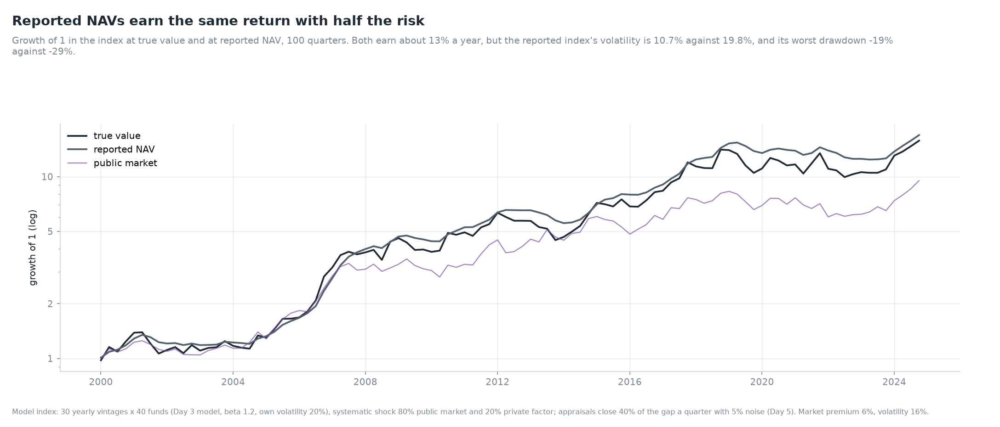
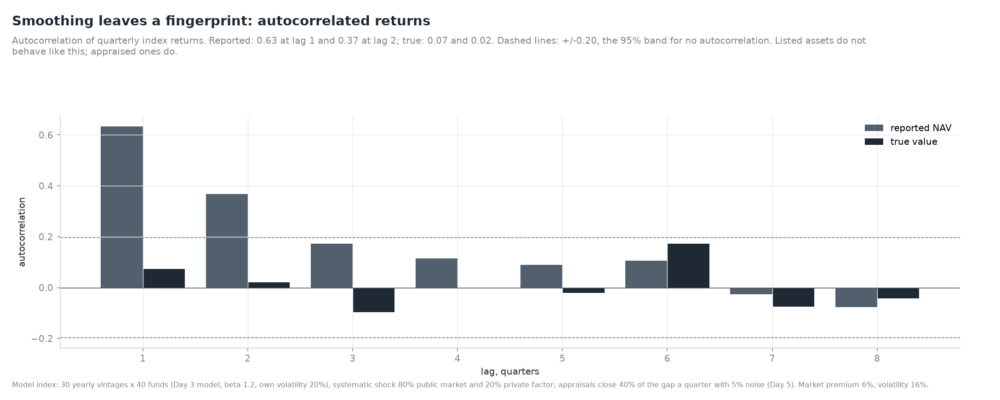
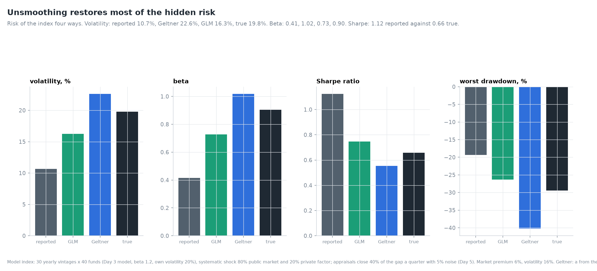
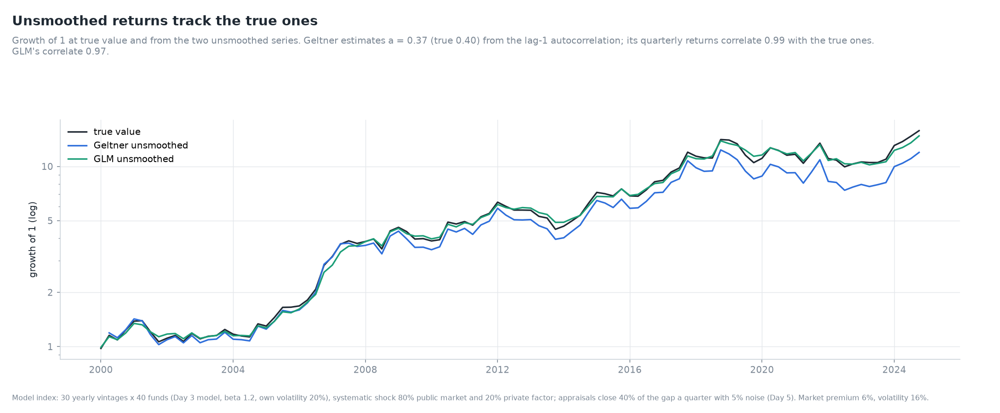
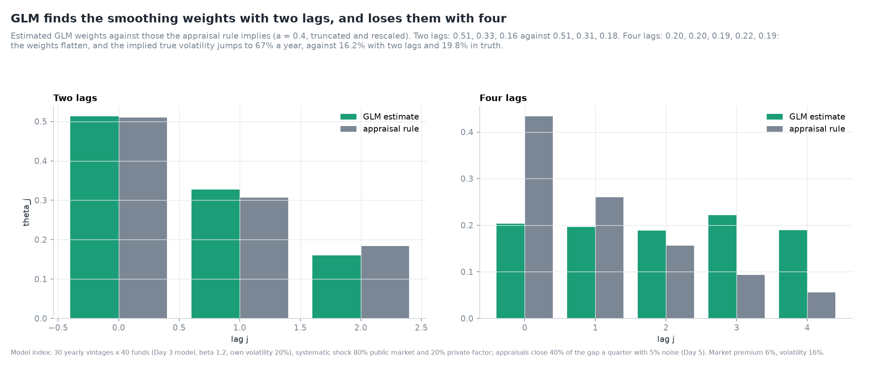
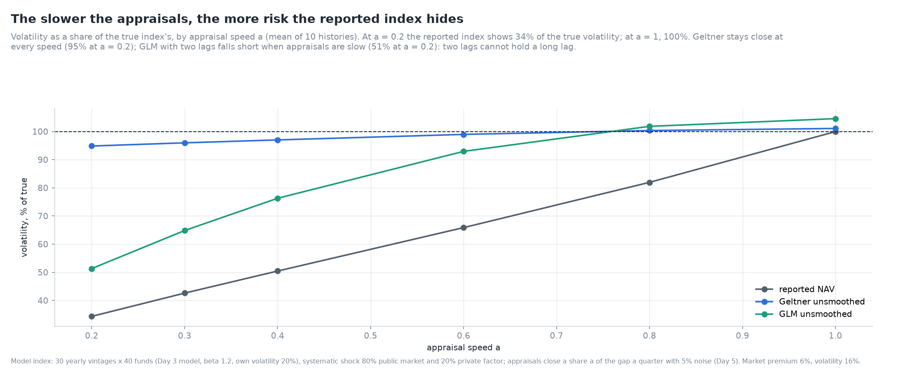
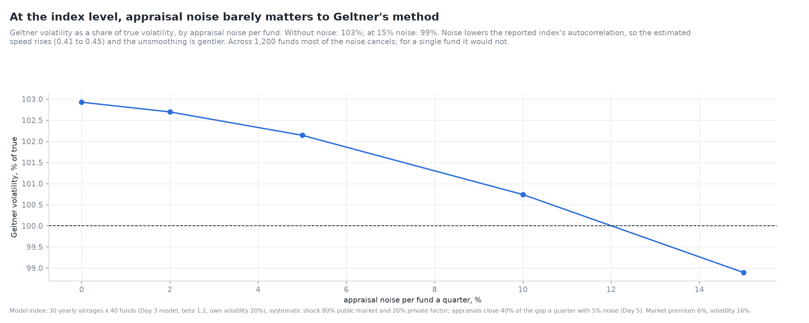
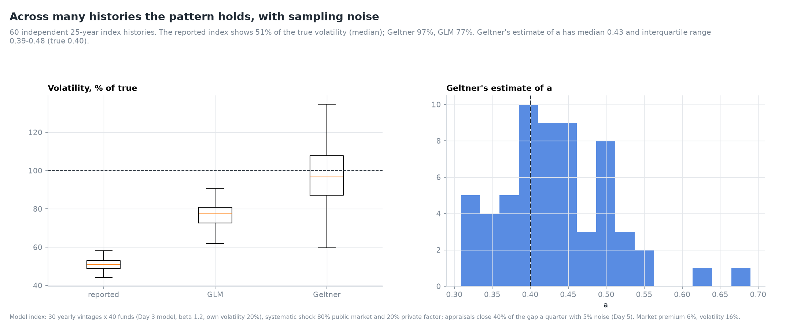
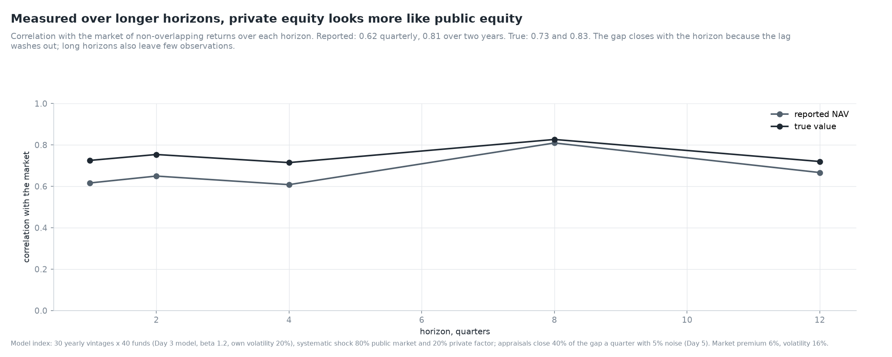
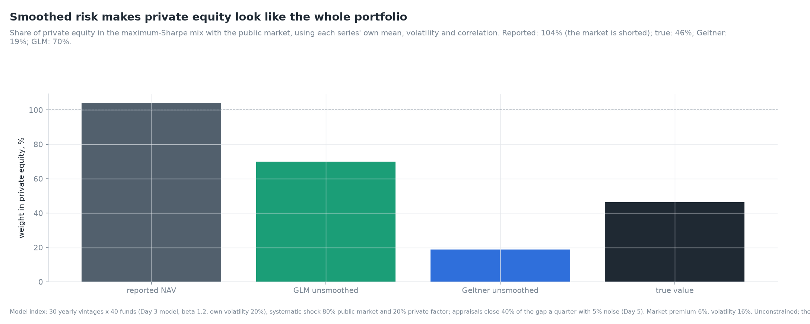

# Smoothed returns and hidden risk

*Day 6 of 10 · private-markets-lab v0.6.0 · a model index, no proprietary data*

## Summary

Private equity indices built from reported NAVs look like a superior asset: equity-like returns
with bond-like volatility, low correlation with public markets, and shallow drawdowns. Much of that
is an artefact of appraisal smoothing (Day 5). This note builds a model private equity index whose
true returns are known, measures what smoothing hides, and tests the two standard corrections:
Geltner's (1993) unsmoothing and the moving-average model of Getmansky, Lo and Makarov (2004,
"GLM").

Findings (model index, 100 quarters, appraisals closing 40% of the gap a quarter):

1. **The reported index shows half the risk for the same return.** Both earn about 13% a year,
   but reported volatility is 10.7% against 19.8%. The worst drawdown is −19% against −29%.
2. **Beta and Sharpe ratio are badly wrong.** Reported beta is 0.41 against a true 0.90. The
   reported Sharpe ratio is 1.12 against a true 0.66.
3. **Smoothing leaves a fingerprint.** Reported returns have autocorrelations of 0.63 at lag 1 and
   0.37 at lag 2. True returns have 0.07 and 0.02.
4. **Geltner restores the risk.** Its volatility is 22.6% (true 19.8%) and its beta 1.02 (true
   0.90). Its quarterly returns correlate 0.99 with the true ones. Over 60 histories its volatility
   is a median 97% of the truth.
5. **GLM with two lags finds the smoothing weights but understates risk.** Its weights, 0.51, 0.33
   and 0.16, match the appraisal rule's 0.51, 0.31 and 0.18. But two lags cannot hold the whole of a
   slow appraisal's memory, so its volatility is 16.3%, a median 77% of the truth.
6. **With four lags, GLM breaks down.** The weights flatten to about 0.2 each and the implied
   volatility jumps to 67%. On 25 years of quarterly data the extra lags are not identified.
7. **The slower the appraisal, the more risk is hidden.** At a = 0.2 the reported index shows 34%
   of the true volatility; at a = 1, all of it. Geltner stays close at every speed (95% at
   a = 0.2). GLM(2) falls to 51%.
8. **At the index level, appraisal noise barely matters.** Geltner's volatility goes from 103% of
   the truth without noise to 99% with 15% noise per fund. Noise lowers the index's
   autocorrelation, so the estimated speed rises and the unsmoothing is gentler.
9. **Correlation recovers with the horizon.** Quarterly, the reported index correlates 0.62 with
   the market (true 0.73). Over two years, 0.81 (true 0.83).
10. **Smoothed risk distorts allocation.** The maximum-Sharpe mix of private equity and the public
    market puts 104% in private equity on reported numbers (shorting the market), and 46% on true
    numbers.

Four new validation checks bring the suite to 39, all passing.

## 1. The question

An investor deciding how much to hold in private equity needs its risk: volatility, beta,
correlation with the rest of the portfolio, and how deep it can fall. The only regular data are
quarterly index returns built from reported NAVs. Day 5 showed that each fund's reported NAV lags
its true value. Aggregated into an index, the lag becomes:

* **autocorrelation:** this quarter's reported return contains part of last quarter's true return;
* **understated volatility:** each reported return is an average of several true returns;
* **understated beta and correlation:** the market's move in a quarter is only partly reported in
  that quarter;
* **overstated Sharpe ratios and shallow drawdowns.**

These biases matter for every allocation decision built on index data, which is most of them.

## 2. Literature

**Geltner (1993)** introduced partial-adjustment unsmoothing for real estate appraisal indices.
**Getmansky, Lo and Makarov (2004)** model observed returns as a moving average of true returns,
with weights summing to one, and estimate them by maximum likelihood. They show that smoothing
raises measured Sharpe ratios by roughly 1/√ξ, where ξ is the sum of the squared weights.
**Lo (2002)** corrects Sharpe ratios for autocorrelation. **Asness, Krail and Liew (2001)** show
that hedge fund betas rise when lagged market returns are added (the Dimson correction). **Woodward
(2009)** and **Ang, Chen, Goetzmann and Phalippou (2018)** estimate private equity risk from cash
flows and find betas well above those of reported returns. **Couts, Gonçalves and Rossi (2020)**
show how unsmoothing changes the measured risk of private real estate funds.

## 3. A model index

Real index returns cannot be checked against the truth, so the note builds an index whose true
returns are known (ADR 0017):

| Feature | Setting |
|---|---|
| Funds | 30 yearly vintages × 40 funds, Day 3 model (beta 1.2, own volatility 20%, expected return 11%) |
| Systematic shock | 80% public market, 20% a private factor common to all funds |
| Appraisals | Day 5 rule: close a = 0.4 of the gap each quarter, 5% noise |
| Index return | Σ(value − calls + distributions) / Σ opening value − 1, true and reported |
| Sample | 100 quarters, labelled 2000-2024, once five vintages are running |
| Public market | 6% premium, 16% volatility |

*Table 1. The model index.*

## 4. What smoothing hides

| | Mean, % | Volatility, % | Sharpe | Beta | Correlation | Worst drawdown, % | Lag-1 autocorrelation |
|---|---|---|---|---|---|---|---|
| True | 13.0 | 19.8 | 0.66 | 0.90 | 0.73 | −29 | 0.07 |
| Reported | 12.0 | 10.7 | 1.12 | 0.41 | 0.62 | −19 | 0.63 |
| Geltner | 12.5 | 22.6 | 0.55 | 1.02 | 0.72 | −40 | 0.04 |
| GLM, two lags | 12.2 | 16.3 | 0.75 | 0.73 | 0.71 | −26 | 0.05 |

*Table 2. Risk of the index four ways, annualised.*

The reported index has the same return with half the volatility and less than half the beta. Its
Sharpe ratio is 70% too high. Its worst drawdown is two thirds of the true one. In this history,
Geltner overshoots in the other direction: 14% too much volatility and a drawdown of −40%. The
next sections show this is sampling noise. Across many histories Geltner is close to unbiased.

## 5. The corrections

### 5.1 Geltner

If reported returns follow r_obs_t = a·r_t + (1 − a)·r_obs_{t−1}, the true return is
(r_obs_t − (1 − a)·r_obs_{t−1}) / a. The lag-1 autocorrelation of reported returns estimates 1 − a.
Here it gives a = 0.37 against the true 0.40.

### 5.2 GLM

GLM assumes r_obs_t = θ₀·r_t + θ₁·r_{t−1} + ... + θ_k·r_{t−k}, with the θs summing to one. It
estimates them by maximum likelihood as a moving average. The appraisal rule implies geometrically
declining weights, a(1 − a)^j. Truncated at two lags, those are 0.51, 0.31 and 0.18.

| | θ₀ | θ₁ | θ₂ | θ₃ | θ₄ | Implied true volatility |
|---|---|---|---|---|---|---|
| Appraisal rule, 2 lags | 0.51 | 0.31 | 0.18 | | | |
| GLM, 2 lags | 0.51 | 0.33 | 0.16 | | | 16.2% |
| GLM, 4 lags | 0.20 | 0.20 | 0.19 | 0.22 | 0.19 | 67% |

*Table 3. GLM weights. True volatility 19.8%.*

With two lags GLM finds the weights almost exactly. But the appraisal's memory is longer than two
quarters, so the remaining smoothing is attributed to the true returns, and their volatility is
understated. With four lags the likelihood is nearly flat. The estimate puts equal weight on every
lag, which implies an implausible true volatility. On 100 quarters, GLM needs to be kept short.

## 6. When the corrections work

| Appraisal speed a | 0.2 | 1.0 |
|---|---|---|
| Reported, % of true volatility | 34 | 100 |
| Geltner | 95 | close to 100 (chart) |
| GLM, two lags | 51 | close to 100 (chart) |

*Table 4. Volatility as a share of the true index's, mean of 10 histories; the chart shows every speed.*

| Over 60 histories | Median | |
|---|---|---|
| Reported volatility, % of true | 51% | |
| Geltner volatility, % of true | 97% | |
| GLM(2) volatility, % of true | 77% | |
| Geltner's estimate of a | 0.43 | interquartile range 0.39-0.48 (true 0.40) |

*Table 5. Robustness across independent 25-year histories.*

Geltner works well here because its assumption is the model's: the appraisal rule is exactly
partial adjustment. In real data the appraisal process is unknown and may vary over time, and
the estimated a carries sampling error. A 25-year index gives an interquartile range of 0.39-0.48
around the true 0.40.

## 7. Consequences

### 7.1 Correlation and horizon

| Horizon | 1 quarter | 2 years |
|---|---|---|
| Reported | 0.62 | 0.81 |
| True | 0.73 | 0.83 |

*Table 6. Correlation with the public market over non-overlapping horizons.*

Over long horizons the lag washes out and the reported index's correlation approaches the true one.
Low quarterly correlation is a measurement artefact rather than diversification. The longer
horizons rest on few observations: 12 two-year periods.

### 7.2 Allocation

| Risk estimates from | Private equity in the maximum-Sharpe mix |
|---|---|
| Reported index | 104% |
| GLM, two lags | 70% |
| True index | 46% |
| Geltner | 19% |

*Table 7. Unconstrained maximum-Sharpe weight in private equity, with the public market.*

On reported numbers the optimiser wants more than the whole portfolio in private equity, financed
by shorting the market. Geltner, which overstates volatility in this history, swings to the other
side. Maximum-Sharpe weights are notoriously sensitive to their inputs, and smoothing is one of
the largest input errors an allocator faces. Day 8 returns to allocation with illiquidity
constraints.

## 8. Validation

| Check | Reference | Result |
|---|---|---|
| Geltner inversion | partial adjustment with a = 0.3, 400 periods | 6 × 10⁻¹⁷ |
| GLM recovery | planted weights 0.5, 0.3, 0.2, 4,000 periods | 0.497, 0.300, 0.203 |
| Index identity | no smoothing, no noise: reported = true | 0 |
| GLM identity | weights sum to one and re-smooth to the data | 3 × 10⁻¹⁷ |

*Table 8. The four new checks; all 39 pass ([VALIDATION.md](../VALIDATION.md)).*

Nine new tests cover the index, the private factor's effect on correlation, both methods, the
partial-adjustment weights, the risk table, horizon correlations and the tangency weight.

## 9. Limitations

* **A model index.** Real appraisal behaviour is less regular than the partial-adjustment rule. It
  varies over the cycle, and write-downs may be faster than write-ups. Geltner's good performance
  here is partly because its assumption is the model's.
* **No real index data.** Cambridge Associates, Burgiss and NCREIF data are licensed.
* **One private factor**, with a fixed share. Real private equity has several (size, sector,
  leverage).
* **Allocation** uses unconstrained maximum-Sharpe weights, the most input-sensitive choice there is.

## 10. What comes next

Day 7 measures private equity performance against public markets with a stochastic discount
factor: Korteweg and Nagel's generalised PME, which also accounts for the risk that Day 6 shows
reported returns hide.

## References

* Ang, A., Chen, B., Goetzmann, W. N. and Phalippou, L. (2018). Estimating private equity returns
  from limited partner cash flows. *Journal of Finance*, 73(4), 1751-1783.
* Asness, C. S., Krail, R. J. and Liew, J. M. (2001). Do hedge funds hedge? *Journal of Portfolio
  Management*, 28(1), 6-19.
* Couts, S., Gonçalves, A. S. and Rossi, A. (2020). Unsmoothing returns of illiquid funds.
  Working paper.
* Geltner, D. (1993). Estimating market values from appraised values without assuming an efficient
  market. *Journal of Real Estate Research*, 8(3), 325-345.
* Getmansky, M., Lo, A. W. and Makarov, I. (2004). An econometric model of serial correlation and
  illiquidity in hedge fund returns. *Journal of Financial Economics*, 74(3), 529-609.
* Lo, A. W. (2002). The statistics of Sharpe ratios. *Financial Analysts Journal*, 58(4), 36-52.
* Woodward, S. E. (2009). Measuring risk for venture capital and private equity portfolios.
  Working paper, Sand Hill Econometrics.
