# Venture capital as options: preferred stock, the exit waterfall, and why post-money valuations overstate

*Day 4 of 10 · private-markets-lab v0.4.0 · stylised companies, no proprietary data*

## Summary

A venture-backed company does not have "a share price". It has a stack of share classes. Each
round of financing creates a new class of convertible preferred stock with its own liquidation
preference, seniority and conversion right. The headline number, the **post-money valuation**,
takes the price the newest investors paid for the newest, most protected shares and multiplies it
by every share outstanding. That treats a share of common stock held by a founder as if it were worth
the same as a Series D preferred share that is paid back first in a sale. It is not.

This note builds the machinery to value every class properly and applies it to a stylised
late-stage company and to 200 random cap tables. The method is the option-pricing method (OPM) used
in practice for fund reporting and in the academic work of Gornall and Strebulaev (2020). Each
class's payoff at exit is a piecewise-linear function of the exit value. A lognormal exit value
turns each class into a portfolio of call options on the company.

The main findings, on the stated assumptions (volatility 90%, four years to exit, risk-free rate
4%):

1. **The headline overstates fair value by two thirds.** The stylised company raised Series D at
   $30 a share for a $3.0bn post-money valuation. The value that makes that $30 fair is $1.80bn:
   post-money is 66.6% above fair value.
2. **Common stock is worth 56% of the round price.** Founders' and employees' shares are worth
   $16.80, not $30. The early preferred classes (A and B) are worth almost exactly common. Series C
   is worth $17.98. Only Series D is worth $30, by construction.
3. **Conversion happens in order of preference per share.** Series A converts above an exit of
   $399m, B above $496m, C above $976m and D above $3.0bn. Below $240m, Series D
   takes everything.
4. **Investor-friendly terms raise the overstatement sharply.** With a 1.5x preference on Series D
   the overstatement is 136%; with 2x, 218%. Uncapped participation gives 128%, a 3x cap 116% and
   an 8% cumulative dividend 109%. Putting every round pari passu lowers it to 51%.
5. **Volatility has a hump.** The overstatement is 31% at 30% volatility, peaks near 79% at
   60-70%, and falls back to 31% at 140%. Very safe and very risky companies both make the
   preference matter less.
6. **Time to exit matters as much.** One year to exit gives 128%; ten years gives 23%. The longer
   the horizon, the more the expected exit outgrows the preferences.
7. **The overstatement does not depend on the round price.** Raising Series D at $10 or $60
   changes post-money and fair value in the same proportion. When the latest class is the most
   senior, its payoff scales with its price, so the overstatement measures the structure of the cap
   table, not the level of the valuation.
8. **Across 200 random companies, the median overstatement is 61%.** The 5th to 95th percentile
   range is 29% to 144%, and the extremes are 23% and 295%. A latest round with a multiple above 1x
   doubles the median (103% against 52%). So does participation (102% against 57%). A senior latest
   round has a median of 69%, against 39% for pari passu.
9. **The preference is a put on failure.** Series D is worth 4.8 times its pro rata share of the
   company if the company is worth $200m today, 66.6% more at fair value, and only 3% more at
   $20bn.
10. **Series D and common are different bets.** With a 20% expected growth rate, Series D loses
    money in 26% of exits, and common (bought at its fair value) in 67%. But common returns more than
    3x in 16% of exits, against 9% for Series D.
11. **The exact integral matches simulation.** Monte Carlo with 40,000 exits and a control variate
    agrees with the exact OPM integral within 1.6 standard errors for every class. The one-class case
    agrees with Black-Scholes to 3 × 10⁻⁷.

Six new validation checks bring the suite to 31, all passing.

## 1. The question

A press release says a company "raised $240m at a $3bn valuation". Two numbers are true: the
investors paid $240m, and they received 8m shares at $30 each. The third number is an
extrapolation. The company has 100m shares on a fully diluted basis, and 100m × $30 = $3bn. That
step assumes every share is worth $30.

Venture shares are not alike. The 8m Series D shares carry rights the other 92m do not have:

* a **liquidation preference**: in a sale, Series D gets its $240m back before anyone junior gets
  anything;
* **seniority** over Series A, B and C, whose preferences come next, in reverse order;
* the right to **convert** into common if the company does well, so Series D gives up nothing on
  the upside.

Series D has both the downside protection of debt and the upside of equity. Founders and
employees, who hold common, have only the upside, after everyone else is paid. A rational investor
pays more for the protected share. The $30 is a price for a protected share and says little,
directly, about the unprotected ones.

The question this note answers: **given the price and terms of the latest round, what is the
company actually worth, and what is each class of share worth?** It matters for:

* **funds**, which report portfolio companies at "fair value" (ASC 820, IFRS 13) and cannot simply
  mark at the last round price;
* **employees**, whose options are common stock; a 409A valuation in the US must value common
  separately;
* **anyone reading headlines**, since "unicorn" status (a $1bn post-money) may not survive a fair
  valuation.

## 2. Literature

Venture contracts have been studied since **Sahlman (1990)**, who described convertible preferred
stock as the standard instrument. **Kaplan and Strömberg (2003)** read 213 actual financing
contracts. They found that liquidation preferences, seniority, participation and anti-dilution
rights are common, and that cash-flow and control rights are separately allocated, as contracting
theory predicts. **Bengtsson and Sensoy (2015)** follow how these terms change across rounds within
a company. **Gompers and Lerner (2004)** give the broader institutional picture. **Metrick and
Yasuda (2010)** set out the valuation of venture preferred stock as options in textbook form, with
the "breakpoint" method used here.

The option view goes back to **Black and Scholes (1973)** and **Merton (1973)**, who noted that
corporate securities are options on the firm's value. **Ingersoll (1977)** valued convertible
securities this way: a convertible holder exercises the conversion option when it pays.

The practitioner standard is the **AICPA** valuation guides (AICPA 2013, 2019). They describe the
OPM, the probability-weighted expected return method and hybrids of the two. The OPM treats each
class as a call option spread over breakpoints, with a lognormal exit value and a volatility taken
from public comparables.

**Gornall and Strebulaev (2020)** apply the OPM to 135 US unicorns, using the terms in their
legal filings. They find that the reported post-money valuations were on average 48% above fair
value. Their measure of overvaluation, post-money over fair value minus one, is the one used here.
Their results depend on their assumptions, notably volatility and time to exit. This note shows how
strongly.

Volatility inputs are hard to pin down for private firms. **Cochrane (2005)** and **Korteweg and
Sorensen (2010)**, correcting for the selection bias in observed venture returns, estimate
volatilities for individual venture investments of the order of 90% a year. That is the base case
here. **Hall and Woodward (2010)** stress how skewed entrepreneurial payoffs are: most of the value
sits in rare large exits.

## 3. The exit waterfall

### 3.1 Securities

Each class of shares is described by:

| Term | Meaning | Base case |
|---|---|---|
| Shares | Millions of shares, as converted | 40, 10, 15, 15, 12, 8 |
| Issue price | What the round paid per share | $0.50, $2, $8, $30 for A-D |
| Multiple | Liquidation preference as a multiple of what was paid | 1x |
| Seniority | Higher ranks are paid first; equal ranks share pro rata | D > C > B > A |
| Participating | Takes its preference and also shares in the residual | No |
| Cap | Participation stops when the class has received this multiple | None |
| Cumulative dividend | Added to the preference each year until exit | 0% |
| Conversion ratio | Common shares received per preferred share | 1 |

*Table 1. The terms modelled. "Options" are treated as common: an option pool is equity once
exercised, and strike prices are left out for simplicity.*

### 3.2 The waterfall at one exit value

At an exit worth V, the money flows in two stages:

1. **Preferences.** Classes that have not converted are paid their preference, most senior first.
   Classes of equal rank share pro rata to what they are owed. If the money runs out, junior classes
   get nothing.
2. **Residual.** What remains is shared, as converted, among common, converted preferred and
   participating preferred. A participating class with a cap stops when it reaches its cap; the
   rest then share again.

A non-participating preferred class must choose: keep its preference, or convert to common and
share the residual. It converts when that pays more. The choices interact. When Series A converts,
its preference no longer has to be paid, which leaves more for the residual. But it also adds 15m
shares to the residual, which dilutes everyone else in it.

The model finds conversion as an **equilibrium** (ADR 0012). It starts from nobody converting.
Each class in turn switches if switching raises its own payout, until no class wants to change. Two
properties are checked on random cap tables: payouts add up exactly to V, and no class gains by
reversing its choice.

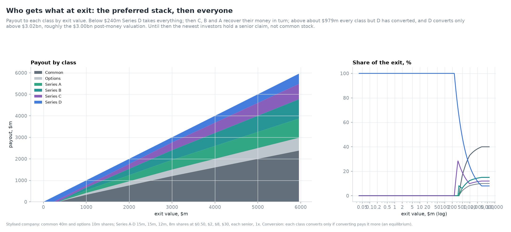

The waterfall for the base company:

| Exit value, $m | Common | Options | Series A | Series B | Series C | Series D | Converted |
|---|---|---|---|---|---|---|---|
| 100 | 0.0 | 0.0 | 0.0 | 0.0 | 0.0 | 100.0 | none |
| 250 | 0.0 | 0.0 | 0.0 | 0.0 | 10.0 | 240.0 | none |
| 400 | 20.9 | 5.2 | 7.8 | 30.0 | 96.0 | 240.0 | A |
| 500 | 82.0 | 20.5 | 30.7 | 30.7 | 96.0 | 240.0 | A, B |
| 750 | 207.0 | 51.8 | 77.6 | 77.6 | 96.0 | 240.0 | A, B |
| 1,000 | 330.4 | 82.6 | 123.9 | 123.9 | 99.1 | 240.0 | A, B, C |
| 2,000 | 765.2 | 191.3 | 287.0 | 287.0 | 229.6 | 240.0 | A, B, C |
| 3,000 | 1,200.0 | 300.0 | 450.0 | 450.0 | 360.0 | 240.0 | A, B, C |
| 5,000 | 2,000.0 | 500.0 | 750.0 | 750.0 | 600.0 | 400.0 | all |

*Table 2. Payout to each class, $m, at selected exit values.*

Three features stand out:

* **Below $240m, Series D takes everything.** A $100m sale of a company "valued" at $3bn pays
  founders and employees nothing.
* **An exit at the post-money, $3bn, is exactly where Series D stops needing its protection.** Its
  $240m preference equals its 8% as-converted share. At any exit below the headline valuation the
  latest investors are better off with their preference than with common.
* **Above $3.0bn everyone holds common**, and each class gets its as-converted share: Series D
  8%, common 40%.

### 3.3 Conversion points

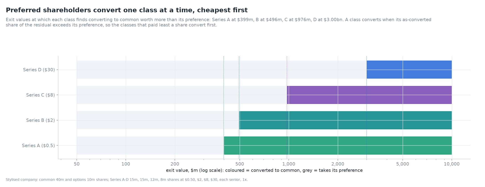

The order of conversion follows the preference per share:

| Class | Preference per share | Converts above, $m | Payoff slope after converting |
|---|---|---|---|
| Series A | $0.50 | 398.5 | as-converted share of the residual |
| Series B | $2.00 | 496.0 | as above |
| Series C | $8.00 | 976.0 | as above |
| Series D | $30.00 | 3,000.0 | 8% of every extra dollar |

*Table 3. Conversion points from the equilibrium, bracketed on the grid and refined by bisection
on the exact payoff. Series D's has a closed form: 8% of $3bn is its $240m preference. Between conversions, the classes in the residual
share each extra dollar; when a class converts, the slope of every other residual holder drops.*

Each conversion point is roughly the exit at which the class's as-converted share of the residual
equals its preference. The exact value depends on who else has converted. That is why the model
finds them, rather than using a formula.

### 3.4 Each class is a portfolio of options

Between breakpoints every payoff is linear in V. A payoff that is linear in pieces can be
written exactly as a sum of call options on V at the breakpoints. Series D, for example, is:

* long V up to $240m (it takes everything),
* short a call at $240m (it stops gaining once its preference is paid),
* long 8% of a call at the point where it converts.

That is a bull spread plus a fraction of a further call. Common is a sum of calls struck above
$240m, with the slope rising as more of the senior classes are paid off.

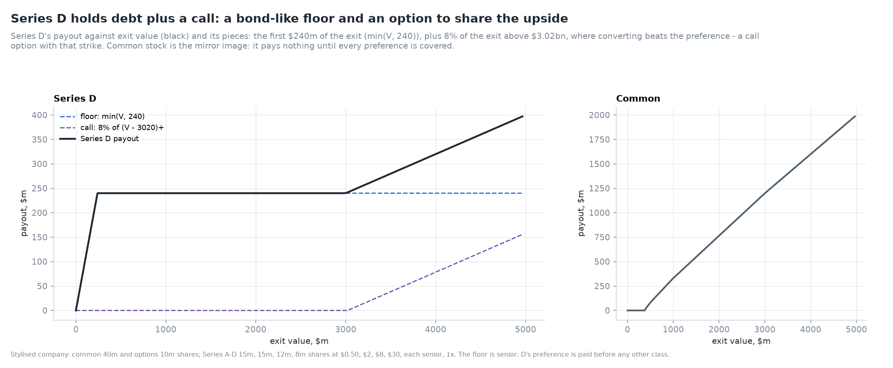

The breakpoint chart shows each class's share of the marginal dollar along the exit range. It is
the slope of each payoff, and it is the hedge ratio a dealer would use to replicate the class with
the company.

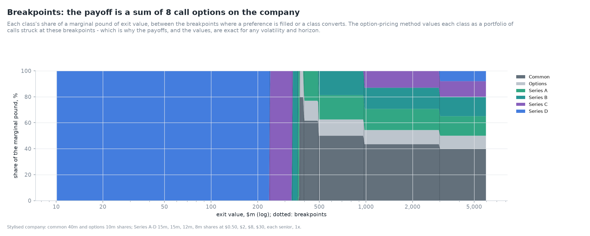

## 4. The option-pricing method

### 4.1 Valuing each class

Under risk-neutral pricing, each class is worth its expected payoff, discounted at the risk-free
rate, with the exit value V_T lognormal around a forward of V₀·e^{rT}:

  value_k = e^{-rT} · E^Q[payoff_k(V_T)].

V₀ is the value of the company today. Practitioners usually find the breakpoints by hand and sum
Black-Scholes calls. Here the payoff is evaluated on a dense geometric grid of 1,500 exit values.
The linear interpolation is then integrated **exactly** against the lognormal density (ADR 0013).
On each interval the payoff is α + βV, and

  E[(α + βV)·1{a < V < b}] = α·[N(d₂(a)) − N(d₂(b))] + β·F·[N(d₁(a)) − N(d₁(b))],

where F is the forward and d₁, d₂ are the Black-Scholes terms. The breakpoints are found
automatically, to grid precision. Because the interpolated payoffs add to V at every grid point,
the class values add to V₀ exactly.

Two checks hold the integral to account:

* **A closed form.** A company with 80m common shares and one class of 20m preferred shares at $5
  has a preferred payoff of V − max(V − 100, 0) + 0.2·max(V − 500, 0). Its value is V₀ − C(100) +
  0.2·C(500), with C a Black-Scholes call. The grid integral agrees to 3 × 10⁻⁷.
* **Monte Carlo.** Simulating the exit value and running the full equilibrium waterfall on each
  path gives an independent estimate. A plain average is too noisy for a lognormal with 90%
  volatility over 4 years. Using the discounted exit value, whose mean is known, as a control
  variate removes most of the noise.

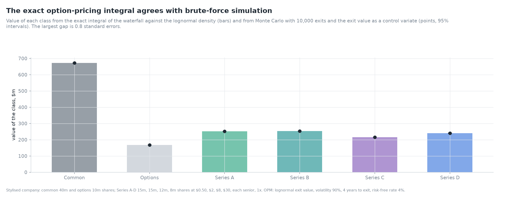

| Class | Exact OPM, $m | Monte Carlo, $m | Standard error | Gap, s.e. |
|---|---|---|---|---|
| Common | 671.92 | 671.71 | 0.19 | −1.10 |
| Options | 167.98 | 167.93 | 0.05 | −1.10 |
| Series A | 252.03 | 251.96 | 0.07 | −1.05 |
| Series B | 253.12 | 253.09 | 0.06 | −0.52 |
| Series C | 215.78 | 215.92 | 0.09 | +1.62 |
| Series D | 240.00 | 240.21 | 0.32 | +0.65 |

*Table 4. The exact integral against 40,000 simulated exits with a control variate, at the
backsolved company value. All gaps are within 1.6 standard errors. The control variate shrinks the
standard error of Series D to 0.13% of its value.*

### 4.2 Backsolving the round

The round tells us one price: Series D paid $30. The **backsolve** (ADR 0014) finds the company
value V₀ at which Series D's OPM value equals what it paid, $240m. Brent's method finds the root;
the class's value rises monotonically with V₀, so there is exactly one. With V₀ fixed, every other
class follows.

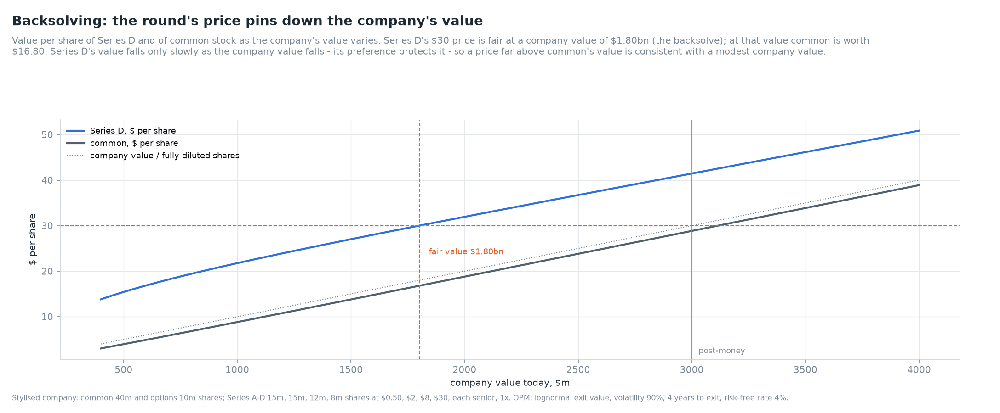

The chart shows each class's value per share as V₀ varies. Series D's line crosses $30 at
$1.80bn. At that value common is worth $16.80.

## 5. The base company

### 5.1 Fair value against post-money

| Class | Shares, m | Issue price | Invested, $m | Fair value, $m | Per share | Per share / $30 | Share of company |
|---|---|---|---|---|---|---|---|
| Common | 40 | - | - | 671.9 | $16.80 | 56% | 37.3% |
| Options | 10 | - | - | 168.0 | $16.80 | 56% | 9.3% |
| Series A | 15 | $0.50 | 8 | 252.0 | $16.80 | 56% | 14.0% |
| Series B | 15 | $2.00 | 30 | 253.1 | $16.87 | 56% | 14.1% |
| Series C | 12 | $8.00 | 96 | 215.8 | $17.98 | 60% | 12.0% |
| Series D | 8 | $30.00 | 240 | 240.0 | $30.00 | 100% | 13.3% |
| **Company** | **100** | | **374** | **1,800.8** | | | **100%** |

*Table 5. Fair values at the backsolved company value of $1.80bn. Post-money: $3.0bn. Overstatement:
66.6%.*

The table makes three points:

* **The overstatement is in the senior class.** Series D holds 8% of the shares but 13.3% of the
  value. Its protection is worth the difference.
* **Early preferred is worth almost exactly common.** Series A's preference of $0.50 a share is
  tiny next to the company's value. It converts in nearly every scenario that matters, so it is
  priced like common. Series B is close too. Only Series C's $8 preference adds noticeably (7%
  over common).
* **Common is worth 56% of the headline price.** An employee told their options are "worth $30 a
  share less the strike" is overstating them by 79%.

The fair value of common is sometimes thought of as the post-money "discounted for lack of
preference". The discount here is 44%, and it is not a fixed haircut. It depends on volatility and
time to exit, as the next sections show.

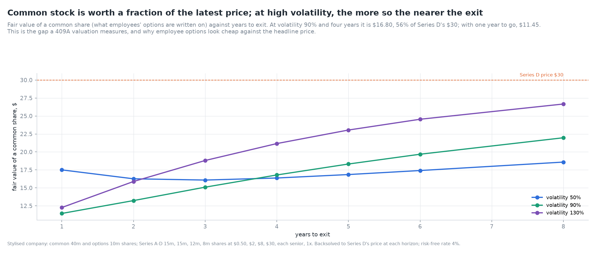

The chart of common against time to exit shows the discount narrowing with a longer horizon: more
of the value moves to the shared upside, where all classes are alike.

### 5.2 Terms

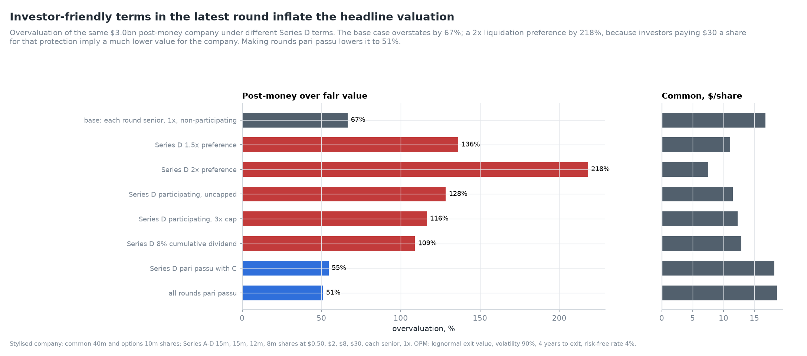

Change one term of Series D at a time, keep its $30 price, and backsolve again:

| Series D terms | Fair value, $m | Overstatement | Common per share |
|---|---|---|---|
| Base: senior, 1x, non-participating | 1,801 | 66.6% | $16.80 |
| 1.5x preference | 1,270 | 136.3% | $11.07 |
| 2x preference | 943 | 218.1% | $7.55 |
| Participating, uncapped | 1,313 | 128.4% | $11.50 |
| Participating, 3x cap | 1,386 | 116.5% | $12.28 |
| 8% cumulative dividend | 1,436 | 108.9% | $12.86 |
| Pari passu with Series C | 1,941 | 54.5% | $18.21 |
| All rounds pari passu | 1,988 | 50.9% | $18.67 |

*Table 6. The effect of each Series D term on fair value. Same price ($30), same post-money ($3.0bn).*

A headline that says only "$3bn" hides a fair value anywhere between $0.94bn and $1.99bn,
depending on terms that are not in the press release. A 2x preference cuts the fair value of the
company to under a third of the post-money. Investors who accept a higher headline price in
exchange for a richer preference are not paying more for the company. They may be paying less.

The ranking makes sense once each term is read as an option:

* **A higher multiple** raises the strike of the bull spread. Series D's protected region now runs
  to $360m (1.5x) or $480m (2x).
* **Participation** gives Series D its preference *and* its 8% share. It never gives up the
  preference, so its payoff exceeds the non-participating one at every exit above $240m.
* **A cap** at 3x removes the top of that extra payoff: once Series D has received $720m it stops
  sharing until converting pays more. It lowers the overstatement from 128% to 116%, so most of the
  value of participation lies in moderate exits, below the cap.
* **A cumulative dividend** adds 32% to the preference over four years.
* **Pari passu** makes Series D share its rank with others, so in a weak exit it collects
  only part of its preference. That makes it less of a senior claim and narrows the gap.

### 5.3 Volatility, time and rates

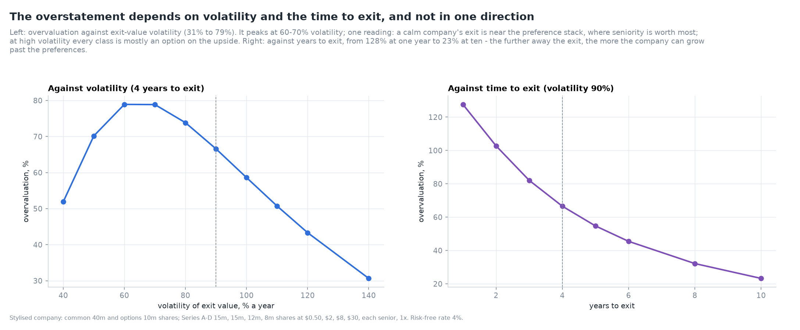

| Volatility | Fair value, $m | Overstatement | Common per share |
|---|---|---|---|
| 30% | 2,283 | 31.4% | $22.18 |
| 40% | 1,975 | 51.9% | $18.75 |
| 50% | 1,763 | 70.2% | $16.38 |
| 60% | 1,677 | 78.9% | $15.41 |
| 70% | 1,677 | 78.9% | $15.42 |
| 90% (base) | 1,801 | 66.6% | $16.80 |
| 110% | 1,990 | 50.7% | $18.90 |
| 140% | 2,296 | 30.7% | $22.27 |

*Table 7. Volatility. Four years to exit, risk-free rate 4%.*

The overstatement first rises with volatility and then falls. With low volatility, exits cluster
near the forward value, and few fall in the weak region where Series D's preference takes money
from the junior classes. Series D then has to be priced mostly on its share of a solid company, and
the classes are valued close to one another. With very high volatility, most exits are weak, but
the value sits in a few huge exits where every class holds common. The preference pays off in many
small exits that, together, are worth little next to that upside. The
hump peaks near 60-70%. This is one reading from one cap table; the shape is general, but the peak
depends on the structure.

| Years to exit | Fair value, $m | Overstatement | Common per share |
|---|---|---|---|
| 1 | 1,318 | 127.6% | $11.45 |
| 2 | 1,479 | 102.8% | $13.24 |
| 3 | 1,648 | 82.1% | $15.10 |
| 4 (base) | 1,801 | 66.6% | $16.80 |
| 6 | 2,062 | 45.5% | $19.68 |
| 8 | 2,270 | 32.2% | $21.97 |
| 10 | 2,434 | 23.3% | $23.78 |

*Table 8. Time to exit. Volatility 90%, risk-free rate 4%. A risk-free rate of 0%, 2% or 6% gives
88.4%, 76.7% or 57.9% at four years.*

A longer horizon lowers the overstatement fast. More years means a higher forward value (the
company grows at the risk-free rate under the pricing measure) and a wider distribution, so more
of the value sits in exits above all the conversion points. A company expected to sell next year
is the one where the headline is most misleading.

Neither volatility nor time to exit is observed for a private company. A valuer who picks 60%
and two years reports a very different fair value from one who picks 100% and six years. Any
single overstatement number should be read with its inputs.

## 6. The round price and the down round

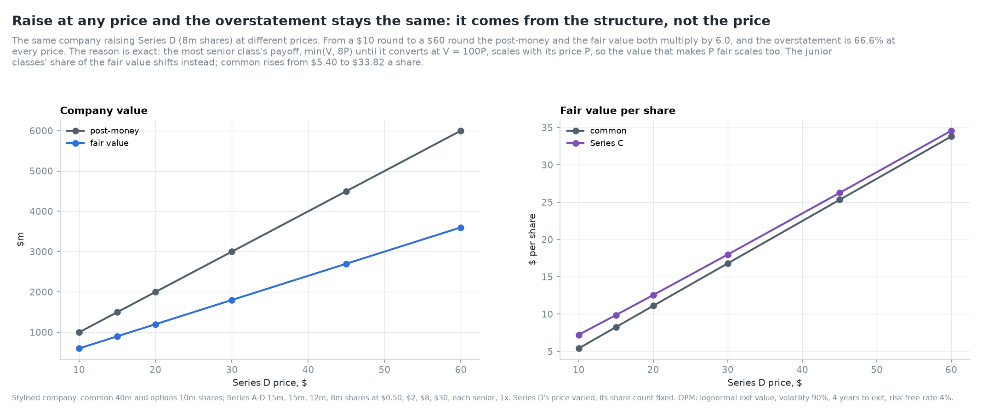

What if Series D had raised at a different price with the same number of shares? Between a $10 and
a $60 round, post-money and fair value both multiply by six. The overstatement is 66.6% at every
price, to the fifth digit.

This is not a coincidence. Series D is the most senior class. Its payoff is min(V, 8P) until it
converts at V = 100P, where every other class has already converted. After that it is 8% of V.
Written as a function of V/P, that payoff is P times a fixed function. So its value is P times a
function of V₀/P, and the V₀ that makes it worth 8P scales with P. Post-money is 100P, so the ratio
of the two is fixed. The test suite checks this (prices of $15 and $45).

What changes is how the junior classes share the fair value. A high Series D price means the
earlier classes are far below it and convert early; a low price puts Series C's $8 preference
close to Series D's. Common rises from $5.40 at a $10 round to $33.82 at a $60 round.

The point for a reader of headlines: the overstatement measures the structure of the cap table,
not whether the price is high. A "flat" round with richer terms can overstate more than a big up
round with plain terms.

## 7. The value of protection

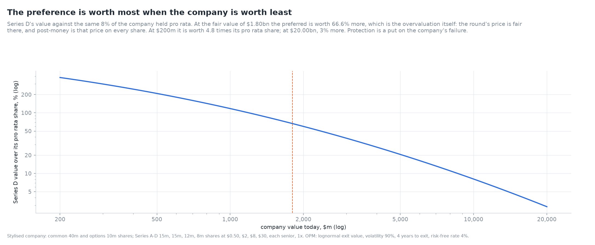

Compare Series D's value with the same 8% of the company held pro rata, as plain equity:

| Company value today, $m | Series D, $ per share | Pro rata, $ per share | Premium |
|---|---|---|---|
| 200 | 9.65 | 2.00 | 383% |
| 500 | 15.44 | 5.00 | 209% |
| 1,000 | 21.76 | 10.00 | 118% |
| 1,801 (fair) | 30.00 | 18.01 | 66.6% |
| 3,000 | 41.45 | 30.00 | 38% |
| 5,000 | 60.30 | 50.00 | 21% |
| 10,000 | 108.09 | 100.00 | 8% |
| 20,000 | 205.66 | 200.00 | 3% |

*Table 9. Series D's value against its pro rata share of the company. At fair value the premium is
exactly the overstatement: post-money is the price on every share, and the price is fair for
Series D.*

The preference is a put option on the company's failure. It is worth most when the company is worth
least: at $200m, Series D is worth almost five times its pro rata share. For a company that is
doing well, the protection is nearly worthless. This is why investors in later rounds, who buy at
high prices and so face larger falls, demand senior preferences, and why the terms of a round
matter most for companies whose high valuation is at risk.

## 8. Different bets: Series D and common

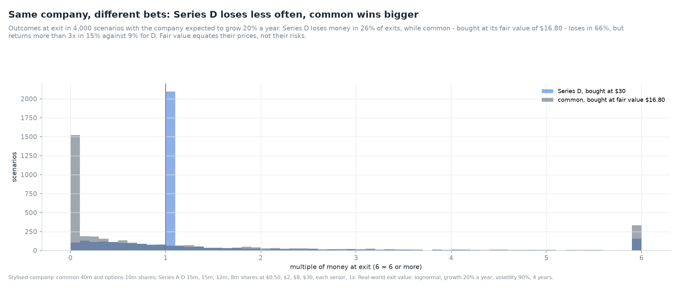

Valuation uses the risk-neutral distribution. To see what each holder actually experiences,
simulate exits with a real-world expected growth of 20% a year, from the fair value, and compute
each class's multiple on what it paid. For Series D that is $30; for common, its fair value of
$16.80.

| Percentile of exits | Series D multiple | Common multiple |
|---|---|---|
| 10th | 0.34x | 0.00x |
| 25th | 0.96x | 0.00x |
| 50th | 1.00x | 0.31x |
| 75th | 1.00x | 1.58x |
| 90th | 2.71x | 4.85x |
| Loses money | 26% | 67% |
| Wiped out | - | 35% |
| Returns more than 3x | 9% | 16% |

*Table 10. Exit multiples, 5,000 simulated exits, growth 20%, volatility 90%, four years.*

Series D is a capped bond with an equity kicker: in 51% of exits it gets exactly its money back.
Common is a lottery ticket: in a third of exits it gets nothing, and it loses money two times in
three. But it wins bigger, more often. The two classes are priced fairly relative to each other
under the pricing model, but they are different bets. A single "valuation" cannot describe both.

## 9. Two hundred random companies

### 9.1 How the sample is built

To see how much the overstatement varies across cap tables, `random_company` draws stylised
companies:

* 3 to 6 rounds; prices rising by 1.6 to 3.5 times each round;
* 8m to 20m shares per round; common 30m to 60m and an option pool of 5m to 15m;
* each round senior to the last in 70% of companies, all pari passu otherwise;
* participation 15% of rounds (half of those capped at 3x); a multiple above 1x in a third of
  rounds; an 8% cumulative dividend in 8%.

These frequencies are chosen to be of the order reported in the literature (Kaplan and Strömberg
2003; Gornall and Strebulaev 2020). They are illustrative, not estimates: the sample shows the
mechanism, not the distribution for any real population of companies.

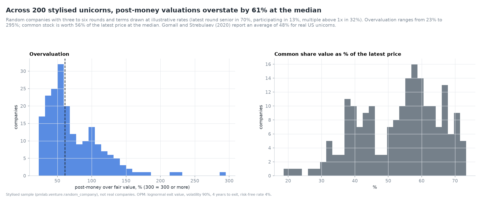

| Statistic | Overstatement | Common's discount to the latest price |
|---|---|---|
| Minimum | 23% | 27% |
| 5th percentile | 29% | |
| 25th percentile | 45% | 38% |
| Median | 61% | 44% |
| Mean | 73% | 47% |
| 75th percentile | 97% | 57% |
| 95th percentile | 144% | |
| Maximum | 295% | 81% |

*Table 11. 200 random companies, volatility 90%, four years to exit.*

Every company is overstated, and the median is 61%. That is the same order as Gornall and
Strebulaev's 48% average for real unicorns. But the sample is stylised and the comparison is only
one of order.

### 9.2 What drives it

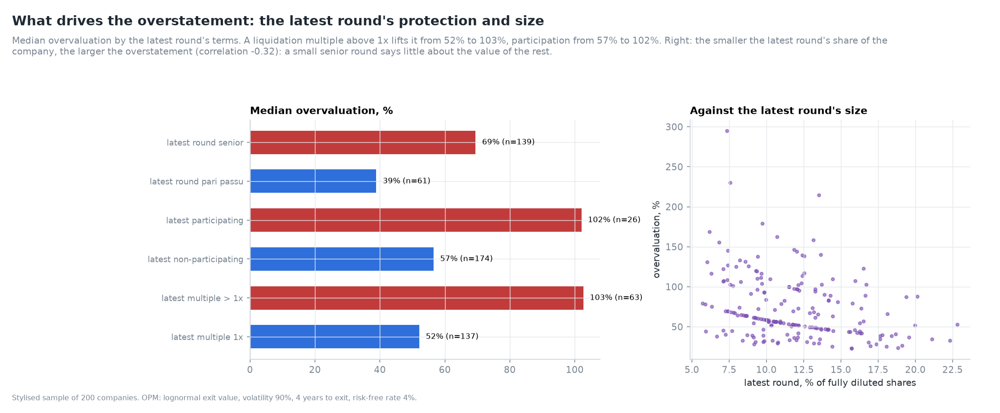

| Latest round | Companies | Median overstatement |
|---|---|---|
| Multiple 1x | 137 | 52% |
| Multiple above 1x | 63 | 103% |
| Non-participating | 174 | 57% |
| Participating | 26 | 102% |
| Pari passu with earlier rounds | 61 | 39% |
| Senior to earlier rounds | 139 | 69% |
| 3 rounds | 47 | 52% |
| 6 rounds | 54 | 70% |

*Table 12. The overstatement by the latest round's terms.*

The latest round's terms dominate. A multiple above 1x and participation each roughly double the
median. Seniority raises it by three quarters. The number of rounds matters less: more rounds mean
more classes with preferences, but early classes convert early and add little.

Correlations across the 200 companies point the same way. The overstatement correlates 0.67 with
the latest round's multiple, 0.40 with seniority and 0.29 with participation. It correlates
**−0.32** with the latest round's share of the company: a small round, sold at a high price on a
small slice of shares, overstates most, because the price of a sliver is extrapolated to the whole.
Common's discount and the overstatement move almost together (correlation 0.95). They are two views
of one quantity.

## 10. Validation

| Check | Reference | Result |
|---|---|---|
| Waterfall pays out the exit value | identity, random cap tables | error 4 × 10⁻¹⁶ |
| Conversion is an equilibrium | no class gains by switching | best gain 0 |
| One preferred class | Black-Scholes closed form | 3 × 10⁻⁷ |
| No preferences | every share worth V₀ / shares | 5 × 10⁻¹⁵ |
| Backsolve | latest class worth its price; values add to the company | 2 × 10⁻¹⁴ |
| OPM against Monte Carlo | simulation with control variate | max 0.67 s.e. |

*Table 13. The six new checks, from `pmlab validate`. The full suite has 31 checks, all passing;
see [VALIDATION.md](../VALIDATION.md).*

The tests add 17 cases. Among them: the Black-Scholes closed form, participation with and without a
cap, pari passu sharing, cumulative dividends, monotone payoffs, the ranking of terms, and the
invariance to the round price.

## 11. Limitations

* **One exit, at a fixed date, lognormal.** Real companies exit early or late, by sale, IPO or
  failure. A time-to-exit distribution would mix the results of Table 8. The probability-weighted
  expected return method (AICPA 2019) models scenarios directly.
* **IPOs void preferences.** In most IPOs, preferred converts automatically. Gornall and Strebulaev
  (2020) model this, with IPO ratchets and protective provisions. Here, an IPO is just a large exit
  where everyone converts anyway, so the effect is partly captured, not exactly.
* **No new money.** Future rounds dilute every class and often add a more senior class on top. The
  model holds the cap table fixed until exit.
* **Options as common.** Strike prices are ignored. With strikes, the option pool is a call on
  common and worth less.
* **Risk-neutral pricing of an untradeable asset.** The OPM assumes the company could be replicated.
  It cannot. The method is a convention, accepted by auditors and standard setters, and it should be
  read as one.
* **Inputs.** Volatility and time to exit drive the result (Tables 7 and 8), and neither is observed.
* **Stylised sample.** The random companies show the mechanism. They are not a dataset of real
  term sheets.

## 12. What comes next

Day 5 turns to the other side of private-markets valuation: reported NAVs. Fund NAVs are appraisals,
updated with a lag. Day 5 estimates the true value behind them with a state-space model and the
Kalman filter, and measures how much smoothing hides.

## References

* AICPA (2013). *Valuation of Privately-Held-Company Equity Securities Issued as Compensation*.
  Accounting and Valuation Guide. American Institute of Certified Public Accountants.
* AICPA (2019). *Valuation of Portfolio Company Investments of Venture Capital and Private Equity
  Funds and Other Investment Companies*. Accounting and Valuation Guide.
* Bengtsson, O. and Sensoy, B. A. (2015). Changing the nexus: The evolution and renegotiation of
  venture capital contracts. *Journal of Financial and Quantitative Analysis*, 50(3), 349-375.
* Black, F. and Scholes, M. (1973). The pricing of options and corporate liabilities. *Journal of
  Political Economy*, 81(3), 637-654.
* Brent, R. P. (1973). *Algorithms for Minimization without Derivatives*. Prentice-Hall.
* Cochrane, J. H. (2005). The risk and return of venture capital. *Journal of Financial Economics*,
  75(1), 3-52.
* Glasserman, P. (2003). *Monte Carlo Methods in Financial Engineering*. Springer.
* Gompers, P. and Lerner, J. (2004). *The Venture Capital Cycle*, 2nd ed. MIT Press.
* Gornall, W. and Strebulaev, I. A. (2020). Squaring venture capital valuations with reality.
  *Journal of Financial Economics*, 135(1), 120-143.
* Hall, R. E. and Woodward, S. E. (2010). The burden of the nondiversifiable risk of
  entrepreneurship. *American Economic Review*, 100(3), 1163-1194.
* Ingersoll, J. E. (1977). A contingent-claims valuation of convertible securities. *Journal of
  Financial Economics*, 4(3), 289-321.
* Kaplan, S. N. and Strömberg, P. (2003). Financial contracting theory meets the real world: An
  empirical analysis of venture capital contracts. *Review of Economic Studies*, 70(2), 281-315.
* Korteweg, A. and Sorensen, M. (2010). Risk and return characteristics of venture capital-backed
  entrepreneurial companies. *Review of Financial Studies*, 23(10), 3738-3772.
* Merton, R. C. (1973). Theory of rational option pricing. *Bell Journal of Economics and
  Management Science*, 4(1), 141-183.
* Metrick, A. and Yasuda, A. (2010). *Venture Capital and the Finance of Innovation*, 2nd ed. Wiley.
* Sahlman, W. A. (1990). The structure and governance of venture-capital organizations. *Journal of
  Financial Economics*, 27(2), 473-521.
